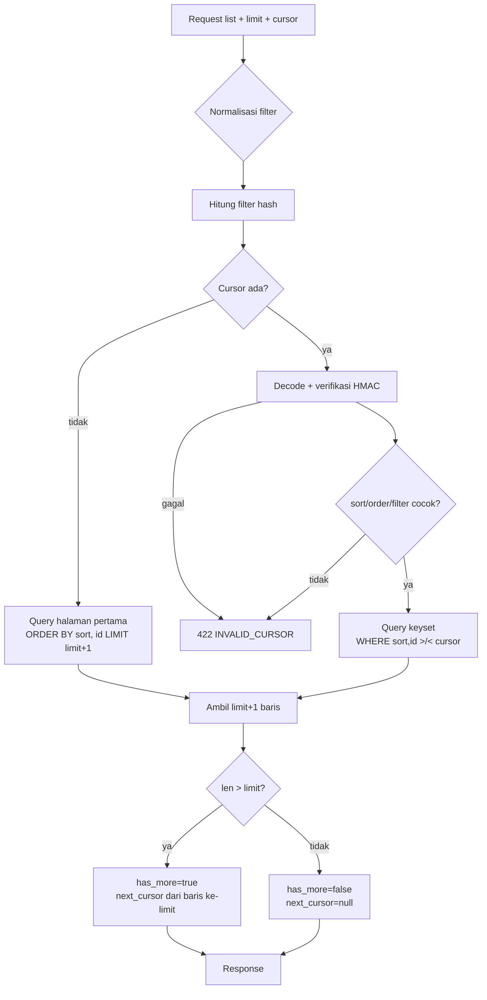

# API — Cursor-Based Pagination

## 1. Tujuan

Menyediakan pagination yang:

- Stabil untuk infinite scroll.
- Tidak melambat saat halaman semakin dalam (tidak seperti `OFFSET`).
- Deterministik (tidak ada baris hilang/duplikat karena tie).
- Tidak dapat dimanipulasi client.
- Konsisten dengan filter dan sorting.

## 2. Keputusan Utama

| Aspek | Keputusan |
|---|---|
| Mekanisme | Keyset pagination (seek method) |
| Default limit | 20 |
| Maximum limit | 100 |
| Cursor | Opaque: `base64url(payload) + "." + base64url(HMAC-SHA256)` |
| Signing | `CURSOR_SECRET` (min 32 byte), HMAC-SHA256 |
| Tie-breaker | `id` (UUID) selalu ditambahkan |
| Arah | Ditentukan `order` (`asc`/`desc`) dan disimpan di cursor |
| Filter binding | Hash filter disimpan di cursor; mismatch → 422 |
| Offset | Tidak dipakai sebagai mekanisme utama |

Alasan menandatangani cursor: mencegah client mengubah nilai `k`/`id` untuk mengakses data
di luar filter, dan mencegah cursor asal-asalan. Ini bukan pengganti otorisasi, tetapi
lapisan pertahanan tambahan.

## 3. Format Cursor

### 3.1 Payload

```json
{
  "v": 1,
  "s": "created_at",
  "o": "desc",
  "f": "9f2c1a7b",
  "k": "2026-11-12T10:00:00Z",
  "id": "01a1b2c3-d4e5-7f60-8123-456789abcdef",
  "r": null
}
```

| Field | Tipe | Wajib | Keterangan |
|---|---|---|---|
| `v` | int | Ya | Versi format cursor (saat ini `1`) |
| `s` | string | Ya | Kolom sort |
| `o` | string | Ya | `asc`/`desc` |
| `f` | string | Ya | Hash filter (8 hex pertama SHA-256) |
| `k` | any | Ya | Nilai kolom sort pada baris terakhir |
| `id` | string | Ya | UUID tie-breaker |
| `r` | int/null | Tidak | Rank untuk sort priority |

`k` bertipe sesuai kolom:

| Sort | Tipe `k` |
|---|---|
| `created_at`, `updated_at` | string RFC3339 UTC |
| `due_at` | string RFC3339 UTC atau `null` |
| `priority` | int rank (1–4) |
| `title` | string `lower(title)` |
| `joined_at`, `scheduled_at` | string RFC3339 UTC |

### 3.2 Encoding

```text
payloadJSON = json.Marshal(payload)
payloadB64  = base64url_nopad(payloadJSON)
signature   = HMAC-SHA256(payloadB64, CURSOR_SECRET)
cursor      = payloadB64 + "." + base64url_nopad(signature)
```

- Base64 URL-safe tanpa padding (`RawURLEncoding`).
- Panjang maksimum cursor yang diterima: **2048 karakter**. Lebih dari itu → 422.
- Cursor tidak dienkripsi; payload dapat dibaca client. Karena itu **jangan** menaruh data
  sensitif di cursor. Nilai sort dan ID bukan rahasia (client sudah menerimanya), dan
  signature mencegah perubahan.

Contoh (ilustratif):

```text
eyJ2IjoxLCJzIjoiY3JlYXRlZF9hdCIsIm8iOiJkZXNjIiwiZiI6IjlmMmMxYTdiIiwiayI6IjIwMjYtMTEtMTJUMTA6MDA6MDBaIiwiaWQiOiIwMWExLi4uIn0.3f9c...
```

### 3.3 Mengapa Tidak Mengenkripsi

Enkripsi menambah kompleksitas dan rotasi key. Payload tidak berisi data sensitif. Tanda
tangan sudah cukup untuk integritas. Jika suatu saat payload memuat data sensitif, gunakan
AEAD (AES-GCM) dan dokumentasikan.

## 4. Validasi Cursor

Urutan validasi:

1. `cursor` kosong → tidak ada pagination, mulai dari awal.
2. Panjang > 2048 → 422 `INVALID_CURSOR`.
3. Tidak ada tepat satu titik pemisah → 422.
4. Decode base64 gagal → 422.
5. Signature tidak cocok (constant-time compare) → 422.
6. JSON tidak valid → 422.
7. `v != 1` → 422.
8. `s`/`o` tidak sama dengan request saat ini → 422.
9. `f` tidak sama dengan hash filter saat ini → 422.
10. `id` bukan UUID valid → 422.
11. `k` tidak sesuai tipe sort → 422.

Semua kegagalan mengembalikan code yang sama (`INVALID_CURSOR`) tanpa menjelaskan detail
kriptografis. Detail dicatat di log level DEBUG (tanpa token).

## 5. Perhitungan Hash Filter

`f` = 8 hex pertama dari:

```text
SHA-256(
  workspace_id || "|" ||
  view || "|" ||
  canonical(status) || "|" ||
  canonical(priority) || "|" ||
  assignee || "|" ||
  canonical(tag_ids) || "|" ||
  canonical(label_ids) || "|" ||
  due_from || "|" ||
  due_to || "|" ||
  q || "|" ||
  include_completed
)
```

Aturan kanonikalisasi:

- `status`/`priority`: urutkan nilai sesuai enum, gabung koma.
- `tag_ids`/`label_ids`: urutkan UUID secara leksikografis, gabung koma.
- `workspace_id` selalu disertakan.
- `view` (`list`/`today`/`upcoming`/`overdue`) disertakan.
- `sort`/`order` tidak perlu (sudah ada di field `s`/`o`).
- String `q` di-trim, lowercase? **Tidak**; case memengaruhi `ILIKE`? `ILIKE` tidak
  case-sensitive, tetapi hash harus konsisten dengan input. Simpan apa adanya setelah trim.

Jika client mengubah filter di tengah scroll tetapi memakai cursor lama, server menolak
dengan 422. Ini mencegah hasil yang membingungkan. Client harus mereset cursor saat filter
berubah.

## 6. Sorting dan Tie-Breaker

### 6.1 Daftar Sort

| Sort | Kolom | Tie-breaker | Default order | Null handling |
|---|---|---|---|---|
| `created_at` | `created_at` | `id` | `desc` | tidak null |
| `updated_at` | `updated_at` | `id` | `desc` | tidak null |
| `due_at` | `due_at` | `id` | `asc` | `NULLS LAST` |
| `priority` | rank ekspresi | `id` | `desc` | tidak null |
| `title` | `lower(title)` | `id` | `asc` | tidak null |

Aturan:

- Tie-breaker **wajib** `id` untuk determinisme.
- `id` adalah UUIDv7, unik, dan time-ordered.
- Tidak ada sort berdasarkan kolom yang dapat berubah tanpa konsekuensi (lihat §10).
- Sort `priority` memakai rank:

```sql
CASE priority
  WHEN 'URGENT' THEN 4
  WHEN 'HIGH'   THEN 3
  WHEN 'MEDIUM' THEN 2
  WHEN 'LOW'    THEN 1
END
```

### 6.2 Predikat Keyset

#### DESC (created_at, updated_at)

```sql
WHERE workspace_id = $1
  AND deleted_at IS NULL
  AND (created_at, id) < ($2, $3)   -- row comparison
ORDER BY created_at DESC, id DESC
LIMIT $4;
```

`(a, b) < (x, y)` adalah row comparison PostgreSQL yang setara dengan
`a < x OR (a = x AND b < y)`.

#### ASC (due_at)

```sql
WHERE workspace_id = $1
  AND deleted_at IS NULL
  AND status <> 'DONE'
  AND (due_at, id) > ($2, $3)
ORDER BY due_at ASC, id ASC
LIMIT $4;
```

#### due_at dengan NULL (NULLS LAST)

Untuk `ASC NULLS LAST`:

```sql
WHERE (
        ($2::timestamptz IS NOT NULL AND due_at IS NOT NULL AND (due_at, id) > ($2, $3))
     OR ($2::timestamptz IS NOT NULL AND due_at IS NULL)
     OR ($2::timestamptz IS NULL AND due_at IS NULL AND id > $3)
      )
ORDER BY due_at ASC NULLS LAST, id ASC
```

- Jika cursor `k` bukan null: ambil due_at lebih besar, atau due_at null (karena null
  berada setelah semua nilai).
- Jika cursor `k` null: kita sudah di grup null, lanjutkan dengan `id > cursor.id`.

Untuk `DESC NULLS LAST`, arahkan perbandingan dan letakkan null setelah nilai:

```sql
WHERE (
        ($2::timestamptz IS NOT NULL AND due_at IS NOT NULL AND (due_at, id) < ($2, $3))
     OR ($2::timestamptz IS NOT NULL AND due_at IS NULL)
     OR ($2::timestamptz IS NULL AND due_at IS NULL AND id < $3)
      )
ORDER BY due_at DESC NULLS LAST, id DESC
```

Catatan: index `(workspace_id, due_at ASC, id ASC)` mendukung ASC NULLS LAST (default).
Untuk DESC NULLS LAST, PostgreSQL dapat memindai index mundur, tetapi urutan NULL menjadi
NULLS FIRST. Diperlukan index terpisah `(workspace_id, due_at DESC NULLS LAST, id DESC)`
jika sort DESC sering dipakai. **Keputusan Phase 0:** view memakai ASC; sort DESC pada
`due_at` didukung tetapi tidak dioptimalkan index sampai ada kebutuhan.

#### Priority

```sql
WITH ranked AS (
  SELECT *,
         CASE priority WHEN 'URGENT' THEN 4 WHEN 'HIGH' THEN 3
                       WHEN 'MEDIUM' THEN 2 ELSE 1 END AS pr
  FROM tasks
  WHERE workspace_id = $1 AND deleted_at IS NULL
)
SELECT * FROM ranked
WHERE (pr, id) < ($2, $3)
ORDER BY pr DESC, id DESC
LIMIT $4;
```

Tidak ada index untuk rank; query akan sort. Karena itu sort priority sebaiknya dipakai
pada dataset yang sudah difilter (status/assignee/tag). Dokumentasikan trade-off.

#### Title

```sql
WHERE (lower(title), id) > ($2, $3)
ORDER BY lower(title) ASC, id ASC
```

Kolasi database memengaruhi urutan. Cursor menyimpan `lower(title)` persis seperti yang
dihasilkan database, sehingga request berikutnya konsisten selama kolasi tidak berubah.
Tidak ada index; tambahkan `ix_tasks_workspace_title (workspace_id, lower(title), id)`
jika dibutuhkan.

## 7. Limit

- Default 20 jika tidak dikirim.
- `limit < 1` → 422 `VALIDATION_ERROR`.
- `limit > 100` → di-clamp ke 100 (bukan error) dan response `limit: 100`.
  Alasan: client tidak perlu menangani error hanya karena ingin mengambil banyak; clamp
  menjaga server.
- `limit` tidak disimpan di cursor; client bebas mengubah limit antar halaman. Perubahan
  limit tidak membatalkan cursor karena cursor berbasis posisi, bukan offset.

## 8. Query Flow



Mengapa `LIMIT limit+1`: untuk mengetahui `has_more` tanpa `COUNT(*)`. Baris ekstra tidak
dikirim; cursor dibuat dari baris ke-`limit`.

## 9. Pembentukan `next_cursor`

```text
rows = query(limit+1)
if len(rows) > limit:
    page = rows[:limit]
    last = page[len(page)-1]
    next_cursor = sign({v:1, s:sort, o:order, f:filterHash, k:key(last), id:last.id, r:rank(last)})
    has_more = true
else:
    page = rows
    next_cursor = null
    has_more = false
```

- Cursor dibuat dari baris terakhir yang **dikirim**, bukan baris ekstra.
- Jika `len(rows) == limit+1` tetapi baris ke-`limit+1` ternyata duplikat (tidak mungkin
  dengan keyset), tetap dianggap ada halaman berikutnya; request berikutnya akan
  mengembalikan kosong. Ini aman.

## 10. Perilaku Data Baru dan Berubah

### 10.1 Data Baru

Keyset bersifat **snapshot-less**: tidak ada snapshot transaksi antar request.

| Sort | Data baru | Efek |
|---|---|---|
| `created_at DESC` (default) | `created_at` lebih besar → muncul di atas halaman pertama | Tidak muncul di halaman berikutnya; tidak ada duplikat; user melihat saat refresh |
| `created_at ASC` | Muncul di akhir setelah cursor | Akan muncul di halaman berikutnya (bisa membingungkan) |
| `due_at ASC` | Task baru dengan due lebih besar muncul nanti | Konsisten |
| `updated_at DESC` | Task yang baru diubah naik ke atas | Bisa terlewat di halaman berikutnya |

Keputusan: default `created_at DESC` dipilih karena paling stabil untuk infinite scroll.
Untuk sort `updated_at`, dokumentasikan bahwa perubahan data dapat menyebabkan pergeseran.

### 10.2 Data Berubah

Jika kolom sort berubah (mis. `due_at` digeser), baris dapat:

- Pindah ke halaman yang sudah dilewati → terlewat.
- Pindah ke halaman yang belum dibaca → muncul dua kali.

Ini keterbatasan keyset yang diterima. Mitigasi:

1. Gunakan sort immutable (`created_at`) sebagai default.
2. Client melakukan deduplikasi berdasarkan `id` saat menggabungkan halaman (wajib di
   frontend).
3. Untuk kebutuhan konsistensi kuat, gunakan snapshot `as_of` (tidak di Phase 0).

### 10.3 Data Dihapus

Soft delete menghilangkan baris dari hasil. Tidak ada duplikat; bisa ada "gap" visual.
Client tidak perlu tindakan khusus.

### 10.4 Insert dengan `id` Lebih Kecil (UUIDv7)

Jika ada impor data dengan UUID tidak time-ordered, tie-breaker `id` tetap deterministik,
tetapi urutan tidak lagi sepenuhnya kronologis. Tidak menjadi masalah untuk pagination.

## 11. Integrasi dengan Filter

- Semua filter diterapkan **sebelum** keyset predicate.
- Filter tidak boleh diubah antar halaman (dijaga `f`).
- Filter tag/label memakai `EXISTS`/join; keyset tetap pada tabel `tasks`.
- Untuk filter `tag_ids` (AND), gunakan:

```sql
AND (
  SELECT count(DISTINCT tt.tag_id)
  FROM task_tags tt
  WHERE tt.task_id = tasks.id AND tt.tag_id = ANY($tags)
) = $tagCount
```

atau `GROUP BY tasks.id HAVING count(...) = n`. Pilihan implementasi di Phase 5; yang
penting: keyset predicate tetap pada kolom `tasks` dan index filter dipakai.

- `q` memakai `ILIKE`; filter ini tidak index-backed sampai trigram ditambahkan.

## 12. Index yang Dibutuhkan

| Endpoint | Sort | Index |
|---|---|---|
| Tasks list | created_at DESC | `ix_tasks_workspace_created` |
| Tasks list | updated_at DESC | `ix_tasks_workspace_updated` |
| Tasks list | due_at ASC | `ix_tasks_workspace_due` (partial) |
| Tasks list | priority DESC | Tidak ada (sort) |
| Tasks list | title ASC | Tidak ada (sort) |
| Today/Upcoming/Overdue | due_at ASC | `ix_tasks_workspace_due` |
| Notifications | created_at DESC | `ix_notifications_user_created` |
| Members | joined_at ASC | `ux_members_workspace_user` tidak mencakup joined_at → tambah `(workspace_id, joined_at, id)` jika perlu |
| Invitations | created_at DESC | `ix_invitations_workspace_created` |
| Reminders | scheduled_at ASC | `ix_reminders_task` |
| Tags | lower(name) ASC | `ux_tags_workspace_name` |
| Labels | lower(name) ASC | `ux_labels_workspace_name` |

Catatan member: untuk Phase 3, jumlah member per workspace kecil; sort in-memory dapat
diterima. Jika cursor tetap dipakai, tambahkan index `(workspace_id, joined_at, id)`.

## 13. Cursor per Resource

| Resource | Sort default | Kunci | Catatan |
|---|---|---|---|
| Tasks | `created_at desc` | `created_at`, `id` | Filter + view |
| Notifications | `created_at desc` | `created_at`, `id` | `unread` filter |
| Members | `joined_at asc` | `joined_at`, `id` | |
| Invitations | `created_at desc` | `created_at`, `id` | |
| Reminders | `scheduled_at asc` | `scheduled_at`, `id` | |
| Tags | `name asc` | `lower(name)`, `id` | |
| Labels | `name asc` | `lower(name)`, `id` | |
| Workspaces | `created_at desc` | `created_at`, `id` | |

## 14. Edge Cases

| Kasus | Perilaku |
|---|---|
| Cursor kosong | Halaman pertama |
| Cursor `"null"` / rusak | 422 `INVALID_CURSOR` |
| Cursor dari workspace lain | Signature valid tetapi filter hash beda → 422 |
| Cursor dari user lain | Sama → 422 (filter hash mencakup workspace; notifikasi mencakup user) |
| Filter diubah | 422; client reset cursor |
| Sort diubah | 422 |
| Limit diubah | Boleh |
| `limit=0` | 422 |
| `limit=101` | Clamp 100 |
| Halaman terakhir | `next_cursor=null`, `has_more=false` |
| Data kosong | `data=[]`, `has_more=false` |
| Semua data terhapus setelah halaman 1 | Halaman 2 kosong |
| Cursor sangat panjang | 422 |
| `CURSOR_SECRET` dirotasi | Semua cursor lama invalid → client reset (dokumentasikan saat rotasi) |
| Server restart | Cursor tetap valid (stateless) |

## 15. Keamanan Cursor

- HMAC mencegah modifikasi payload.
- Cursor tidak mengandung otorisasi; server tetap memeriksa membership dan filter
  `workspace_id`.
- Cursor tidak mengandung email/token/nama.
- Rotasi `CURSOR_SECRET` akan membatalkan semua cursor; lakukan bersamaan dengan deploy
  yang menangani 422 dengan reset.
- Jangan mencatat cursor penuh di log (potong 32 char pertama untuk debugging).

## 16. Testing Cursor

| Test | Ekspektasi |
|---|---|
| Encode → decode | Payload sama |
| Signature diubah | 422 |
| Payload diubah tanpa signature | 422 |
| Filter beda | 422 |
| Sort beda | 422 |
| Cursor dari resource lain | 422 |
| Halaman 1 + 2 tanpa duplikat | ID unik |
| Halaman 1 + 2 tanpa kehilangan | Gabungan = dataset |
| `updated_at` berubah antar halaman | Didokumentasikan (test toleran) |
| Limit 101 | Clamp 100 |
| Cursor dengan `k` null (due_at) | Tidak panic, query benar |
| Priority sort | Urutan URGENT→LOW, tie id |
| Title sort | Urutan case-insensitive deterministik |

## 17. Keputusan dan Trade-off

| Keputusan | Alasan | Alternatif |
|---|---|---|
| Keyset, bukan offset | Performa stabil, tidak ada drift | Offset (lambat, duplikat) |
| Cursor opaque bertanda tangan | Integritas + sederhana | Plain base64 (dapat dimanipulasi) |
| Filter hash di cursor | Mencegah pencampuran hasil | Tanpa hash (hasil membingungkan) |
| `id` tie-breaker | Deterministik | Tanpa tie-breaker (baris hilang) |
| `limit+1` | `has_more` tanpa COUNT | COUNT (mahal) |
| Default created_at | Immutable, stabil | updated_at (bergeser) |
| Clamp limit | Melindungi server | Error 422 (mengganggu) |
| Payload tidak dienkripsi | Cukup aman, mudah debug | Enkripsi (kompleks) |
| `next_cursor` di body | Konsisten dengan envelope | Header `Link` |
