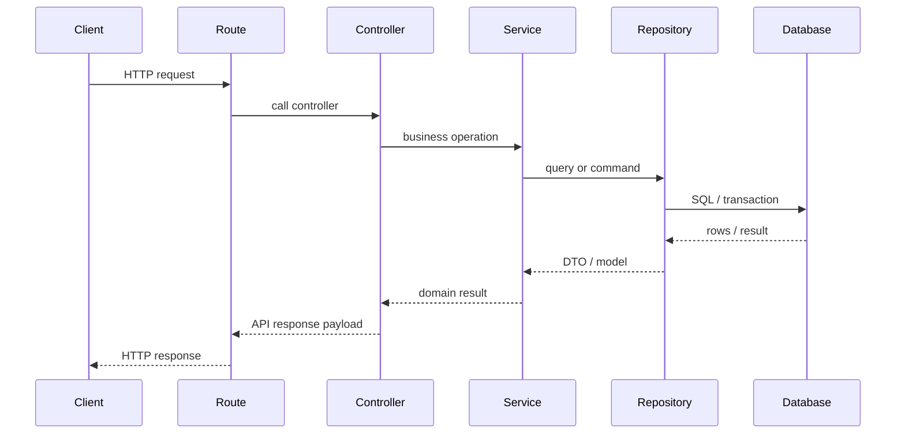
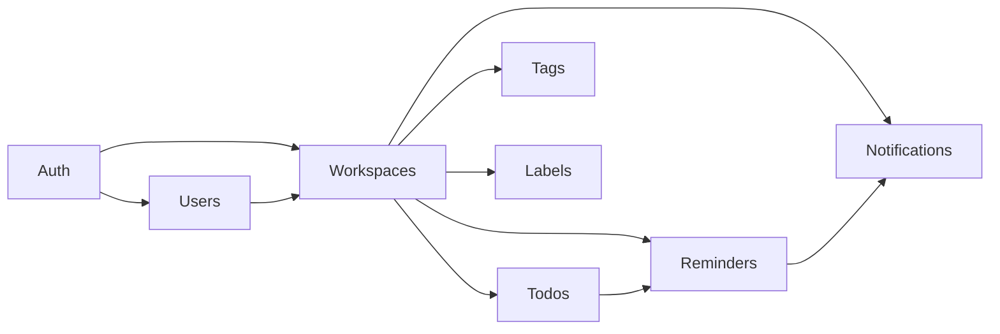

# Architecture Design

## Architectural choice

This backend uses a Modular Monolith architecture. The application remains one deployable codebase, but features are grouped into modules with strict boundaries. This approach is suitable for a collaborative Todo backend because it preserves maintainability and clear separation without introducing the complexity of microservices.

## Design principles

- One codebase, multiple domains.
- Service-oriented separation inside a single application.
- Strong ownership at the module boundary.
- Business logic in service layers, not in routes.
- Database access via async SQLAlchemy repositories.
- Shared functionality only when clearly reusable.

## Module organization

The planned service modules are:

- `auth`
- `users`
- `workspaces`
- `todos`
- `tags`
- `labels`
- `reminders`
- `notifications`

Each module follows a similar structure:

```text
service_name/
├── controllers/
├── routes/
├── models.py
├── schemas.py
├── repository.py
└── service.py
```

## Responsibilities by layer

### Routes
- Define HTTP endpoints.
- Expose path and HTTP method.
- Handle dependency injection.
- Delegate request handling to controllers.
- Do not include business logic.

### Controllers
- Coordinate the request and response lifecycle.
- Invoke relevant service methods.
- Map domain logic to API contracts.
- Keep logic light and straightforward.

### Service
- Owns the business logic.
- Validates domain invariants.
- Handles authorization and workflow orchestration.
- Controls transactional boundaries.

### Repository
- Performs SQL queries and persistence operations.
- Encapsulates complex database reads and writes.
- Keeps SQL logic testable and isolated.

### Models
- Define database tables and ORM mappings.
- Include relationships, constraints, and field metadata.

### Schemas
- Validate request and response payloads.
- Separate create/update/filter/pagination contracts.
- Prevent leaking raw ORM objects to clients.

## Supporting folders

```text
app/
├── core/
├── common/
├── api/
└── services/
```

### `core`
- configuration
- database session management
- security helpers
- exception handling
- logging
- dependency injection

### `common`
- pagination helpers
- common response models
- reusable enums
- utility functions shared across services

### `api`
- API versioning
- main router
- module registration
- central metadata and document configuration

## Dependency rules

- No circular imports between modules.
- No inter-module HTTP calls.
- Service-to-service calls are direct function calls only.
- Repository access stays local to the owning module.
- Shared domain rules are centralized in `common` or `core` only when truly reusable.
- Workspace authorization logic must be reusable by todos, tags, labels, reminders, and notifications.

## Request lifecycle



## Service dependency view



## Authentication and authorization boundary

Authentication is centralized in the auth module, while authorization is enforced by workspace-aware dependencies. The workspace module becomes the mother access control boundary; all other resources must verify workspace membership and role-scoped permissions through consistent permission checks.

## Non-goals of this architecture

- No microservices
- No clean architecture layering pyramid
- No domain events infrastructure unless required later
- No unnecessary abstractions like a generic repository base class with complex patterns

## Architectural assumptions

- The app is a single deployment unit.
- Database is the system of record.
- Background processing is internal to the monolith as a worker process.
- Additional services like Redis or Kafka are not justified in the initial scope.
