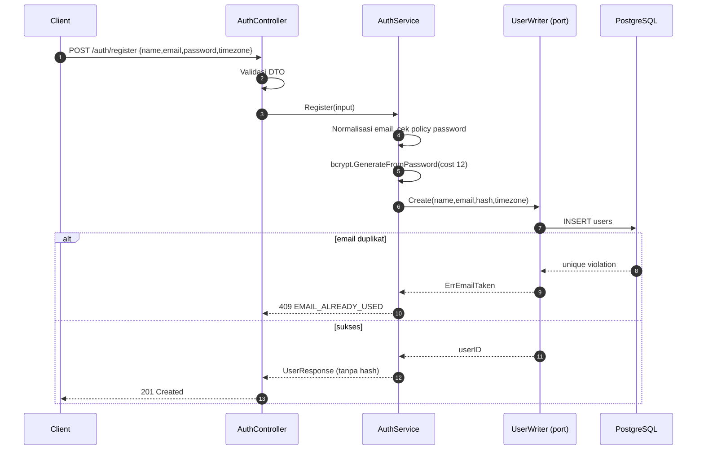
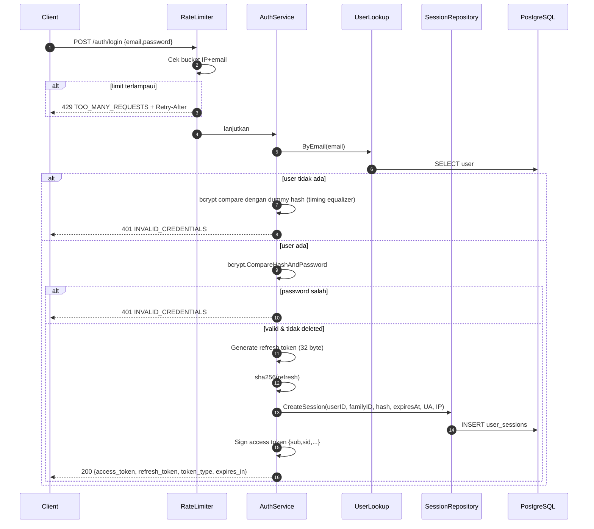
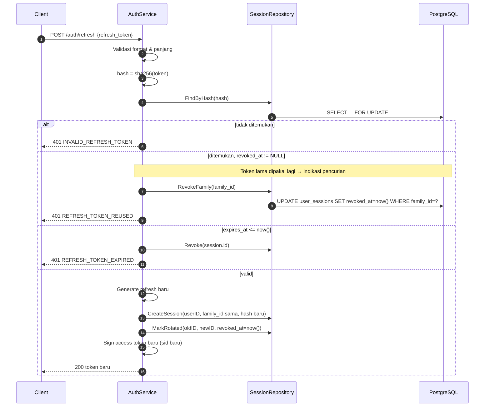
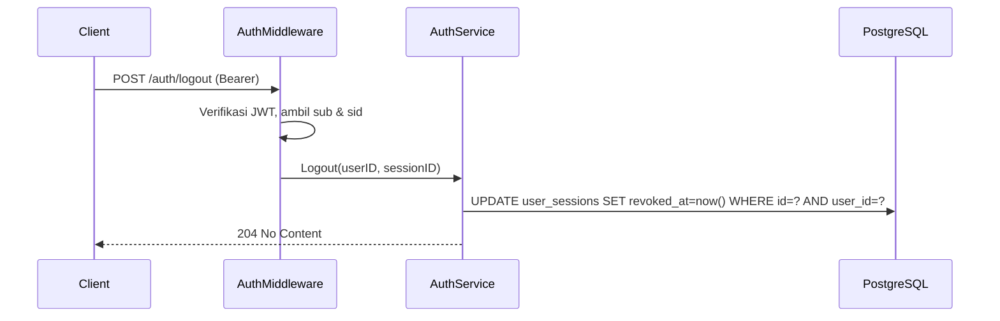

# Arsitektur — Authentication Flow

## 1. Ringkasan Keputusan

| Aspek | Keputusan |
|---|---|
| Access token | JWT, HS256, umur 15 menit |
| Refresh token | Opaque random 32 byte, umur 30 hari, disimpan sebagai SHA-256 hash |
| Rotasi | Setiap refresh membuat session baru; session lama dicabut |
| Deteksi reuse | Jika token lama dipakai lagi, seluruh family dicabut |
| Password | bcrypt cost 12, maksimal 72 byte |
| Logout | Cabut session berdasarkan claim `sid` |
| Logout-all | Cabut semua session user |
| Transport | `Authorization: Bearer <access_token>` |
| Refresh transport | Body JSON `{"refresh_token": "..."}` |
| Session check | Access token diverifikasi signature+klaim; `sid` dicek ke DB pada endpoint sensitif |

Alasan memilih access token pendek + refresh token opaque: access token dapat diverifikasi
tanpa query database (murah), sedangkan refresh token membutuhkan state agar dapat dicabut.
Refresh token tidak pernah disimpan mentah sehingga kebocoran database tidak langsung
memberikan token yang dapat dipakai.

## 2. Entitas dan Kolom

### 2.1 `users` (dimiliki module `users`)

| Kolom | Fungsi |
|---|---|
| `id` | UUID user |
| `name` | Nama tampilan |
| `email` | Login identifier, unik case-insensitive |
| `password_hash` | bcrypt hash |
| `timezone` | IANA timezone |
| `created_at`, `updated_at`, `deleted_at` | Audit & soft delete |

### 2.2 `user_sessions` (dimiliki module `auth`)

| Kolom | Fungsi |
|---|---|
| `id` | UUID session |
| `user_id` | Pemilik session |
| `family_id` | UUID family untuk rotasi/reuse detection |
| `refresh_token_hash` | SHA-256 hex dari refresh token |
| `user_agent` | Snapshot UA (opsional, untuk daftar session) |
| `ip_address` | IP saat login (opsional, `inet`) |
| `expires_at` | Batas berlaku refresh token |
| `revoked_at` | Waktu dicabut (NULL = aktif) |
| `replaced_by_session_id` | Session pengganti saat rotasi |
| `created_at`, `updated_at` | Audit |

## 3. JWT Claims

```json
{
  "iss": "todoit-api",
  "aud": "todoit-client",
  "sub": "0f8fad5b-d9cb-469f-a165-70867728950e",
  "sid": "1c9e2b7a-2b3c-4d5e-8f90-123456789abc",
  "iat": 1762900000,
  "exp": 1762900900,
  "jti": "5d41402a-b1c2-4d3e-9f00-aabbccddeeff"
}
```

| Claim | Wajib | Fungsi |
|---|---|---|
| `iss` | Ya | Diverifikasi sama dengan `JWT_ISSUER` |
| `aud` | Ya | Diverifikasi sama dengan `JWT_AUDIENCE` |
| `sub` | Ya | User ID |
| `sid` | Ya | Session ID, untuk revocation |
| `iat` | Ya | Waktu terbit |
| `exp` | Ya | Kedaluwarsa (15 menit) |
| `jti` | Ya | ID token, untuk audit/log |

Tidak ada role/workspace di dalam token. Alasannya: role bersifat per-workspace dan dapat
berubah; menaruhnya di token akan membuat perubahan role tertunda sampai token kedaluwarsa.
Setiap request workspace memakai pengecekan membership real-time.

## 4. Konfigurasi

| Env | Default dev | Keterangan |
|---|---|---|
| `JWT_SECRET` | wajib diisi | Minimal 32 byte; HS256 |
| `JWT_ISSUER` | `todoit-api` | |
| `JWT_AUDIENCE` | `todoit-client` | |
| `ACCESS_TOKEN_TTL` | `15m` | |
| `REFRESH_TOKEN_TTL` | `720h` (30 hari) | |
| `BCRYPT_COST` | `12` | 10–14 |
| `LOGIN_RATE_LIMIT` | `5` | Percobaan per menit per IP+email |
| `LOGIN_RATE_WINDOW` | `1m` | |
| `INVITATION_TTL` | `168h` (7 hari) | |

Secret production harus berasal dari secret manager, bukan file yang di-commit.

## 5. Alur Register



Aturan:

- Tidak membuat session saat register (client login terpisah).
- Password tidak pernah dicatat di log. Jika validation error, field password tidak
  di-echo.
- Response register tidak mengembalikan token.
- Email duplikat dicek di aplikasi **dan** dijaga unique index (race condition tetap aman).

## 6. Alur Login



Aturan:

- Pesan error selalu sama.
- Jika user tidak ada, tetap jalankan bcrypt compare terhadap hash dummy dengan cost yang
  sama untuk mengurangi perbedaan waktu.
- Rate limit dihitung per `IP + lowercase(email)` agar satu IP tidak dapat menebak banyak
  akun sekaligus, dan satu akun tidak dibanjiri dari banyak IP tanpa batas.
- `family_id` = UUID baru saat login.
- Session menyimpan hash refresh, bukan token.
- Response login:

```json
{
  "success": true,
  "message": "Login successful",
  "data": {
    "access_token": "eyJ...",
    "refresh_token": "8f3a...",
    "token_type": "Bearer",
    "expires_in": 900,
    "user": {
      "id": "0f8fad5b-d9cb-469f-a165-70867728950e",
      "name": "Daffa",
      "email": "daffa@example.com",
      "timezone": "Asia/Jakarta"
    }
  }
}
```

## 7. Alur Refresh & Rotasi



Aturan:

- Seluruh langkah dalam **satu transaksi** dengan `SELECT ... FOR UPDATE` pada baris session
  agar dua request refresh paralel tidak menghasilkan dua session aktif.
- Family ID dipertahankan saat rotasi.
- Jika token yang sudah dirotasi dipakai lagi (mis. penyerang), semua session dalam family
  dicabut. User harus login ulang.
- Refresh token memiliki masa berlaku absolut 30 hari sejak login. Rotasi **tidak**
  memperpanjang `expires_at` family (keputusan: sliding window tanpa batas memperpanjang
  masa hidup token yang dicuri). Dengan demikian, setelah 30 hari user harus login ulang.
- Client wajib mengganti refresh token yang disimpan dengan token baru dari response.
- Response refresh sama bentuknya dengan login (tanpa data user berulang; boleh menyertakan
  `user` untuk kenyamanan — diputuskan **tidak**, agar response kecil).

## 8. Alur Logout dan Logout-All

### Logout



- Idempoten: session yang sudah dicabut tetap 204.
- Jika `sid` tidak ada di DB (mis. sudah dihapus), tetap 204 untuk mencegah enumeration.

### Logout-All

- `UPDATE user_sessions SET revoked_at = now() WHERE user_id = ? AND revoked_at IS NULL`.
- Access token yang masih berlaku secara teknis dapat dipakai sampai `exp` (15 menit),
  kecuali endpoint melakukan pengecekan `sid`. Ini trade-off stateless JWT yang
  didokumentasikan.
- Untuk endpoint sensitif (logout, refresh, perubahan profil, operasi workspace yang
  merusak), middleware melakukan pengecekan session aktif ke DB. Untuk endpoint baca yang
  sering dipanggil, pengecekan session dilewati demi performa.

**Keputusan penting:** pengecekan session (`sid` aktif) dilakukan oleh middleware untuk
**semua** endpoint dengan biaya satu query ringan ber-index (`user_sessions.id`). Alasannya,
tanpa itu logout-all tidak efektif dan token yang dicuri tetap berlaku 15 menit. Query
tersebut memakai primary key sehingga murah. Jika di kemudian hari terbukti menjadi bottleneck,
optimasi dapat berupa cache singkat (mis. 30 detik) — dicatat sebagai backlog performa.

## 9. Get Current User

`GET /auth/me` mengembalikan identitas dari token + data user + session aktif.

```json
{
  "success": true,
  "message": "Current user retrieved successfully",
  "data": {
    "id": "0f8fad5b-...",
    "name": "Daffa",
    "email": "daffa@example.com",
    "timezone": "Asia/Jakarta",
    "session": {
      "id": "1c9e2b7a-...",
      "issued_at": "2026-11-12T08:00:00Z",
      "expires_at": "2026-12-12T08:00:00Z",
      "user_agent": "Mozilla/5.0 ...",
      "ip_address": "203.0.113.10"
    }
  }
}
```

`GET /users/me` mengembalikan profil yang dapat diubah. Perbedaan:

| Endpoint | Fokus | Dapat diubah |
|---|---|---|
| `/auth/me` | Identitas + session | Tidak |
| `/users/me` | Profil (name, timezone, email) | Ya (name/timezone) |

## 10. Token Storage

| Token | Disimpan di server | Disimpan di client |
|---|---|---|
| Access token | Tidak (stateless) | Memory atau storage pilihan frontend |
| Refresh token | Hash SHA-256 di `user_sessions` | Secure storage frontend |
| Invitation token | Hash SHA-256 di `workspace_invitations` | Link email |

Backend tidak menyediakan cookie dan tidak mengatur storage frontend. Untuk aplikasi web,
disarankan menyimpan refresh token di `httpOnly` cookie melalui BFF; namun karena API ini
dirancang untuk multi-client, mekanisme penyimpanan diserahkan ke client. Risiko XSS
didokumentasikan dan menjadi tanggung jawab frontend.

## 11. Revocation

| Kejadian | Dampak |
|---|---|
| Logout | Session `sid` dicabut |
| Logout-all | Semua session user dicabut |
| Rotasi | Session lama dicabut, diganti session baru |
| Reuse terdeteksi | Seluruh family dicabut |
| Ganti password (backlog) | Semua session dicabut |
| User soft delete | Semua session dicabut saat delete (Phase 2 keputusan: set revoked) |

Revocation tidak menghapus baris session; `revoked_at` diisi untuk audit.

## 12. Authentication Middleware

Pseudocode:

```text
raw := header "Authorization"
if raw == "" or not strings.HasPrefix(raw, "Bearer ") -> 401 UNAUTHENTICATED
token := strings.TrimPrefix(...)
claims, err := verifier.VerifyAccessToken(ctx, token)
if err != nil -> 401 INVALID_TOKEN
if claims.Issuer != cfg.Issuer || claims.Audience != cfg.Audience -> 401 INVALID_TOKEN
session := sessionRepo.FindActive(ctx, claims.SessionID, claims.Subject)
if session == nil -> 401 SESSION_REVOKED
ctx = context.WithValue(userID, sessionID, requestID)
next()
```

Aturan:

- Tidak ada fallback ke query string atau cookie.
- Header `Authorization` ganda ditolak.
- Token dengan algoritma selain HS256 ditolak (`jwt.WithValidMethods`).
- Error middleware tidak membocorkan alasan spesifik ke client; detail dicatat di log dengan
  request ID.
- Middleware auth tidak melakukan otorisasi workspace.

## 13. Password Security

- bcrypt cost 12 (dapat dikonfigurasi 10–14).
- Panjang password 8–72 byte. Batas 72 byte karena bcrypt memotong input; menolak lebih dari
  72 mencegah perilaku tak terduga.
- Password tidak pernah disimpan/log/return.
- Perbandingan memakai `bcrypt.CompareHashAndPassword`.
- Password yang sama dengan email ditolak (validasi sederhana).
- Tidak ada password hint atau security question.
- Reset password belum termasuk Phase 0 (butuh email flow); masuk backlog.
- Password policy diperiksa di service, bukan hanya validator DTO, agar dapat diuji unit.

## 14. Login Rate Limiting

Implementasi Phase 2: token bucket in-memory (`golang.org/x/time/rate`) dengan map
`key -> bucket`, key = `ip|lower(email)`, dibersihkan berkala (TTL 10 menit).

| Aturan | Nilai |
|---|---|
| Kapasitas | `LOGIN_RATE_LIMIT` (5) |
| Refill | 1 token per `LOGIN_RATE_WINDOW`/limit |
| Response | 429 `TOO_MANY_REQUESTS`, header `Retry-After` |
| Scope | Login dan refresh (refresh lebih longgar: 30/menit/IP) |

Keterbatasan: multi-instance tidak berbagi counter. Untuk Phase 0–8 ini diterima karena
deployment awal satu instance worker + beberapa API; jika perlu, rate limiter dapat
dipindahkan ke PostgreSQL (tabel `rate_limits`) atau Redis tanpa mengubah kontrak service.

Rate limit bukan pengganti lockout akun; lockout tidak diimplementasikan agar tidak menjadi
vektor DoS terhadap akun korban.

## 15. Error Authentication

| Kondisi | HTTP | Code |
|---|---|---|
| Header tidak ada/invalid | 401 | `UNAUTHENTICATED` |
| Signature/format token salah | 401 | `INVALID_TOKEN` |
| Token expired | 401 | `TOKEN_EXPIRED` |
| Session dicabut | 401 | `SESSION_REVOKED` |
| Kredensial salah | 401 | `INVALID_CREDENTIALS` |
| Refresh tidak dikenal | 401 | `INVALID_REFRESH_TOKEN` |
| Refresh expired | 401 | `REFRESH_TOKEN_EXPIRED` |
| Refresh reuse | 401 | `REFRESH_TOKEN_REUSED` |
| Email sudah terdaftar | 409 | `EMAIL_ALREADY_USED` |
| Rate limit | 429 | `TOO_MANY_REQUESTS` |

Detail format error: [`../api/error-convention.md`](../api/error-convention.md).

## 16. Session Management

- Satu user dapat memiliki banyak session (device berbeda).
- Session tidak memiliki nama device pada Phase 0; hanya `user_agent` dan `ip_address`.
- Tidak ada endpoint untuk melihat/mencabut session lain selain `logout-all`. Endpoint
  `/auth/sessions` masuk backlog.
- Session expired dibersihkan oleh job housekeeping opsional (Phase 6/9), bukan oleh worker
  reminder.
- Index yang dibutuhkan: `user_sessions(refresh_token_hash)` unique,
  `user_sessions(user_id) WHERE revoked_at IS NULL`, `user_sessions(family_id)`.

## 17. Checklist Keamanan Authentication

- [x] Password di-hash bcrypt.
- [x] Refresh token opaque + hash.
- [x] Rotasi + deteksi reuse.
- [x] Revocation per session dan global.
- [x] Pesan login generik + timing equalizer.
- [x] Rate limit login/refresh.
- [x] JWT issuer/audience/algorithm diverifikasi.
- [x] Tidak ada secret di source/log.
- [x] Session dicek ke DB.
- [x] Token tidak diletakkan di URL.
- [x] Email dinormalisasi.
- [ ] Reset password (backlog, butuh keputusan produk).
