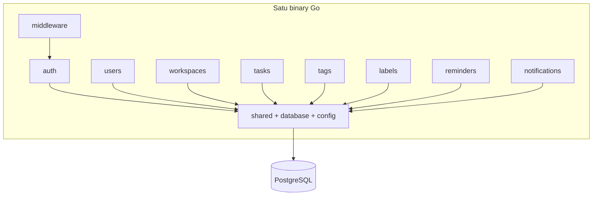
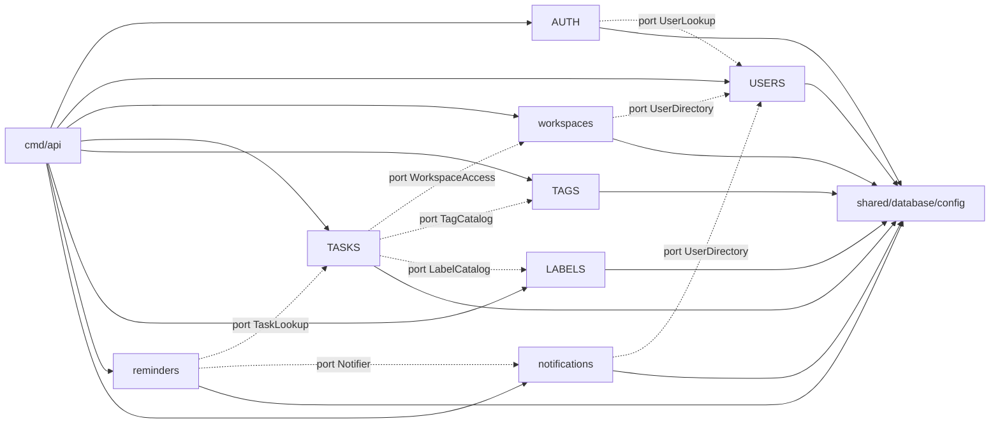

# Arsitektur — Modular Monolith

## 1. Definisi

Modular Monolith adalah satu aplikasi yang di-deploy sebagai satu unit (satu binary, satu
container), tetapi kode di dalamnya dipisahkan menjadi module dengan batas tanggung jawab yang
tegas. Setiap module memiliki kode HTTP, service, repository, model, dan DTO sendiri.

Yang **tidak** dilakukan:

- Tidak ada Clean Architecture (tidak ada `domain/`, `usecase/`, `infrastructure/` berlapis).
- Tidak ada microservices, API gateway internal, atau message broker.
- Tidak ada event bus abstrak; komunikasi antar-module memakai pemanggilan fungsi lewat
  interface kecil.



## 2. Tanggung Jawab Module

| Module | Tanggung jawab | Tidak bertanggung jawab atas |
|---|---|---|
| `auth` | Register, login, refresh, logout, logout-all, `/auth/me`, penerbitan & verifikasi token, session | Profil user (update nama/timezone), membership |
| `users` | Profil user (`GET/PATCH /users/me`), lookup user untuk assignee/invitation | Password, token, session |
| `workspaces` | Workspace CRUD, membership, role, invitation, aturan ownership | Task, tag, label |
| `tasks` | Task CRUD, complete/reopen, assignee, due date, filter, view Today/Upcoming/Overdue, cursor, relasi task-tag/label | CRUD master tag/label, pengiriman reminder |
| `tags` | CRUD tag per workspace, validasi nama unik per workspace | Pemasangan tag ke task (dilakukan `tasks` lewat port katalog) |
| `labels` | CRUD label per workspace, validasi warna | Pemasangan label ke task |
| `reminders` | CRUD reminder per task, penjadwalan, worker pemrosesan reminder | Pembuatan/penyimpanan notifikasi (dipanggil lewat port) |
| `notifications` | Inbox notifikasi, mark read, read-all, deduplikasi, pengiriman email opsional | Penentuan kapan reminder jatuh tempo |
| `shared` | Error, response envelope, pagination, validator, util waktu/ID, logging, mailer | Business logic domain |
| `config` | Load & validasi environment | Mengakses database |
| `database` | Koneksi GORM, transactor, context tx, health probe | Query business |
| `middleware` | Request ID, logging, recovery, CORS, auth JWT, rate limit | Otorisasi workspace |

Aturan kepemilikan data: **satu tabel hanya dimiliki satu module**. Tabel milik module lain
hanya boleh dibaca lewat interface port, bukan dengan mengimpor repository-nya.

## 3. Tanggung Jawab Folder per Module

Struktur baku setiap module (contoh `tasks/`):

```text
tasks/
├── controllers/    # HTTP binding, validasi DTO, panggil service, tulis response
├── routes/         # deklarasi endpoint + middleware khusus module
├── services/       # business logic, otorisasi, transaksi, orkestrasi port
├── repositories/   # query GORM, locking, pemetaan model <-> entity
├── models/         # struct GORM (tabel), enum/constraint helper
└── dto/            # request/response struct + tag validator
```

| Folder | Boleh bergantung pada | Larangan |
|---|---|---|
| `controllers` | `services`, `dto`, `shared/response`, `shared/errors` | Query DB, import repository module lain |
| `routes` | `controllers`, `middleware` | Business logic |
| `services` | `repositories` (module sendiri), `models` (read-only), `dto`, `shared/*`, port interface | `*gin.Context`, import controller |
| `repositories` | `models`, `database`, `shared/*` | Authorization, memanggil service |
| `models` | standard library, `database` (tipe dasar) | Service, controller |
| `dto` | `shared/validator` | Repository, GORM |

Module boleh memiliki file tambahan **hanya jika perlu**, misalnya:

- `services/authorization.go` untuk policy kompleks.
- `services/worker.go` untuk runner background.
- `repositories/cursor.go` untuk query keyset.
- `tags/catalog.go` untuk implementasi port yang dipakai module lain.

Tidak dibuat folder `entities/`, `usecases/`, `ports/`, `adapters/` terpisah agar tidak
menyerupai Clean Architecture dan tidak menambah lapisan tanpa nilai.

## 4. Cara Komunikasi Antar-Module

Ada tiga mekanisme resmi, dipilih dari yang paling sederhana:

### 4.1 Interface port (sinkron, default)

Module pemakai mendeklarasikan interface kecil sesuai kebutuhannya, lalu implementasi disuplai
saat perakitan di `cmd/api/main.go`. Interface dideklarasikan **di sisi konsumen**, bukan di
module penyedia, agar tidak ada import balik.

Contoh nyata:

```go
// internal/tasks/services/ports.go
type WorkspaceAccess interface {
    RequireMember(ctx context.Context, workspaceID, userID uuid.UUID) (role string, err error)
    RequirePermission(ctx context.Context, workspaceID, userID uuid.UUID, action string) error
}

type TagCatalog interface {
    ExistingTagIDs(ctx context.Context, workspaceID uuid.UUID, ids []uuid.UUID) (map[uuid.UUID]bool, error)
}
```

```go
// internal/workspaces/services/access_adapter.go
type AccessAdapter struct { /* repo membership */ }

func (a *AccessAdapter) RequireMember(ctx context.Context, wsID, userID uuid.UUID) (string, error) { ... }
```

Perakitan:

```go
// cmd/api/main.go (ilustrasi Phase 1)
access := workspaces.NewAccessAdapter(memberRepo)
taskSvc := tasks.NewService(taskRepo, access, tagCatalog, labelCatalog, ...)
```

Keuntungan: `tasks` tidak mengimpor `workspaces`, sehingga tidak ada siklus dan mudah diuji
dengan fake.

### 4.2 Query read-only lintas module

Untuk kebutuhan baca sederhana (mis. `tasks` butuh memastikan assignee adalah member), gunakan
port yang mengembalikan data minimal (boolean/ID), bukan model penuh. Jangan mengekspos
`*gorm.DB` module lain.

### 4.3 Shared kernel

`internal/shared` hanya berisi utilitas tanpa pengetahuan domain: error mapping, response,
cursor codec, timezone helper, UUID, validator, mailer, logging. Tidak boleh berisi aturan
workspace/task.

**Tidak digunakan:** event bus internal, pub/sub, atau callback global. Untuk monolith seukuran
ini, pemanggilan fungsi langsung lebih mudah dilacak dan di-debug.

## 5. Pengelolaan Dependency Antar-Module

Aturan yang ditegakkan lewat code review dan (Phase 1) test arsitektur:

1. **Arah dependensi hanya ke `shared`, `database`, `config`.** Module tidak mengimpor module
   lain secara langsung.
2. **Dependency inversion di composition root.** Hanya `cmd/api/main.go` yang mengetahui semua
   modul konkret.
3. **Tidak ada global singleton.** Semua dependensi diberikan lewat constructor.
4. **Interface minimal.** Port hanya berisi method yang benar-benar dipakai; maksimal 1–3
   method per port.
5. **Model bukan kontrak antar-module.** Jangan mengirim struct GORM ke module lain; kirim
   tipe primitif atau struct kecil yang didefinisikan di port.
6. **Import graph diverifikasi otomatis.** Test `tests/unit/architecture_test.go` (Phase 1)
   memindai import dan gagal jika `internal/tasks` mengimpor `internal/workspaces`, dst.

Matriks dependensi lengkap: [`module-dependencies.md`](module-dependencies.md).

## 6. Menghindari Circular Dependency

| Risiko | Mitigasi |
|---|---|
| `tasks` butuh validasi workspace, `workspaces` butuh hitung jumlah task | `workspaces` **tidak** menghitung task lewat module; jika perlu counter, gunakan query agregat milik `workspaces` ke tabel `tasks` read-only, atau simpan `task_count` yang diperbarui `tasks` lewat port `WorkspaceStats`. Untuk Phase 0–5 tidak ada kebutuhan counter. |
| `reminders` membuat notifikasi, `notifications` membaca reminder | `reminders` mendeklarasikan port `Notifier`; `notifications` tidak pernah mengimpor `reminders`. Worker dimiliki `reminders`, tetapi pemanggilan notifikasi lewat port. |
| `auth` butuh data user, `users` butuh auth | `auth` memiliki tabel `users`? **Tidak.** `users` memiliki model `User`; `auth` membaca user lewat port `UserLookup` yang diimplementasikan `users`. `users` tidak mengimpor `auth`. |
| `workspaces` butuh email user untuk undangan | Port `UserDirectory` (id, email, name) diimplementasikan `users`. |
| Dua modul butuh util yang sama | Pindahkan ke `shared`, bukan saling impor. |

Aturan praktis: **jika dua module saling membutuhkan, salah satunya harus menjadi konsumen
port**. Jika keduanya butuh data satu sama lain secara simetris, itu tanda batas domain salah
dan harus digabung atau dipecah ulang.

## 7. Transaksi Antar-Repository

### Keputusan

Gunakan **transactor berbasis context** di `internal/database`:

```go
// internal/database/transactor.go (ilustrasi)
type Transactor interface {
    WithinTx(ctx context.Context, fn func(ctx context.Context) error) error
}

// internal/database/context.go
func FromContext(ctx context.Context, fallback *gorm.DB) *gorm.DB
```

- `WithinTx` memulai `BEGIN`, menaruh `*gorm.DB` transaksi ke context, menjalankan `fn`,
  lalu `COMMIT`/`ROLLBACK`.
- Repository selalu memakai `database.FromContext(ctx, r.db)`, sehingga otomatis ikut
  transaksi bila ada.
- Service yang mengorkestrasi beberapa repository (modul sendiri atau lintas modul lewat port)
  membungkus operasi dengan `WithinTx`.

Ilustrasi:

```go
err := s.tx.WithinTx(ctx, func(ctx context.Context) error {
    if err := s.taskRepo.Create(ctx, task); err != nil { return err }
    if err := s.taskRepo.ReplaceTags(ctx, task.ID, wsID, tagIDs); err != nil { return err }
    return s.taskRepo.ReplaceLabels(ctx, task.ID, wsID, labelIDs); err != nil {
        // rollback otomatis oleh WithinTx
    }
})
```

### Batasan dan aturan

- Transaksi **tidak boleh** menunggu panggilan jaringan (SMTP, HTTP eksternal). Email dikirim
  setelah commit, atau lewat outbox/worker.
- Port lintas module yang dipanggil di dalam transaksi harus memakai `ctx` yang sama agar
  ikut transaksi. Jika implementasi port memakai DB sendiri tanpa `FromContext`, dokumentasikan
  bahwa operasi tersebut tidak transaksional.
- Untuk Phase 0–6, semua operasi lintas module yang memerlukan atomicity terjadi di dalam
  module yang sama (task + pivot). Pembuatan notifikasi dari reminder memakai transaksi
  terpisah yang idempoten, bukan bagian dari transaksi user request.
- Isolation level default PostgreSQL `READ COMMITTED` cukup. Locking eksplisit hanya untuk
  worker (`FOR UPDATE SKIP LOCKED`).

### Alternatif ditolak

- **Unit of Work per module** dengan interface besar: terlalu banyak boilerplate.
- **Repository menerima `*gorm.DB` sebagai parameter**: memaksa service mengetahui GORM.
- **Saga/outbox kompleks**: tidak sepadan untuk monolith dengan satu database.

## 8. Otorisasi Antar-Module

Otorisasi memiliki dua lapis:

1. **Autentikasi** (middleware `auth`): memvalidasi JWT, menaruh `userID` di context.
2. **Otorisasi resource** (service module): memeriksa membership dan role.

Karena service module tidak boleh mengimpor `workspaces`, akses workspace disediakan lewat
port `WorkspaceAccess` (lihat §4.1). Implementasi port berada di `workspaces` dan memakai
repository membership.

Kontrak yang disepakati:

| Method | Semantik |
|---|---|
| `RequireMember(ctx, wsID, userID) (role, error)` | Error `ErrNotMember` jika tidak ada membership; error `ErrWorkspaceNotFound` jika workspace tidak ada/terhapus |
| `RequireRole(ctx, wsID, userID, minRole) error` | Gagal jika role di bawah minimum |
| `RequirePermission(ctx, wsID, userID, action) error` | Berbasis permission matrix; dipakai untuk aksi sensitif |

Pemetaan error ke HTTP dilakukan di `shared/errors` agar konsisten:

- `ErrWorkspaceNotFound` / `ErrNotMember` → **404** `WORKSPACE_NOT_FOUND` (tidak membocorkan
  keberadaan workspace).
- `ErrForbidden` → **403** `FORBIDDEN`.
- `ErrOwnerProtected` → **409** `OWNER_PROTECTED`.

Aturan tambahan:

- Service **wajib** memanggil pengecekan sebelum query resource, dan query tetap memakai
  `workspace_id` + `id` (bukan `id` saja). Ini mencegah IDOR meski pengecekan terlewat.
- Controller tidak boleh menerima `user_id` dari body untuk keperluan otorisasi; `user_id`
  selalu diambil dari context token.
- Endpoint yang hanya butuh login (notifications, users/me) tidak memerlukan workspace port.

Detail matrix: [`workspace-authorization.md`](workspace-authorization.md).

## 9. Background Worker dalam Satu Proses

Worker berjalan sebagai komponen lifecycle di `cmd/api/main.go`:

```text
main
 ├─ load config
 ├─ connect DB + ping
 ├─ build repositories/services (composition root)
 ├─ start HTTP server (goroutine)
 ├─ start reminder worker (goroutine)  ← jika WORKER_ENABLED=true
 ├─ wait signal SIGINT/SIGTERM
 ├─ shutdown HTTP (context timeout)
 ├─ stop worker (cancel context, tunggu selesai)
 └─ close DB pool
```

Prinsip:

- Worker memakai `context.Context` yang di-cancel saat shutdown.
- Tick loop: `time.NewTicker(WORKER_INTERVAL)`; setiap tick memproses batch reminder.
- Tidak ada cron eksternal. Untuk deployment multi-instance, hanya satu instance yang
  sebaiknya menjalankan worker (`WORKER_ENABLED=true` pada satu replica), atau biarkan semua
  instance berjalan karena pengambilan job memakai `FOR UPDATE SKIP LOCKED`.
- Worker tidak mengakses `*gin.Context`; ia memakai `context.Background()` turunan dengan
  timeout per batch.
- Worker dan HTTP berbagi pool koneksi; batasi `WORKER_BATCH_SIZE` agar tidak menghabiskan pool.

Detail: [`notification-worker.md`](notification-worker.md).

## 10. Registrasi Route ke Router Utama

Setiap module memiliki fungsi registrasi dengan dependency eksplisit:

```go
// internal/tasks/routes/routes.go (ilustrasi)
func RegisterRoutes(rg *gin.RouterGroup, h *controllers.TaskController, authMW gin.HandlerFunc) {
    g := rg.Group("/workspaces/:workspace_id/tasks")
    g.Use(authMW)
    g.POST("", h.Create)
    g.GET("", h.List)
    g.GET("/views/today", h.Today)
    ...
}
```

Di composition root:

```go
api := router.Group("/api/v1")
auth.RegisterRoutes(api, authHandler, authMW)
users.RegisterRoutes(api, userHandler, authMW)
workspaces.RegisterRoutes(api, wsHandler, memberHandler, invHandler, authMW)
tasks.RegisterRoutes(api, taskHandler, authMW)
tags.RegisterRoutes(api, tagHandler, authMW)
labels.RegisterRoutes(api, labelHandler, authMW)
reminders.RegisterRoutes(api, reminderHandler, authMW)
notifications.RegisterRoutes(api, notifHandler, authMW)
```

Aturan:

- Prefix `/api/v1` hanya didefinisikan **sekali** di `main.go`/router factory.
- Middleware global (recovery, request ID, logging, CORS) dipasang sebelum group.
- Middleware auth dipasang per group yang membutuhkan; endpoint publik (`register`, `login`,
  `refresh`, `invitations/accept`) tidak memakai auth middleware.
- Urutan route statis sebelum parameter (`/views/today` sebelum `/:task_id`) untuk menghindari
  konflik router. Ini juga alasan rekomendasi C1.
- Setiap module mengekspor satu fungsi `RegisterRoutes`; tidak ada registry dinamis/reflection.
- Test `TestRouteRegistration` (Phase 1) memastikan tidak ada panic dan seluruh endpoint
  terdaftar.

## 11. Batas Transaksi dan Konsistensi antar Module

| Operasi | Transaksi | Catatan |
|---|---|---|
| Register user | Satu tx di `auth` + `users` | User dibuat lewat port `UserWriter`; session tidak dibuat saat register |
| Login | Tx pendek untuk insert session | Verifikasi password di luar tx berat |
| Create task + tag/label | Satu tx di `tasks` | Validasi tag/label lewat port sebelum tx atau di dalam tx read-only |
| Create workspace + owner member | Satu tx di `workspaces` | Wajib atomik: workspace tanpa owner tidak valid |
| Accept invitation | Satu tx di `workspaces` | Cek status PENDING, expiry, membership unik |
| Reminder → notification | Tx terpisah di worker | Idempoten dengan unique `dedupe_key` |
| Hapus workspace | Tx + soft delete | Membership/invitation dipertahankan untuk audit |

## 12. Aturan yang Ditegakkan di Code Review

- Tidak ada import lintas module selain `shared`/`database`/`config`.
- Controller maksimal berisi binding, validasi, pemanggilan service, dan penulisan response.
- Tidak ada `panic` untuk error bisnis; gunakan error terdefinisi.
- Semua query yang menyentuh data workspace memuat `workspace_id`.
- Semua waktu yang disimpan adalah UTC; konversi timezone hanya di service/view.
- Tidak ada `SELECT *` untuk tabel besar; gunakan kolom eksplisit pada list.
- Semua endpoint baru wajib memiliki test controller/service dan entri OpenAPI.

## 13. Diagram Dependency Ringkas



Garis putus-putus = interface port yang dirakit di `cmd/api`, bukan import langsung.
