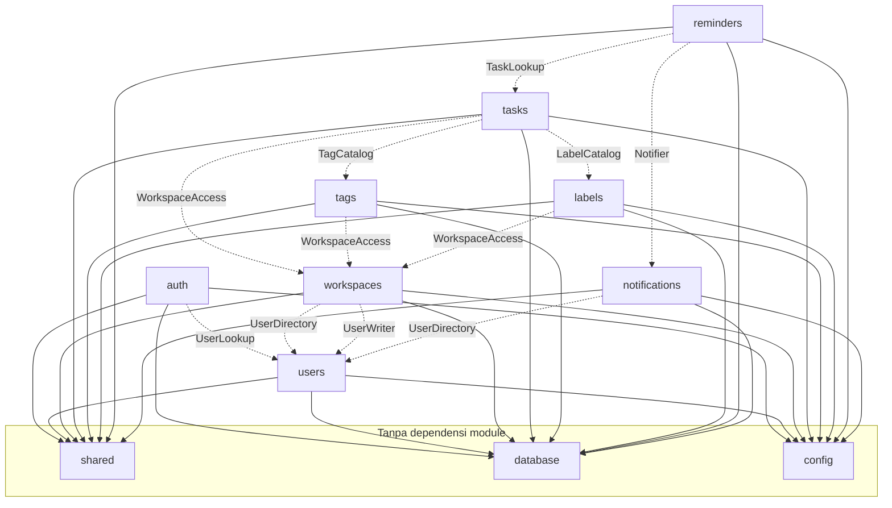

# Arsitektur — Module Dependencies

## 1. Tujuan

Dokumen ini menetapkan arah dependensi antar-module, kontrak port yang diizinkan, dan aturan
yang dapat diverifikasi otomatis agar tidak terjadi circular dependency.

## 2. Matriks Dependensi

Simbol: `→` berarti "mengimpor/memakai"; `P` berarti "memakai lewat port yang dirakit di
composition root"; `—` berarti tidak ada dependensi.

| Module | shared | database | config | users | auth | workspaces | tasks | tags | labels | reminders | notifications |
|---|---|---|---|---|---|---|---|---|---|---|---|
| `auth` | → | → | → | P | — | — | — | — | — | — | — |
| `users` | → | → | → | — | — | — | — | — | — | — | — |
| `workspaces` | → | → | → | P | — | — | — | — | — | — | — |
| `tasks` | → | → | → | — | — | P | — | P | P | — | — |
| `tags` | → | → | → | — | — | P | — | — | — | — | — |
| `labels` | → | → | → | — | — | P | — | — | — | — | — |
| `reminders` | → | → | → | — | — | — | P | — | — | — | P |
| `notifications` | → | → | → | P | — | — | — | — | — | — | — |
| `middleware` | → | — | → | — | P | — | — | — | — | — | — |
| `database` | — | — | — | — | — | — | — | — | — | — | — |

Catatan:

- `tags`/`labels` memakai `WorkspaceAccess` untuk memastikan user adalah member workspace
  sebelum CRUD. Ini port, bukan import.
- `tasks` memakai `TagCatalog`/`LabelCatalog` (port) untuk validasi ID.
- `notifications` memakai `UserDirectory` hanya jika perlu mengirim email; in-app tidak butuh.
- `middleware/auth.go` memakai interface `TokenVerifier`; implementasi disediakan `auth`.

## 3. Dependency Graph



## 4. Katalog Port

Setiap port dideklarasikan di module **konsumen** dan diimplementasikan di module **penyedia**
(atau di `cmd/api` sebagai adapter tipis).

### 4.1 `UserLookup` (dipakai `auth`, disediakan `users`)

```go
type Credentials struct {
    ID           uuid.UUID
    Email        string
    PasswordHash string
    IsDeleted    bool
}

type UserLookup interface {
    ByEmail(ctx context.Context, email string) (Credentials, error)
    ByID(ctx context.Context, id uuid.UUID) (Credentials, error)
    Create(ctx context.Context, name, email, passwordHash, timezone string) (uuid.UUID, error)
}
```

Alasan: `users` adalah pemilik tabel `users`. `auth` tidak boleh mendefinisikan model kedua
untuk tabel yang sama.

### 4.2 `UserDirectory` (dipakai `workspaces`, `notifications`)

```go
type UserSummary struct {
    ID    uuid.UUID
    Name  string
    Email string
}

type UserDirectory interface {
    GetByID(ctx context.Context, id uuid.UUID) (UserSummary, error)
    GetByIDs(ctx context.Context, ids []uuid.UUID) ([]UserSummary, error)
    GetByEmail(ctx context.Context, email string) (UserSummary, error)
    Exists(ctx context.Context, id uuid.UUID) (bool, error)
}
```

Dipakai untuk undangan (email), menampilkan member, dan penerima notifikasi.

### 4.3 `UserWriter` (dipakai `auth` saat register)

Register membutuhkan pembuatan user + kredensial. Karena `users` pemilik tabel, `auth`
memanggil `UserWriter.Create` di dalam transaksi yang sama (ctx transactor). Alternatif: pindahkan
seluruh register ke `users`. **Keputusan:** `auth` tetap pemilik alur register, `users` pemilik
penulisan data profil. Ini menjaga endpoint auth di satu module.

### 4.4 `WorkspaceAccess` (dipakai `tasks`, `tags`, `labels`)

```go
type Role string // OWNER, ADMIN, MEMBER

type WorkspaceAccess interface {
    RequireMember(ctx context.Context, workspaceID, userID uuid.UUID) (Role, error)
    RequirePermission(ctx context.Context, workspaceID, userID uuid.UUID, action Action) error
    MemberIDs(ctx context.Context, workspaceID uuid.UUID) ([]uuid.UUID, error)
}
```

Error yang disepakati: `ErrWorkspaceNotFound`, `ErrNotMember`, `ErrForbidden`.
Implementasi: `workspaces/services/access_adapter.go`.

### 4.5 `TagCatalog` dan `LabelCatalog` (dipakai `tasks`)

```go
type TagCatalog interface {
    ExistingIDs(ctx context.Context, workspaceID uuid.UUID, ids []uuid.UUID) (map[uuid.UUID]struct{}, error)
}
```

`tasks` mengirim daftar ID dari request; katalog mengembalikan ID yang valid **di workspace
itu**. Jika ada ID yang tidak ada di map, service mengembalikan `422 VALIDATION_ERROR`
(`tag_ids` berisi ID milik workspace lain atau tidak ada).

### 4.6 `TaskLookup` (dipakai `reminders`)

```go
type TaskSnapshot struct {
    ID          uuid.UUID
    WorkspaceID uuid.UUID
    Title       string
    Status      string
    DueAt       *time.Time
    AssigneeID  *uuid.UUID
    CreatedBy   uuid.UUID
    Deleted     bool
}

type TaskLookup interface {
    GetForReminder(ctx context.Context, workspaceID, taskID uuid.UUID) (TaskSnapshot, error)
}
```

### 4.7 `Notifier` (dipakai `reminders`, disediakan `notifications`)

```go
type NotificationInput struct {
    UserID      uuid.UUID
    WorkspaceID uuid.UUID
    TaskID      *uuid.UUID
    Type        string
    Title       string
    Message     string
    DedupeKey   string
}

type Notifier interface {
    Create(ctx context.Context, input NotificationInput) (created bool, err error)
}
```

`created=false` berarti notifikasi sudah ada (dedupe). Worker tetap menandai reminder `SENT`
karena duplikat bukan error.

### 4.8 `TokenVerifier` (dipakai `middleware`, disediakan `auth`)

```go
type TokenVerifier interface {
    VerifyAccessToken(ctx context.Context, raw string) (userID uuid.UUID, sessionID uuid.UUID, err error)
}
```

Middleware tidak mengimpor `auth/services`.

## 5. Aturan Anti-Circular yang Dapat Diverifikasi

1. **Import rule:** untuk setiap pasangan module `X`, `Y` (`X != Y`), `X` tidak boleh
   mengimpor `Y` kecuali `Y` adalah `shared`, `database`, atau `config`.
2. **Port rule:** port dideklarasikan di package konsumen (mis. `tasks/services/ports.go`)
   dan implementasinya boleh berada di module penyedia atau di `cmd/api`.
3. **No model sharing:** struct GORM tidak boleh muncul di signature port.
4. **No DB sharing:** module tidak boleh menerima `*gorm.DB` dari module lain; hanya
   `*gorm.DB` dari `database.FromContext` miliknya sendiri.
5. **No package-level mutable state:** tidak ada `var db *gorm.DB` global.
6. **Composition root tunggal:** hanya `cmd/api` yang mengimpor semua module.

Contoh test arsitektur (rencana Phase 1):

```go
func TestModuleBoundaries(t *testing.T) {
    allowed := map[string][]string{
        "tasks": {"shared", "database", "config"},
        "auth":  {"shared", "database", "config"},
        // ...
    }
    // pindai import dengan go/parser, gagal jika ada pelanggaran
}
```

## 6. Skenario yang Sering Menimbulkan Siklus dan Solusinya

| Skenario | Solusi |
|---|---|
| Task list menampilkan nama assignee | `tasks` menyimpan `assignee_id` dan mengembalikan ID; frontend memakai member list. Jika perlu nama, `tasks` memakai port `MemberDirectory` yang disediakan `workspaces`, bukan import `users` langsung. |
| Workspace list menampilkan jumlah task | Phase 0–5 tidak menampilkan counter. Jika nanti perlu, `workspaces` memakai port `TaskStats` yang disediakan `tasks`. |
| Notifikasi ingin menampilkan judul task | Simpan `title` dan `message` sebagai snapshot di tabel `notifications`; tidak perlu join ke `tasks`. Ini juga menjaga histori meski task berubah. |
| Reminder butuh data user | Simpan `user_id` penerima di reminder/notification; data user diambil saat menampilkan notifikasi. |
| Invitation butuh memastikan email belum jadi member | `workspaces` memakai `WorkspaceAccess`/repository sendiri + `UserDirectory`; tidak perlu `auth`. |
| Logout butuh menghapus session | Session dimiliki `auth`; tidak ada module lain yang perlu menghapus. |

## 7. Urutan Inisialisasi di Composition Root

Urutan penting agar dependency tersedia:

```text
config → logger → database → transactor
  → users repo/service/adapters (UserLookup, UserDirectory, UserWriter)
  → auth repo/service (butuh UserLookup)
  → workspaces repo/service (butuh UserDirectory) + AccessAdapter
  → tags repo/service/catalog (butuh WorkspaceAccess)
  → labels repo/service/catalog (butuh WorkspaceAccess)
  → tasks repo/service (butuh WorkspaceAccess, TagCatalog, LabelCatalog)
  → notifications repo/service (butuh UserDirectory)
  → reminders repo/service (butuh TaskLookup, Notifier)
  → controllers → routes
  → HTTP server + worker
```

Tidak ada inisialisasi malas (lazy) atau `init()` yang mengakses DB.

## 8. Dependensi Pihak Ketiga per Module

| Module | Library utama |
|---|---|
| `auth` | `golang-jwt/jwt/v5`, `golang.org/x/crypto/bcrypt`, `google/uuid` |
| `users` | `gorm.io/gorm`, `go-playground/validator/v10` |
| `workspaces` | `gorm.io/gorm`, `google/uuid`, mailer |
| `tasks` | `gorm.io/gorm`, cursor codec (shared), validator |
| `tags`/`labels` | `gorm.io/gorm`, validator |
| `reminders` | `gorm.io/gorm`, `time`, worker ticker |
| `notifications` | `gorm.io/gorm`, mailer, cursor codec |
| Semua | `gin-gonic/gin`, `stretchr/testify` (test) |

Daftar lengkap dan alasan ada di [`../development/testing-strategy.md`](../development/testing-strategy.md)
dan [`../implementation-roadmap.md`](../implementation-roadmap.md).

## 9. Ringkasan Aturan

- Satu tabel = satu module pemilik.
- Module lain hanya lewat port.
- Port kecil, dideklarasikan konsumen.
- Perakitan hanya di `cmd/api`.
- Transaksi lewat `database.WithinTx` + context.
- Otorisasi resource selalu di service, bukan controller.
- Pelanggaran batas = build/test gagal, bukan sekadar catatan review.
