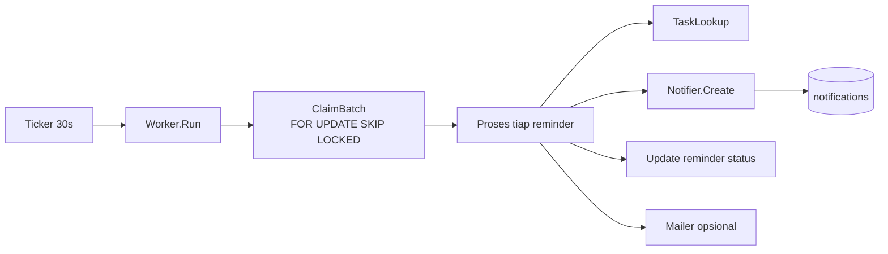
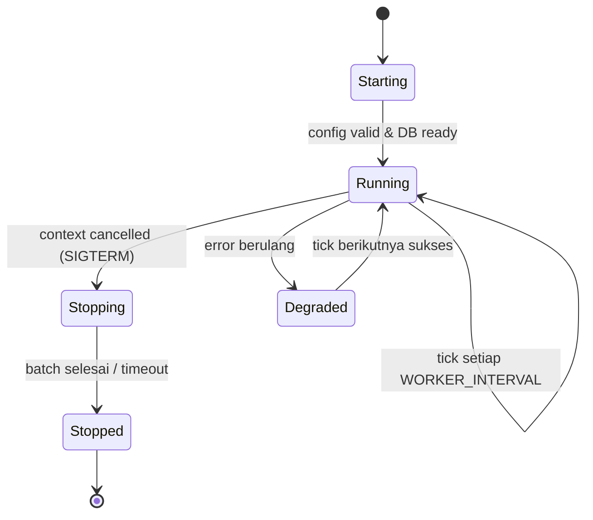
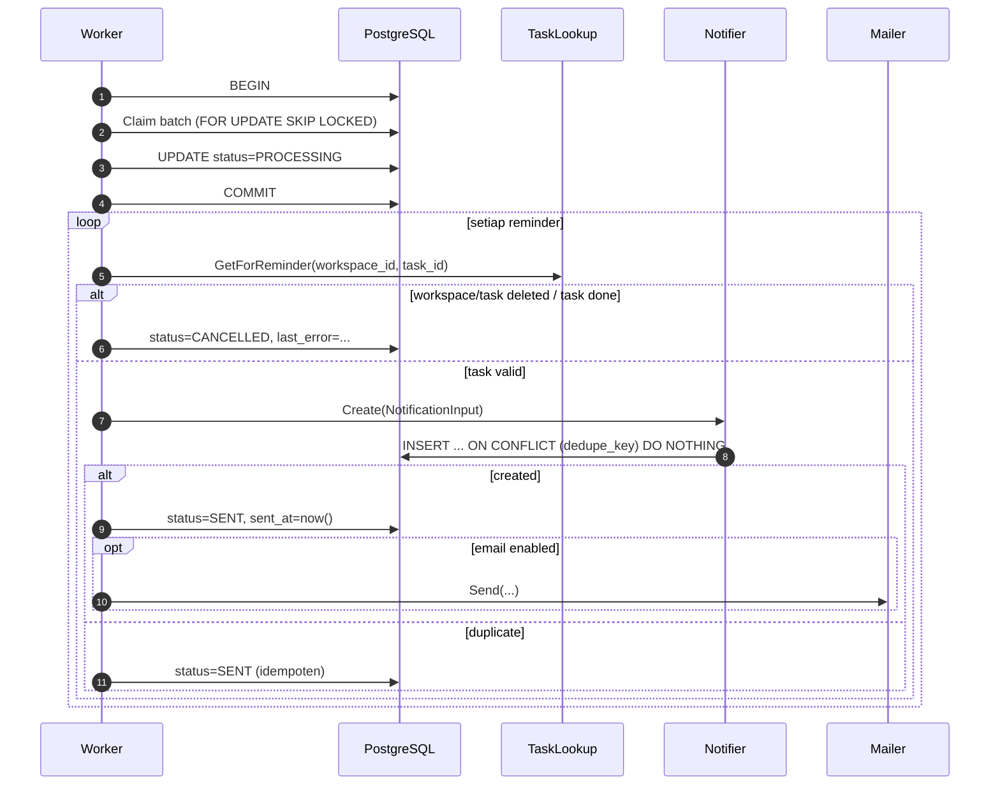
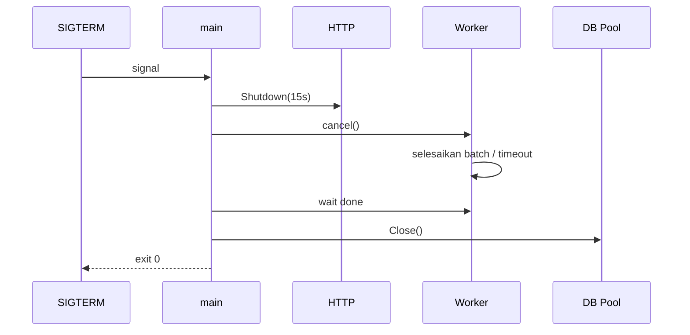

# Arsitektur — Notification Worker

## 1. Tujuan

Menjalankan pemrosesan reminder dan pembuatan notifikasi secara otomatis di dalam proses
aplikasi (monolith), tanpa message broker atau service terpisah. Worker harus aman dijalankan
lebih dari satu instance dan tidak boleh membuat notifikasi duplikat.

## 2. Komponen

| Komponen | Lokasi | Tanggung jawab |
|---|---|---|
| `Worker` | `internal/reminders/services/worker.go` | Lifecycle ticker, batch loop, graceful shutdown |
| `ReminderRepository` | `internal/reminders/repositories` | Claim job dengan `FOR UPDATE SKIP LOCKED`, update status |
| `Notifier` (port) | `internal/reminders/services/ports.go` | Membuat notifikasi idempoten |
| `NotificationService` | `internal/notifications/services` | Insert notifikasi + dedupe |
| `TaskLookup` (port) | `internal/reminders/services/ports.go` | Snapshot task **dan status workspace** untuk pesan & validasi |
| `Mailer` | `internal/shared/mailer` | Email opsional; logger adapter di dev |



## 3. Data yang Diproses

Sumber job adalah tabel `reminders` dengan status `PENDING` dan `scheduled_at <= now()`.

Kolom penting:

| Kolom | Fungsi |
|---|---|
| `id` | ID job |
| `workspace_id` | Scope (diwarisi task) |
| `task_id` | Task terkait |
| `user_id` | Penerima notifikasi |
| `scheduled_at` | Waktu eksekusi (UTC) |
| `status` | `PENDING`, `PROCESSING`, `SENT`, `FAILED`, `CANCELLED` |
| `attempts` | Jumlah percobaan |
| `last_error` | Pesan error terakhir (dipotong 500 char) |
| `sent_at` | Waktu berhasil |
| `updated_at` | Untuk observasi |

Index utama:

```sql
CREATE INDEX idx_reminders_due
    ON reminders (scheduled_at, id)
    WHERE status IN ('PENDING', 'FAILED');
```

Partial index membuat query worker tetap kecil meskipun tabel besar.

## 4. Lifecycle



Pseudocode:

```go
func (w *Worker) Run(ctx context.Context) error {
    ticker := time.NewTicker(w.interval)
    defer ticker.Stop()
    w.log.Info("worker started", "interval", w.interval)

    // Jalankan sekali saat start agar reminder yang sudah due tidak menunggu interval.
    w.runBatch(ctx)

    for {
        select {
        case <-ctx.Done():
            w.log.Info("worker stopping")
            return nil
        case <-ticker.C:
            w.runBatch(ctx)
        }
    }
}

func (w *Worker) runBatch(ctx context.Context) {
    ctx, cancel := context.WithTimeout(ctx, w.batchTimeout) // default 25s
    defer cancel()
    for {
        n, err := w.processOnce(ctx)
        if err != nil {
            w.log.Error("worker batch failed", "error", err)
            return
        }
        if n < w.batchSize {
            return // tidak ada lagi yang due
        }
        if ctx.Err() != nil {
            return
        }
    }
}
```

Aturan:

- `runBatch` dipanggil sekali saat start, lalu setiap tick.
- Jika satu batch penuh, loop lagi sampai habis atau timeout, agar backlog cepat terserap.
- Error pada satu reminder tidak menggagalkan seluruh batch (dicatat dan di-retry).
- Worker tidak pernah `panic`; panic ditangkap di level runner dan dicatat.

## 5. Claim Job: `FOR UPDATE SKIP LOCKED`

### 5.1 Query

```sql
WITH due AS (
    SELECT id
    FROM reminders
    WHERE status IN ('PENDING', 'FAILED')
      AND (next_attempt_at IS NULL OR next_attempt_at <= now())
      AND scheduled_at <= now()
    ORDER BY scheduled_at ASC, id ASC
    LIMIT $1
    FOR UPDATE SKIP LOCKED
)
UPDATE reminders r
SET status = 'PROCESSING',
    attempts = r.attempts + 1,
    updated_at = now()
FROM due
WHERE r.id = due.id
RETURNING r.id, r.workspace_id, r.task_id, r.user_id,
          r.scheduled_at, r.attempts;
```

- `FOR UPDATE SKIP LOCKED` membuat instance lain melewati baris yang sedang diklaim, bukan
  menunggu.
- `ORDER BY scheduled_at, id` menjaga FIFO dan determinisme.
- Status langsung diubah ke `PROCESSING` dalam transaksi claim, sehingga batch berikutnya
  tidak mengambilnya lagi.
- `attempts` dinaikkan saat claim, bukan saat gagal, agar percobaan yang crash tetap
  terhitung. (Jika proses mati setelah claim, job akan "nyangkut" di `PROCESSING`; lihat §8.)

### 5.2 Alternatif yang ditolak

| Alternatif | Alasan ditolak |
|---|---|
| `SELECT` lalu `UPDATE` tanpa lock | Dua instance dapat memproses job sama |
| Advisory lock global | Membatasi paralelisme ke satu worker |
| Tabel antrian terpisah | Duplikasi data; reminder sudah cukup sebagai job table |
| `SKIP LOCKED` tanpa status PROCESSING | Job bisa diproses ulang jika commit gagal setelah efek samping |

## 6. Alur Pemrosesan



### 6.1 Penentuan penerima

`reminders.user_id` sudah eksplisit saat pembuatan reminder:

1. Jika task memiliki assignee → assignee.
2. Jika tidak → `created_by`.

Worker tidak menebak ulang; ia memakai `user_id` yang tersimpan. Jika user sudah dihapus,
worker menandai reminder `CANCELLED` dengan `last_error='recipient_deleted'`.

### 6.2 Isi notifikasi

| Field | Nilai |
|---|---|
| `user_id` | `reminders.user_id` |
| `workspace_id` | `reminders.workspace_id` |
| `task_id` | `reminders.task_id` |
| `type` | `REMINDER` |
| `title` | `Reminder: {task.title}` (dipotong 150) |
| `message` | `Your task "{title}" is due at {due_at dalam timezone user}.` |
| `dedupe_key` | `reminder:{reminder_id}` |

Pesan memakai timezone user (lihat `timezone-handling.md`) dan disimpan sebagai snapshot.

### 6.3 Idempotensi

Tiga lapis:

1. **Status claim**: job `PENDING` hanya diklaim sekali per transisi.
2. **Unique `dedupe_key`** pada `notifications`:
   `INSERT ... ON CONFLICT (dedupe_key) DO NOTHING`. Jika konflik, `created=false`.
3. **Status akhir `SENT`**: worker menganggap `created=false` sebagai sukses, bukan error.

Dengan demikian, jika worker crash setelah insert notifikasi tetapi sebelum update reminder,
retry akan menemukan konflik unique dan tetap menandai `SENT` tanpa duplikat.

### 6.4 Guard Workspace dan Task yang Dihapus

`TaskLookup.GetForReminder(workspace_id, task_id)` wajib mengembalikan status task **dan**
status workspace. Worker membatalkan reminder tanpa membuat notifikasi jika salah satu
kondisi berikut benar:

| Kondisi | `last_error` | Status akhir |
|---|---|---|
| Workspace `deleted_at IS NOT NULL` | `workspace_deleted` | `CANCELLED` |
| Task `deleted_at IS NOT NULL` atau tidak ditemukan | `task_deleted` | `CANCELLED` |
| Task `status = 'DONE'` | `task_completed` | `CANCELLED` |
| Penerima (`user_id`) sudah dihapus | `recipient_deleted` | `CANCELLED` |

Pemeriksaan dilakukan di fase proses, **bukan** di query claim, agar query claim tetap
memakai partial index `(scheduled_at, id) WHERE status IN ('PENDING','FAILED')` tanpa join.
Ini adalah jaring pengaman kedua: service workspace/task sudah membatalkan reminder PENDING
saat delete (lihat `database-design.md` §6.7 dan §9.8), tetapi race antara delete dan claim
tetap mungkin terjadi. Reminder yang sudah `PROCESSING` saat workspace dihapus akan
dibatalkan pada iterasi berikutnya.

## 7. Retry Strategy

| Kondisi | Aksi |
|---|---|
| Task/task user tidak ada | `CANCELLED` (tidak retry) |
| Workspace sudah dihapus | `CANCELLED` (`last_error='workspace_deleted'`) |
| Task sudah DONE | `CANCELLED` |
| Email gagal | Reminder tetap `SENT` (in-app sudah dibuat); error dicatat di log |
| DB error sementara saat claim | Batch dilewati, dicoba tick berikutnya |
| DB error saat insert notifikasi | `FAILED`, `last_error`, retry sampai `MAX_ATTEMPTS` |
| Panic | Ditangkap, reminder `FAILED`, dicatat |

Aturan retry:

```text
MAX_ATTEMPTS = 5 (env WORKER_MAX_ATTEMPTS)
Backoff: next_attempt_at = now() + min(2^attempts * 10s, 10m)
```

Karena baseline tabel reminder tidak memiliki `next_attempt_at`, tambahkan kolom
`next_attempt_at timestamptz NULL` (lihat database design). Query claim menjadi:

```sql
WHERE status IN ('PENDING','FAILED')
  AND (next_attempt_at IS NULL OR next_attempt_at <= now())
  AND scheduled_at <= now()
```

Atau, lebih sederhana: `FAILED` dengan `next_attempt_at` di masa depan tidak diambil. Jika
`attempts >= MAX_ATTEMPTS`, status menjadi `DEAD` (final). `DEAD` memerlukan review manual
operator (Phase 6+).

**Keputusan Phase 0:** gunakan status `FAILED` + `next_attempt_at` + `attempts`; setelah
melebihi max, set `FAILED` dengan `next_attempt_at = NULL` dan `last_error='max_attempts_exceeded'`,
sehingga tidak pernah diambil lagi. Tidak menambah status `DEAD` agar enum tetap kecil.

## 8. Recover Job yang "Nyangkut"

Job `PROCESSING` dapat tertinggal jika proses mati mendadak. Solusi:

- Setiap claim menyimpan `locked_at = now()` (kolom tambahan).
- Saat start dan setiap N tick, jalankan:

```sql
UPDATE reminders
SET status = 'PENDING',
    last_error = 'recovered_stale_lock',
    updated_at = now()
WHERE status = 'PROCESSING'
  AND locked_at < now() - INTERVAL '5 minutes';
```

- Idempotensi notifikasi membuat pengulangan aman.
- Interval `WORKER_STALE_LOCK` default 5 menit.

## 9. Graceful Shutdown

Urutan saat `SIGTERM`:

1. HTTP server `Shutdown(ctx)` dengan timeout 15 detik (berhenti menerima request baru).
2. Cancel context worker.
3. Worker berhenti setelah batch aktif selesai; jika melewati `WORKER_SHUTDOWN_TIMEOUT`
   (default 20 detik), paksa return. Job yang masih `PROCESSING` akan dipulihkan oleh stale
   lock recovery.
4. Tutup pool database setelah worker selesai (agar tidak ada query ke pool tertutup).
5. Log `shutdown complete`.



## 10. Multi-Instance Behavior

| Skenario | Perilaku |
|---|---|
| 2 instance worker aktif | `SKIP LOCKED` membagi job; tidak ada duplikat |
| 1 instance worker, 3 API | Aman; worker hanya di satu container |
| Semua instance worker | Tetap aman, tetapi beban DB naik; disarankan satu |
| Instance mati saat memproses | Stale lock recovery mengembalikan ke PENDING |
| Clock berbeda antar instance | `scheduled_at <= now()` memakai jam DB, bukan jam app, agar konsisten |

Rekomendasi deployment:

- Phase 1–8: satu container `api` dengan `WORKER_ENABLED=true`.
- Skala horizontal: pisahkan `WORKER_ENABLED=false` untuk replika API, dan satu replika
  khusus worker (masih image yang sama, command sama, env berbeda). Ini bukan microservice;
  hanya peran proses.

`now()` di query memakai waktu PostgreSQL, sehingga perbedaan clock container tidak
mempengaruhi due check. Aplikasi tetap memakai `time.Now().UTC()` untuk log.

## 11. Scheduling Mechanism

Tidak memakai cron library. Alasan: ticker sederhana cukup, tidak ada ekspresi cron yang
perlu dievaluasi, dan shutdown lebih mudah dikontrol.

| Env | Default | Keterangan |
|---|---|---|
| `WORKER_ENABLED` | `true` (dev), `false` (prod API) | |
| `WORKER_INTERVAL` | `30s` | Minimal 5s |
| `WORKER_BATCH_SIZE` | `50` | 1–500 |
| `WORKER_BATCH_TIMEOUT` | `25s` | |
| `WORKER_MAX_ATTEMPTS` | `5` | |
| `WORKER_STALE_LOCK` | `5m` | |
| `WORKER_SHUTDOWN_TIMEOUT` | `20s` | |

Ticker tidak akurat untuk jadwal presisi; reminder dapat terkirim hingga `interval` lebih
lambat. Ini trade-off yang didokumentasikan. SLA: reminder terkirim dalam ±1 menit.

## 12. Due Soon & Overdue Notification

Selain reminder eksplisit, worker (atau batch terpisah dengan interval lebih panjang) membuat
notifikasi:

| Jenis | Kondisi | Dedupe |
|---|---|---|
| Due soon | `due_at` dalam 24 jam ke depan, status bukan DONE | `task_due_soon:{task_id}:{unix(due_at)}` |
| Overdue | `due_at < now()`, status bukan DONE | `task_overdue:{task_id}:{local_date_user}` |

Keputusan Phase 0: implementasi due soon/overdue **dilakukan pada Phase 6** bersama reminder.
Worker memiliki dua fase:

1. `processReminders()` — setiap tick.
2. `processDueSoonAndOverdue()` — setiap `WORKER_SCAN_INTERVAL` (default 10 menit), dengan
   window due soon 24 jam.

Agar tidak memindai seluruh task setiap 10 menit, query dibatasi:

```sql
-- due soon
WHERE status <> 'DONE' AND deleted_at IS NULL
  AND due_at >= now() AND due_at < now() + interval '24 hours'
-- overdue
WHERE status <> 'DONE' AND deleted_at IS NULL
  AND due_at < now()
  AND due_at >= now() - interval '30 days'   -- batasi backlog
```

Index `(due_at, id) WHERE status <> 'DONE' AND deleted_at IS NULL` mendukung. Scan lintas
workspace diperbolehkan karena worker bukan atas nama user; penerima dihitung per task
(assignee/creator).

Overdue berulang setiap hari untuk task yang sama; dedupe memakai tanggal lokal user agar
satu notifikasi per hari.

## 13. Notifikasi Undangan Workspace

Selain reminder, module `workspaces` membuat notifikasi in-app secara **sinkron** saat
undangan dibuat dan saat undangan diterima:

| Kejadian | Penerima | Type | Dedupe key |
|---|---|---|---|
| Undangan dibuat untuk user yang sudah terdaftar | User dengan email tersebut | `WORKSPACE_INVITATION` | `invitation:{invitation_id}:{user_id}` |
| Undangan diterima | User yang menerima | `INVITATION_ACCEPTED` | `invitation_accepted:{invitation_id}` |

- Pembuatan notifikasi memakai port `Notifier` (implementasi `notifications`), dipanggil
  setelah transaksi undangan commit.
- Jika email belum terdaftar, tidak ada notifikasi in-app; email tetap dikirim.
- Kegagalan membuat notifikasi tidak menggagalkan undangan (dicatat di log).
- Worker tidak menangani undangan; ini operasi request-time yang idempoten lewat `dedupe_key`.

## 14. Email Invitation & SMTP Adapter

Undangan workspace dikirim **saat request** (bukan worker), setelah transaksi commit.

```go
type Mailer interface {
    Send(ctx context.Context, msg Email) error
}
```

| Implementasi | Kapan |
|---|---|
| `SMTPMailer` | `SMTP_HOST` diisi |
| `LoggerMailer` | Default dev / SMTP tidak tersedia |

`LoggerMailer` menulis ke log:

```json
{"level":"INFO","msg":"email suppressed (dev)","to":"user@example.com","subject":"Undangan workspace","template":"invitation"}
```

Aturan:

- Tidak pernah mencatat token undangan mentah di log production. Logger adapter
  menyamarkan token dan hanya mencatat `invitation_id`.
- SMTP timeout 10 detik; kegagalan dicatat dan tidak menggagalkan request (status undangan
  tetap PENDING, `email_delivery_status='FAILED'`).
- Retry email undangan tidak otomatis pada Phase 0; disediakan resend manual di backlog.
- Notifikasi reminder email opsional; default **off** (`NOTIFICATION_EMAIL_ENABLED=false`).

Konfigurasi SMTP:

```env
SMTP_HOST=
SMTP_PORT=587
SMTP_USERNAME=
SMTP_PASSWORD=
SMTP_FROM=no-reply@todoit.local
SMTP_TLS=true
```

## 15. Observability Worker

Log wajib:

| Event | Level | Field |
|---|---|---|
| Worker start/stop | INFO | interval, batch_size |
| Batch claimed | DEBUG | count |
| Reminder sent | INFO | reminder_id, task_id, user_id |
| Duplicate skipped | DEBUG | reminder_id, dedupe_key |
| Reminder failed | WARN | reminder_id, attempts, error |
| Stale lock recovered | WARN | count |
| Batch error | ERROR | error |

Metrik (Phase 9, opsional):

- `worker_batches_total`
- `worker_reminders_processed_total{status}`
- `worker_batch_duration_seconds`
- `worker_backlog_size` (count PENDING due)

Tidak ada metrik wajib pada Phase 0; logging sudah cukup untuk debugging awal.

## 16. Batasan dan Keputusan

| Keputusan | Alasan | Alternatif |
|---|---|---|
| Worker in-process | Sederhana, satu deployable | Cron eksternal/queue (kompleks) |
| Reminder sebagai job table | Tidak perlu tabel antrian tambahan | Job table terpisah |
| `SKIP LOCKED` | Aman multi-instance, throughput baik | Advisory lock global |
| Dedupe di DB | Jaminan kuat, bukan hanya aplikasi | Cek-lalu-insert (race) |
| Email setelah commit | Tidak memperpanjang transaksi | Kirim dalam tx (risiko rollback setelah email) |
| Satu ticker | Mudah diuji | Cron expression |
| `PROCESSING` + stale recovery | Mencegah job hilang saat crash | Tanpa status (sulit observasi) |
| Overdue window 30 hari | Membatasi backlog | Scan seluruh histori (mahal) |
| Email default off | Menghindari ketergantungan SMTP di dev | Wajib SMTP (menyulitkan onboarding) |

## 17. Checklist Implementasi Phase 6

- [ ] Kolom tambahan reminder: `next_attempt_at`, `locked_at`, `attempts`, `last_error`.
- [ ] Index partial `(scheduled_at, id) WHERE status IN ('PENDING','FAILED')`.
- [ ] Claim query `FOR UPDATE SKIP LOCKED`.
- [ ] `Notifier` port + `ON CONFLICT DO NOTHING`.
- [ ] Stale lock recovery.
- [ ] Retry backoff.
- [ ] Graceful shutdown terhubung ke `main`.
- [ ] Dedupe due soon & overdue.
- [ ] Logger mailer + SMTP mailer.
- [ ] Test: dua worker paralel tidak menghasilkan duplikat.
- [ ] Test: crash setelah insert tidak menghasilkan duplikat.
- [ ] Test: shutdown tidak meninggalkan job `PROCESSING` permanen.
