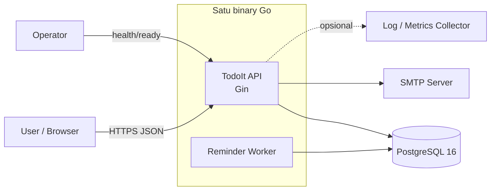
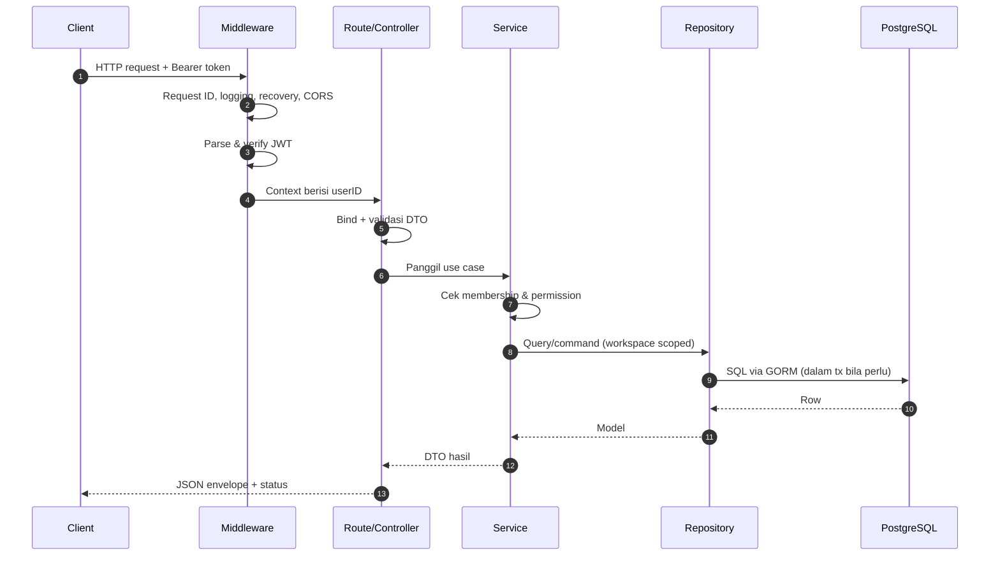
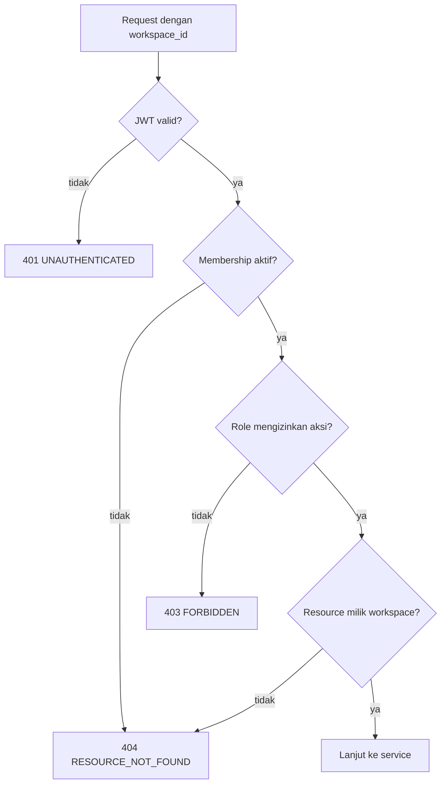
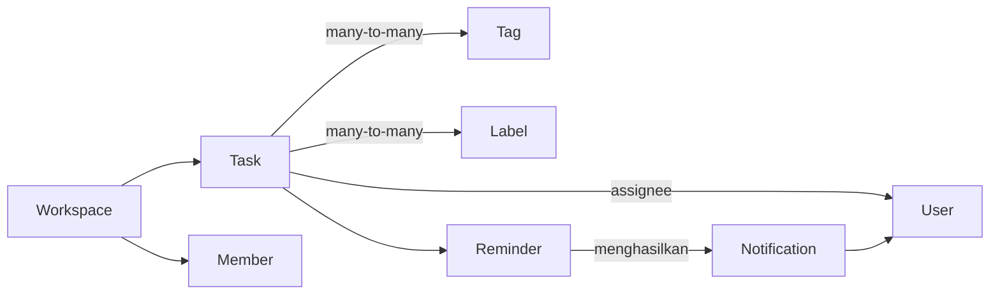

# Arsitektur — Overview

## 1. Tujuan Dokumen

Dokumen ini menjelaskan gambaran besar sistem TodoIt Backend: aktor, batas sistem, prinsip
arsitektur, alur request, dan komponen runtime. Detail per topik ada di dokumen terpisah.

## 2. Konteks Sistem

TodoIt Backend adalah **satu aplikasi HTTP monolitik** yang melayani REST API untuk satu atau
lebih frontend (web/mobile). Aplikasi juga menjalankan **background worker** untuk reminder dan
notifikasi di dalam proses yang sama. Tidak ada message broker wajib, tidak ada service terpisah.

### Aktor

| Aktor | Interaksi |
|---|---|
| Anonymous user | Register, login, accept invitation (butuh token) |
| Authenticated user | Semua operasi dalam workspace tempat ia menjadi member |
| Workspace OWNER | Kontrol penuh workspace, termasuk hapus workspace |
| Workspace ADMIN | Kelola anggota, task, tag, label |
| Workspace MEMBER | Kelola task, tag, label sesuai matrix |
| Operator/SRE | Health check, migrasi, observability, deployment |
| SMTP server | Mengirim email undangan dan notifikasi opsional |

## 3. Ruang Lingkup (Scope)

### Termasuk

- Autentikasi JWT + refresh token rotation.
- Manajemen profil user.
- Workspace, membership, dan invitation berbasis email.
- Task dengan status, priority, due date, assignee.
- Tag dan label per workspace.
- Reminder terjadwal dan notifikasi in-app.
- Cursor pagination, filter, view Today/Upcoming/Overdue.
- Structured logging, health/readiness, graceful shutdown.
- Docker image production dan compose development.

### Tidak termasuk (Phase 0)

- Realtime push (WebSocket/SSE). Notifikasi diambil lewat polling REST.
- Attachment/file upload.
- Subtask, recurring task, dependency antar task.
- Multi-tenant billing/plan.
- Microservices, message queue eksternal, event sourcing.
- Search full-text lanjutan (disediakan sebagai filter `q` opsional, bukan fitur utama).

Fitur yang tidak termasuk tidak dirancang agar tidak menimbulkan ekspektasi kontrak API yang
tidak disepakati. Jika dibutuhkan, harus melalui perubahan requirement.

## 4. Prinsip Arsitektur

1. **Modular Monolith, bukan Clean Architecture.** Setiap module adalah paket Go berisi
   `controllers/routes/services/repositories/models/dto`. Tidak ada layer
   `domain/application/infrastructure/presentation` terpisah.
2. **Satu sumber kebenaran otorisasi di backend.** ID workspace dari URL tidak pernah
   dipercaya sebagai bukti akses; membership selalu dicek di server.
3. **Workspace sebagai batas data.** Hampir semua query operasional memakai
   `workspace_id` sebagai filter pertama. Integritas scope dijaga di service **dan** database.
4. **Database relasional yang ketat.** Foreign key, unique index, dan check constraint dipakai
   secara aktif; validasi aplikasi bukan satu-satunya pengaman.
5. **UTC untuk penyimpanan, timezone user untuk presentasi/perhitungan hari.**
6. **Stateless HTTP layer.** Access token tidak disimpan di server; refresh token disimpan
   sebagai hash sehingga session dapat dicabut.
7. **Idempotensi di titik yang berbahaya.** Worker reminder dan pembuatan notifikasi
   menggunakan unique key idempotensi.
8. **Satu proses, dua peran.** HTTP server dan worker berbagi koneksi pool, config, logger,
   dan lifecycle shutdown.
9. **Dependensi mengarah ke kontrak kecil.** Module tidak mengimpor service module lain;
   komunikasi lewat interface sempit yang dideklarasikan di sisi pemakai dan dirakit di
   composition root (`cmd/api/main.go`).
10. **Sederhana lebih diutamakan.** Abstraksi hanya dibuat jika ada dua implementasi nyata
    (mis. SMTP vs logger adapter, transactor, cursor codec).

## 5. Komponen Runtime

| Komponen | Deskripsi | Lokasi rencana |
|---|---|---|
| HTTP Server | Gin engine, middleware global, route per module | `cmd/api`, `internal/middleware` |
| Router Registry | Setiap module mengekspor `RegisterRoutes(router, deps)` | `internal/*/routes` |
| Service Layer | Business logic + authorization orchestration | `internal/*/services` |
| Repository Layer | Query GORM, transaksi, locking | `internal/*/repositories` |
| Config Loader | Env + `.env`, validasi saat startup | `internal/config` |
| Database | Pool GORM, transactor, health probe, context tx | `internal/database` |
| Worker | Ticker reminder processor + graceful stop | `internal/reminders/services` (runner) |
| Mailer | SMTP sender atau logger adapter | `internal/shared/mailer` |
| Logger | `slog` JSON + request ID | `internal/shared/logging` |
| Error/Response | Envelope & pemetaan error | `internal/shared/errors`, `response` |
| Pagination | Cursor encode/decode + query helper | `internal/shared/pagination` |

Struktur folder final dijelaskan di [`project-structure.md`](project-structure.md).

## 6. Alur Request (High Level)

Aturan penting:

- Controller **tidak** berisi business logic dan tidak mengakses GORM langsung.
- Service **tidak** mengetahui `*gin.Context`; hanya `context.Context` + input DTO.
- Repository **tidak** melakukan otorisasi; ia menerima `workspace_id`/`user_id` yang sudah
  tervalidasi dan tetap memfilter berdasarkan parameter tersebut.
- Middleware hanya melakukan autentikasi (siapa user-nya), bukan otorisasi workspace.
  Otorisasi workspace dilakukan di service karena butuh data membership.

## 7. Alur Authorization (Ringkas)

Keputusan: untuk resource yang tidak boleh diketahui keberadaannya, gunakan **404** agar tidak
membocorkan existence. Untuk aksi yang resource-nya jelas milik workspace yang user ikuti tetapi
role-nya kurang, gunakan **403**. Detail di
[`workspace-authorization.md`](workspace-authorization.md).

## 8. Alur Data Task (Ringkas)

Semua entitas turunan (`tags`, `labels`, `tasks`, `reminders`) membawa `workspace_id`
(reminder mewarisi lewat task) sehingga filter workspace konsisten.

## 9. Non-Functional Requirements

| Aspek | Target Phase 0 |
|---|---|
| Latency baca list | p95 < 300 ms untuk 100k task/workspace dengan index yang dirancang |
| Throughput awal | 100 RPS per instance (skala horizontal) |
| Konsistensi | Read-after-write dalam satu request transaksi |
| Availability | Single instance dev; production minimal 2 replica tanpa worker race |
| Observability | JSON log + request ID + health/ready |
| Keamanan | Password bcrypt, refresh token hashed, RBAC server-side, rate limit login |
| Data retention | Soft delete untuk user/workspace/task; hard delete untuk pivot & tag/label |
| Timezone | IANA tz, DST-safe untuk Today/Upcoming/Overdue |
| Deployment | Image distroless non-root, config via env |

## 10. Keputusan Utama dan Alternatif yang Ditolak

| Keputusan | Alasan | Alternatif ditolak |
|---|---|---|
| Modular monolith satu binary | Kompleksitas operasional rendah, transaksi lintas domain mudah | Microservices (butuh broker, distributed tx) |
| Gin | Familiar, cepat, middleware sederhana, komunitas besar | Echo/Fiber (tidak ada alasan kuat pindah) |
| GORM | Produktivitas CRUD, migrasi via Goose tetap SQL eksplisit | sqlc (lebih rendah level, kurva belajar), raw SQL penuh (verbos) |
| Goose | SQL-first, dapat dikontrol, tidak menyembunyikan DDL | AutoMigrate GORM (tidak aman untuk produksi) |
| JWT access + opaque refresh | Access token stateless; refresh dapat dicabut & dirotasi | Session cookie murni (kurang cocok untuk API lintas client) |
| Cursor pagination | Stabil untuk infinite scroll, tidak lambat di offset besar | Offset pagination (dipakai hanya untuk data kecil non-kritis) |
| Workspace-scoped composite FK | Mencegah tag/label lintas workspace di level DB | Validasi aplikasi saja (bisa bocor jika ada bug) |

## 11. Konflik Requirement yang Ditemukan

| # | Konflik | Rekomendasi |
|---|---|---|
| C1 | Route statis `/tasks/today` vs parameter `/tasks/{task_id}` dapat konflik di router Gin | Pakai `/tasks/views/today`, `/tasks/views/upcoming`, `/tasks/views/overdue`; detail di `api/api-overview.md` |
| C2 | `GET /auth/me` dan `GET /users/me` tumpang tindih | `auth/me` = identitas + session summary; `users/me` = profil lengkap yang dapat di-update |
| C3 | Token undangan di path `{token}` berpotensi tercatat di access log | Terima token di body pada `POST /invitations/accept`; path dipertahankan sebagai alias opsional |
| C4 | Requirement "Workspace Membership" dan "Invitation" tidak menyebut endpoint decline/resend | Tidak diimplementasikan di Phase 3 kecuali disetujui; hanya accept & cancel |
| C5 | Baseline task tidak punya kolom urutan manual | Tidak menambahkan `position`; sorting berbasis `created_at`/`due_at` |

Detail keputusan ada pada masing-masing dokumen terkait.
