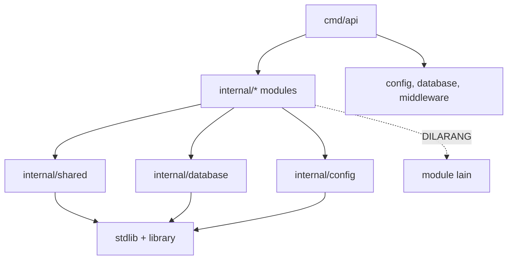

# Arsitektur — Project Structure

## 1. Prinsip Penyusunan Struktur

1. **Feature-first, bukan layer-first.** Folder utama adalah module bisnis, bukan `handlers/`,
   `services/` global.
2. **Standar 6 folder per module.** `controllers/`, `routes/`, `services/`, `repositories/`,
   `models/`, `dto/`. Tidak menambah folder jika isinya hanya 1 file dan tidak punya makna
   tersendiri.
3. **Infrastruktur global minimal.** `config/`, `database/`, `middleware/`, `shared/`.
4. **Entrypoint tipis.** `cmd/api/main.go` hanya memuat config, merakit dependency, menjalankan
   server + worker, dan shutdown.
5. **Dokumentasi dan migrasi terpisah dari kode.** `docs/`, `migrations/`, `tests/`, `scripts/`.

## 2. Struktur Final yang Direkomendasikan

```text
backend/
│
├── cmd/
│   └── api/
│       └── main.go
│
├── internal/
│   ├── config/
│   │   ├── config.go
│   │   └── env.go
│   ├── database/
│   │   ├── postgres.go
│   │   ├── transactor.go
│   │   ├── context.go
│   │   └── health.go
│   ├── middleware/
│   │   ├── request_id.go
│   │   ├── logger.go
│   │   ├── recovery.go
│   │   ├── cors.go
│   │   ├── auth.go
│   │   └── rate_limit.go
│   │
│   ├── shared/
│   │   ├── errors/
│   │   │   ├── app_error.go
│   │   │   └── codes.go
│   │   ├── response/
│   │   │   └── response.go
│   │   ├── pagination/
│   │   │   ├── cursor.go
│   │   │   └── params.go
│   │   ├── validator/
│   │   │   └── validator.go
│   │   ├── logging/
│   │   │   └── logger.go
│   │   ├── mailer/
│   │   │   ├── mailer.go
│   │   │   ├── smtp.go
│   │   │   └── logger.go
│   │   └── utils/
│   │       ├── uuid.go
│   │       ├── time.go
│   │       └── strings.go
│   │
│   ├── auth/
│   │   ├── controllers/
│   │   ├── routes/
│   │   ├── services/
│   │   ├── repositories/
│   │   ├── models/
│   │   └── dto/
│   ├── users/
│   │   └── (6 folder standar)
│   ├── workspaces/
│   │   └── (6 folder standar + services/access_adapter.go)
│   ├── tasks/
│   │   └── (6 folder standar + services/authorization.go)
│   ├── tags/
│   ├── labels/
│   ├── reminders/
│   └── notifications/
│
├── migrations/
│   ├── 00001_create_users.sql
│   ├── 00002_create_user_sessions.sql
│   ├── 00003_create_workspaces.sql
│   ├── 00004_create_workspace_members.sql
│   ├── 00005_create_workspace_invitations.sql
│   ├── 00006_create_tasks.sql
│   ├── 00007_create_tags.sql
│   ├── 00008_create_labels.sql
│   ├── 00009_create_task_tags.sql
│   ├── 00010_create_task_labels.sql
│   ├── 00011_create_reminders.sql
│   ├── 00012_create_notifications.sql
│   └── 00013_indexes_and_hardening.sql
│
├── docs/
│   ├── architecture/
│   ├── database/
│   ├── api/
│   ├── development/
│   ├── deployment/
│   └── openapi/            (diisi Phase 7)
│
├── tests/
│   ├── integration/
│   ├── fixtures/
│   └── unit/               (unit test boleh di sebelah file; folder ini untuk lintas module)
│
├── scripts/
│   ├── migrate.sh
│   ├── seed.sh
│   └── wait-for-db.sh
│
├── .env.example
├── .env.development
├── .env.test
├── .env.staging.example
├── .env.production.example
├── .gitignore
├── Dockerfile
├── docker-compose.yml
├── docker-compose.dev.yml
├── docker-compose.prod.yml
├── .dockerignore
├── go.mod
├── go.sum
└── README.md
```

Catatan: file `.go` di atas adalah rencana nama file, bukan file yang dibuat pada Phase 0.
`go.mod`, `go.sum`, `Dockerfile`, dan compose **belum ada** dan baru dibuat Phase 1.

## 3. Alasan Perubahan dari Struktur Acuan

Struktur acuan pada requirement hampir seluruhnya dipertahankan. Perubahan kecil:

| Perubahan | Alasan |
|---|---|
| `docs/openapi/` tidak dibuat sekarang | Baru relevan Phase 7; folder kosong tidak menambah nilai |
| `tests/unit/` ditambahkan di samping `tests/integration/` | Unit test lintas module (arsitektur, config, cursor) tidak cocok di `integration/` |
| `shared/logging/` dan `shared/mailer/` ditambahkan | Dibutuhkan semua module; menaruhnya di `utils/` akan mengaburkan tanggung jawab |
| `internal/database/context.go` dan `transactor.go` | Menjaga transaksi lintas repository tanpa Clean Architecture |
| `migrations/00013_indexes_and_hardening.sql` | Index non-FK, partial index, dan constraint tambahan dipisah agar mudah dibaca |
| `workspaces/services/access_adapter.go` | Implementasi port `WorkspaceAccess` untuk module lain |
| `internal/tags/catalog.go`, `internal/labels/catalog.go` | Implementasi port katalog untuk `tasks` |

Tidak ada folder `entities/`, `usecases/`, `ports/`, `infrastructure/`, `presentation/`.
Penambahan tersebut akan mendorong gaya Clean Architecture yang secara eksplisit tidak dipakai.

## 4. Fungsi Folder dan File Penting

### 4.1 `cmd/api/main.go`

- Memuat config dan logger.
- Membuka koneksi database, menjalankan ping.
- Merakit seluruh repository → service → controller (composition root).
- Mendaftarkan route ke router.
- Menjalankan HTTP server dan worker.
- Menangani graceful shutdown (`SIGINT`, `SIGTERM`) dengan timeout.

Tidak berisi business logic, query, atau definisi route individual.

### 4.2 `internal/config`

- `config.go`: struct `Config` dengan sub-struct (`App`, `DB`, `JWT`, `Worker`, `Mail`, `CORS`).
- `env.go`: helper `getEnv`, `getEnvInt`, `getEnvDuration`, `getEnvBool` + validasi wajib.
- Gagal cepat (exit non-zero) jika env wajib tidak ada atau tidak valid.
- Tidak membaca env di package lain; hanya `main.go` yang meneruskan struct config.

### 4.3 `internal/database`

- `postgres.go`: membuka GORM dengan DSN, mengatur pool (`MaxOpenConns`, `MaxIdleConns`,
  `ConnMaxLifetime`), dan `PingContext`.
- `transactor.go`: `WithinTx(ctx, fn)`.
- `context.go`: `WithTx`, `FromContext` untuk mengambil `*gorm.DB` aktif.
- `health.go`: `Ping(ctx)` untuk endpoint `/ready`.

### 4.4 `internal/middleware`

| File | Fungsi |
|---|---|
| `request_id.go` | Membaca/membuat `X-Request-ID`, simpan di context dan response header |
| `logger.go` | Log akses terstruktur (method, path, status, latency, user_id) |
| `recovery.go` | Menangkap panic, log stack, response 500 generik |
| `cors.go` | Allowlist origin dari env; tidak memakai `*` di production bila credentials aktif |
| `auth.go` | Parse `Authorization: Bearer`, verifikasi JWT, set `userID` + `sessionID` di context |
| `rate_limit.go` | Token bucket in-memory untuk login/refresh per IP+identifier |

### 4.5 `internal/shared`

| Folder | Isi | Alasan shared |
|---|---|---|
| `errors` | `AppError{Code, HTTPStatus, Message, Details}`, konstanta kode | Semua module butuh pemetaan error konsisten |
| `response` | `Success`, `Created`, `Error`, `Paginated` | Envelope seragam |
| `pagination` | `CursorCodec` (encode/decode + HMAC), `Params{Limit, Cursor}` | Dipakai tasks, notifications, members, invitations |
| `validator` | Wrapper `go-playground/validator`, translator pesan | Semua DTO |
| `logging` | `slog` handler JSON, redaksi field sensitif | Semua module |
| `mailer` | Interface `Mailer`, implementasi SMTP + logger | Auth (undangan), reminders/notifications (email opsional) |
| `utils` | UUIDv7 generator, konversi waktu, sanitasi string | Tanpa aturan domain |

`shared` tidak boleh mengimpor module mana pun.

### 4.6 Module `auth`

| Path | Isi |
|---|---|
| `controllers/auth_controller.go` | Register, login, refresh, logout, logout-all, me |
| `routes/routes.go` | Group `/auth`, endpoint publik vs terproteksi |
| `services/auth_service.go` | Orkestrasi register/login/refresh/logout |
| `services/token_service.go` | Sign/verify access token, generate & hash refresh token |
| `services/session_service.go` | Buat, rotasi, cabut session |
| `repositories/user_auth_repository.go` | Baca user untuk login (via port `UserLookup`) |
| `repositories/session_repository.go` | CRUD `user_sessions`, revoke, reuse detection |
| `models/user_session.go` | Model `UserSession` |
| `dto/*.go` | `RegisterRequest`, `LoginRequest`, `RefreshRequest`, `TokenResponse`, `MeResponse` |

Catatan: `auth` tidak memiliki model `User`; model `User` milik `users`. Untuk login, `auth`
memakai port `UserLookup` yang disediakan `users` (lihat `module-dependencies.md`).

### 4.7 Module `users`

- `GET/PATCH /users/me`.
- Model `User` (tabel `users`).
- Repository: `FindByID`, `FindByEmail`, `Create`, `UpdateProfile`, `SoftDelete`.
- Port yang diekspor untuk module lain: `UserLookup`, `UserDirectory`, `UserWriter` (dipakai
  `auth`, `workspaces`, `notifications`).
- Validasi timezone IANA saat update profil.

### 4.8 Module `workspaces`

- Workspace CRUD, membership, role management, invitation.
- `services/authorization.go`: permission matrix dan guard.
- `services/access_adapter.go`: implementasi `WorkspaceAccess` untuk module lain.
- `repositories/workspace_repository.go`, `member_repository.go`, `invitation_repository.go`.
- Model: `Workspace`, `WorkspaceMember`, `WorkspaceInvitation`.
- Invitation email memakai `shared/mailer`, dikirim setelah commit (bukan di dalam tx).

### 4.9 Module `tasks`

- CRUD task, complete/reopen, views, filter, cursor.
- `services/task_service.go`: orkestrasi create/update/list.
- `services/authorization.go`: aturan spesifik task (assignee harus member, dsb).
- `services/query_builder.go`: filter + keyset pagination.
- `repositories/task_repository.go`: query list/detail, pivot replace.
- Model: `Task`, `TaskTag`, `TaskLabel`.
- DTO: `CreateTaskRequest`, `UpdateTaskRequest`, `TaskResponse`, `TaskListResponse`,
  `TaskFilter`.

### 4.10 Module `tags` dan `labels`

- CRUD master data per workspace.
- Validasi nama unik per workspace (case-insensitive).
- Menyediakan port katalog (`TagCatalog`, `LabelCatalog`) agar `tasks` dapat memvalidasi ID
  tanpa mengimpor repository.
- Label memiliki validasi format warna `#RRGGBB` (disepakati; lihat database design).

### 4.11 Module `reminders`

- CRUD reminder untuk task.
- Validasi `scheduled_at` di masa depan saat create/update (kecuali status SENT).
- Worker runner (`services/worker.go`) yang memproses reminder jatuh tempo.
- Memakai port `TaskLookup` untuk memastikan task ada dan mengambil assignee/creator.
- Memakai port `Notifier` untuk membuat notifikasi.

### 4.12 Module `notifications`

- `GET /notifications`, mark read, read-all.
- Repository dengan cursor pagination.
- Idempotensi via `dedupe_key` unik.
- Opsional email melalui `shared/mailer` (in-app tetap sumber utama).
- Model: `Notification`.

### 4.13 `migrations/`

- File SQL Goose bernomor 5 digit.
- Satu file per perubahan logis; perubahan besar boleh dipecah (DDL + index).
- Tidak ada `AutoMigrate` di runtime production.

### 4.14 `tests/`

| Folder | Isi |
|---|---|
| `tests/integration` | Test dengan PostgreSQL nyata: auth flow, isolasi workspace, CRUD, pagination, worker |
| `tests/fixtures` | Seeder data uji (user, workspace, task) dengan builder |
| `tests/unit` | Test lintas module: config, cursor codec, architecture import rules |

Unit test untuk service/controller spesifik diletakkan di sebelah file (`*_test.go`) agar mudah
ditemukan.

### 4.15 `scripts/`

- `migrate.sh`: wrapper `goose up/down/status` memakai env.
- `seed.sh`: menjalankan seeder development.
- `wait-for-db.sh`: menunggu PostgreSQL siap di compose.

Script harus `set -euo pipefail` dan tidak menyimpan credential.

### 4.16 Root files

| File | Fungsi | Dibuat |
|---|---|---|
| `go.mod` / `go.sum` | Module Go dan dependency terkunci | Phase 1 |
| `Dockerfile` | Multi-stage build dev/test/prod | Phase 1 |
| `docker-compose.yml` | Base service (api, postgres) | Phase 1 |
| `docker-compose.dev.yml` | Override hot reload + bind mount | Phase 1 |
| `docker-compose.prod.yml` | Override image production, tanpa source mount | Phase 1 |
| `.dockerignore` | Kecualikan `.git`, `.env`, `docs`, `tests`, binary | Phase 1 |
| `.env.example` | Template aman, tanpa secret nyata | Phase 1 |
| `.env.development` | Credential dev (bukan untuk produksi) | Phase 1 |
| `.env.test` | Config test DB terpisah | Phase 1 |
| `.env.staging.example` | Placeholder staging | Phase 1 |
| `.env.production.example` | Placeholder production | Phase 1 |
| `.gitignore` | Abaikan `.env` nyata, binary, coverage | Phase 1 |

## 5. Dependency Rules Ringkas



- `internal/shared` tidak boleh mengimpor `internal/auth`, `internal/tasks`, dst.
- `internal/database` tidak boleh mengimpor module.
- `internal/middleware/auth.go` boleh mengimpor `auth/services` **hanya** untuk verifier token
  (satu arah, tidak ada balik). Alternatif yang lebih bersih: definisikan `TokenVerifier`
  interface di `middleware` dan implementasi di `auth`. **Keputusan:** gunakan interface
  `TokenVerifier` agar middleware tidak bergantung pada implementasi auth.
- `tests/unit/architecture_test.go` memverifikasi aturan ini.

## 6. Ukuran dan Batas File

- Controller: maksimal ~150 baris; jika lebih, pecah per resource.
- Service: boleh lebih besar, tetapi pisahkan query/filter ke file sendiri.
- Repository: satu file per agregat; hindari "god repository".
- DTO: satu file per resource (`task_dto.go`), bukan satu file per struct.
- Tidak ada file `utils.go` raksasa; gunakan nama spesifik.

## 7. Struktur yang Sengaja Tidak Dibuat

| Struktur | Alasan tidak dibuat |
|---|---|
| `pkg/` publik | Tidak ada konsumen eksternal; semua kode internal |
| `api/` untuk protobuf | Hanya REST JSON |
| `internal/domain` global | Akan mendorong anemic domain + Clean Architecture |
| `internal/events` | Tidak ada event bus di Phase 0 |
| `internal/jobs` terpisah | Worker reminder cukup di module `reminders` |
| Folder per layer global (`handlers/`, `services/`) | Melanggar feature-first dan menyulitkan isolasi module |
| `vendor/` | Belum diputuskan; default tanpa vendor, module cache di Docker layer |

## 8. Checklist Struktur

- [x] Setiap module punya 6 folder standar.
- [x] Tidak ada layer Clean Architecture.
- [x] Entry point tunggal.
- [x] Folder docs lengkap sesuai requirement.
- [x] Folder migrations dan tests tersedia dalam rencana.
- [x] Tidak membuat folder kosong yang tidak dipakai.
- [x] Semua file root yang diminta tercantum dengan waktu pembuatannya.
