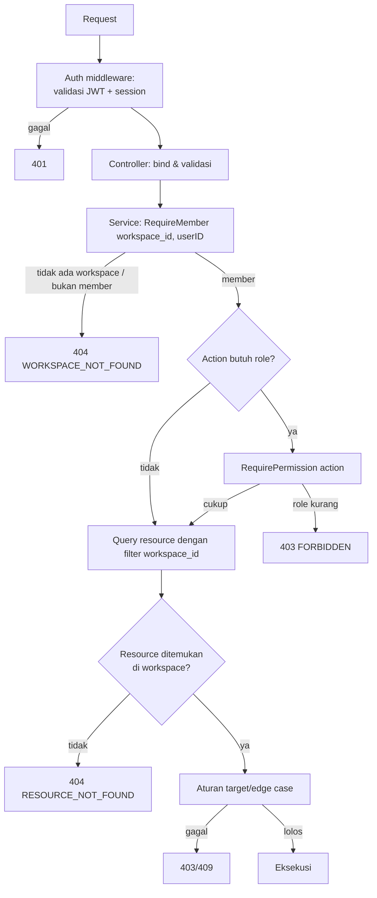

# Arsitektur — Workspace Authorization

## 1. Prinsip

1. **Setiap akses data workspace harus melewati pengecekan membership di server.**
2. **ID dari client bukan bukti otorisasi.** `workspace_id`, `task_id`, `tag_id` hanya
   digunakan setelah membership diverifikasi, dan query tetap memfilter `workspace_id`.
3. **Least privilege.** Role default saat join adalah `MEMBER`.
4. **Owner adalah entitas khusus.** Tidak dapat dihapus/diturunkan lewat endpoint biasa.
5. **Tidak ada eskalasi role.** Role hanya dapat dinaikkan oleh pihak yang berwenang, dan
   tidak pernah melebihi role pemberi.
6. **Konsisten di semua module.** Task, tag, label, reminder memakai `WorkspaceAccess` yang
   sama.

## 2. Role

| Role | Deskripsi |
|---|---|
| `OWNER` | Pemilik workspace. Tepat satu per workspace. Kontrol penuh. |
| `ADMIN` | Pengelola operasional. Dapat mengelola member (kecuali owner/admin lain) dan konten. |
| `MEMBER` | Pengguna biasa. Dapat mengelola task, tag, label, reminder. |

Role disimpan di `workspace_members.role` dengan check constraint
`role IN ('OWNER','ADMIN','MEMBER')`.

Tidak ada role `VIEWER` pada Phase 0. Jika nanti dibutuhkan (read-only), tambahkan role baru
dan perbarui matrix.

## 3. Permission Matrix

Legend: ✅ diizinkan; ❌ ditolak (403); — tidak berlaku.

### 3.1 Workspace

| Permission | OWNER | ADMIN | MEMBER | Catatan |
|---|---|---|---|---|
| Read workspace | ✅ | ✅ | ✅ | Member saja; non-member → 404 |
| Update workspace (name, description) | ✅ | ✅ | ❌ | |
| Delete workspace | ✅ | ❌ | ❌ | Soft delete |
| Transfer ownership | ❌ | ❌ | ❌ | Tidak diimplementasikan Phase 0 |

### 3.2 Membership

| Permission | OWNER | ADMIN | MEMBER | Catatan |
|---|---|---|---|---|
| List members | ✅ | ✅ | ✅ | |
| Invite MEMBER | ✅ | ✅ | ❌ | |
| Invite ADMIN | ✅ | ❌ | ❌ | Cegah eskalasi |
| Cancel invitation | ✅ | ✅ | ❌ | Hanya PENDING |
| Accept invitation | — | — | — | Berdasarkan email undangan, bukan role |
| Remove MEMBER | ✅ | ✅ | ❌ | |
| Remove ADMIN | ✅ | ❌ | ❌ | Admin tidak boleh menghapus admin lain |
| Remove self (leave) | ❌ | ✅ | ✅ | Owner harus transfer/delete workspace |
| Update MEMBER → ADMIN | ✅ | ✅ | ❌ | |
| Update ADMIN → MEMBER | ✅ | ❌ | ❌ | |
| Update role → OWNER | ❌ | ❌ | ❌ | Tidak ada endpoint |
| Update role OWNER | ❌ | ❌ | ❌ | Owner tidak dapat diturunkan |

### 3.3 Task

| Permission | OWNER | ADMIN | MEMBER | Catatan |
|---|---|---|---|---|
| Create task | ✅ | ✅ | ✅ | |
| Read/list task | ✅ | ✅ | ✅ | |
| Update task | ✅ | ✅ | ✅ | Termasuk assignee, due date, tag, label |
| Delete task | ✅ | ✅ | ✅ | Soft delete |
| Complete/reopen | ✅ | ✅ | ✅ | |
| View Today/Upcoming/Overdue | ✅ | ✅ | ✅ | |

### 3.4 Tag & Label

| Permission | OWNER | ADMIN | MEMBER |
|---|---|---|---|
| Create/Read/Update/Delete tag | ✅ | ✅ | ✅ |
| Create/Read/Update/Delete label | ✅ | ✅ | ✅ |

### 3.5 Reminder

| Permission | OWNER | ADMIN | MEMBER |
|---|---|---|---|
| Create/list/update/delete reminder | ✅ | ✅ | ✅ |

### 3.6 Notification

Notifikasi bersifat personal, bukan workspace permission. Setiap user hanya dapat mengakses
notifikasinya sendiri, apa pun role-nya di workspace.

## 4. Matriks Aksi → Role Minimum

Dipakai oleh `RequirePermission`:

| Action | Minimum role | Catatan |
|---|---|---|
| `workspace:read` | MEMBER | |
| `workspace:update` | ADMIN | |
| `workspace:delete` | OWNER | |
| `member:list` | MEMBER | |
| `invitation:create` | ADMIN | Role target divalidasi terpisah |
| `invitation:cancel` | ADMIN | |
| `invitation:list` | MEMBER | |
| `member:remove` | ADMIN | Aturan target dicek terpisah |
| `member:update_role` | ADMIN | Aturan target dicek terpisah |
| `task:write` | MEMBER | Create/update/delete/complete |
| `tag:write` | MEMBER | |
| `label:write` | MEMBER | |
| `reminder:write` | MEMBER | |

Role minimum bukan satu-satunya aturan. Ada **aturan target** yang harus dicek terpisah:

```text
remove_member(actor, target):
  if target.role == OWNER -> 409 OWNER_PROTECTED
  if actor.role == ADMIN and target.role == ADMIN -> 403 FORBIDDEN
  if actor.role == ADMIN and target.role == MEMBER -> allowed
  if actor.role == OWNER -> allowed (kecuali target OWNER)
  if actor == target -> allowed (leave), kecuali OWNER

update_role(actor, target, new_role):
  if new_role == OWNER -> 403 FORBIDDEN (tidak ada transfer via endpoint ini)
  if target.role == OWNER -> 409 OWNER_PROTECTED
  if actor.role == ADMIN and target.role == ADMIN -> 403
  if actor.role == ADMIN and new_role == ADMIN and actor != target -> allowed?
      -> Keputusan: ADMIN boleh mengangkat MEMBER menjadi ADMIN.
      -> ADMIN tidak boleh menurunkan ADMIN lain (termasuk diri sendiri).
  if actor.role == OWNER -> allowed (MEMBER<->ADMIN)
```

## 5. Alur Otorisasi Request



### Mengapa 404 untuk non-member?

Jika user bukan member dan kita mengembalikan 403, penyerang dapat memverifikasi keberadaan
workspace berdasarkan ID. Dengan 404, tidak ada informasi yang bocor. Untuk member dengan role
kurang, 403 tepat karena user sudah mengetahui keberadaan workspace.

## 6. Implementasi Guard

### 6.1 Port `WorkspaceAccess`

```go
type Action string

const (
    ActionWorkspaceRead        Action = "workspace:read"
    ActionWorkspaceUpdate      Action = "workspace:update"
    ActionWorkspaceDelete      Action = "workspace:delete"
    ActionMemberList           Action = "member:list"
    ActionInvitationCreate     Action = "invitation:create"
    ActionInvitationCancel     Action = "invitation:cancel"
    ActionMemberRemove         Action = "member:remove"
    ActionMemberUpdateRole     Action = "member:update_role"
    ActionTaskWrite            Action = "task:write"
    ActionTagWrite             Action = "tag:write"
    ActionLabelWrite           Action = "label:write"
    ActionReminderWrite        Action = "reminder:write"
)

type WorkspaceAccess interface {
    RequireMember(ctx context.Context, workspaceID, userID uuid.UUID) (Role, error)
    RequirePermission(ctx context.Context, workspaceID, userID uuid.UUID, action Action) error
    MemberIDs(ctx context.Context, workspaceID uuid.UUID) ([]uuid.UUID, error)
}
```

### 6.2 Implementasi

`internal/workspaces/services/access_adapter.go`:

1. Query `workspace_members` + `workspaces` (pastikan workspace tidak soft-deleted).
2. Jika workspace tidak ada/terhapus → `ErrWorkspaceNotFound`.
3. Jika membership tidak ada → `ErrNotMember`.
4. Bandingkan role dengan minimum role untuk action.
5. Untuk action yang butuh aturan target, service pemanggil melakukan pengecekan tambahan.

Query contoh:

```sql
SELECT wm.role
FROM workspace_members wm
JOIN workspaces w ON w.id = wm.workspace_id
WHERE wm.workspace_id = $1
  AND wm.user_id = $2
  AND w.deleted_at IS NULL;
```

Index pendukung: `workspace_members(workspace_id, user_id)` unique. Query ini O(1).

### 6.3 Service Task

```go
func (s *Service) Get(ctx context.Context, userID, wsID, taskID uuid.UUID) (*Task, error) {
    if _, err := s.access.RequireMember(ctx, wsID, userID); err != nil {
        return nil, err
    }
    task, err := s.repo.FindByID(ctx, wsID, taskID) // WAJIB dua parameter
    if err != nil {
        return nil, err
    }
    return task, nil
}
```

Perhatikan `FindByID(ctx, wsID, taskID)` — bukan `FindByID(ctx, taskID)`. Ini pertahanan
berlapis: meskipun guard terlewat, query tidak akan mengembalikan task dari workspace lain.

## 7. Workspace Scope pada Setiap Module

| Module | Filter wajib | Bukti |
|---|---|---|
| `workspaces` | `workspaces.id = ? AND deleted_at IS NULL` | Workspace |
| membership | `workspace_id = ? AND user_id = ?` | Member |
| invitation | `workspace_id = ? AND id = ?` | Undangan |
| `tasks` | `workspace_id = ? AND id = ? AND deleted_at IS NULL` | Task |
| `tags` | `workspace_id = ? AND id = ?` | Tag |
| `labels` | `workspace_id = ? AND id = ?` | Label |
| `reminders` | `workspace_id = ? AND task_id = ? AND id = ?` | Reminder |
| `notifications` | `user_id = ?` (bukan workspace) | Notifikasi |

Database juga menegakkan scope untuk relasi many-to-many lewat composite FK
(`task_tags(task_id, workspace_id) → tasks(id, workspace_id)`), sehingga tag dari workspace
lain secara fisik tidak dapat dipasang. Detail di
[`../database/database-design.md`](../database/database-design.md).

## 8. Pencegahan IDOR

| Vektor | Mitigasi |
|---|---|
| Ganti `workspace_id` di path | `RequireMember` + filter query |
| Ganti `task_id` di path | Query dengan `workspace_id` + `id` |
| Kirim `tag_ids`/`label_ids` dari workspace lain | Validasi katalog + composite FK |
| Kirim `assignee_id` user di luar workspace | Cek `MemberIDs` |
| Kirim `user_id` di body untuk member action | Body hanya berisi `role`; target dari path dan diverifikasi |
| Akses notifikasi user lain | Filter `user_id` dari token |
| Ubah role diri sendiri menjadi OWNER | Ditolak eksplisit |
| Hapus owner | Ditolak eksplisit |

## 9. Owner Protection

Aturan:

1. Tepat satu OWNER per workspace, dijaga partial unique index.
2. OWNER tidak dapat dihapus lewat `DELETE /members/{user_id}`.
3. OWNER tidak dapat diturunkan role-nya.
4. OWNER tidak dapat meninggalkan workspace (leave) tanpa menghapus workspace.
5. Jika OWNER menghapus workspace, workspace di-soft-delete; membership tetap tersimpan.
6. Transfer ownership tidak termasuk Phase 0. Jika dibutuhkan, endpoint khusus
   `POST /workspaces/{id}/transfer-ownership` harus ditambahkan dengan aturan: hanya OWNER,
   target harus member, dan operasi atomik (turunkan owner lama → naikkan target) dengan
   penanganan unique constraint.

Mengapa tidak mengizinkan admin menghapus owner: mencegah pengambilalihan workspace.

## 10. Role Escalation Prevention

| Skenario | Hasil |
|---|---|
| MEMBER memanggil update role | 403 |
| ADMIN mengangkat dirinya menjadi OWNER | 403 |
| ADMIN mengangkat member lain menjadi OWNER | 403 |
| ADMIN mengundang ADMIN | 403 |
| ADMIN menurunkan ADMIN lain | 403 |
| ADMIN menghapus ADMIN lain | 403 |
| OWNER menurunkan dirinya sendiri | 409 |
| OWNER mengundang OWNER | 422 (role target hanya ADMIN/MEMBER) |
| User mengubah `owner_id` lewat PATCH workspace | Field tidak ada di DTO → diabaikan/ditolak |

DTO update workspace hanya memiliki `name` dan `description`. Tidak ada field `owner_id`,
`role`, atau `workspace_id` yang dapat diubah client.

## 11. Authorization pada Invitation Accept

Accept invitation tidak memakai `RequireMember` karena user belum menjadi member. Aturannya:

1. User harus terautentikasi.
2. Token harus valid dan belum expired.
3. Email user (dari token auth) harus sama persis (case-insensitive) dengan `email` undangan.
4. Role diambil dari undangan, bukan dari body.
5. Jika sudah member, tolak (409) — tidak menimpa role yang ada.

Ini mencegah user menerima undangan yang ditujukan ke email orang lain meskipun token bocor
(dalam skenario token bocor, penyerang tetap harus login sebagai email tersebut).

## 12. Authorization pada Notifikasi

- `GET /notifications` tidak memakai workspace guard; filter `user_id = auth.user_id`.
- Jika `workspace_id` dikirim sebagai filter, tetap tidak menambah akses; hanya mempersempit.
- `PATCH /notifications/{id}/read` memakai `id AND user_id`; jika tidak cocok → 404.
- `POST /notifications/read-all` memakai `user_id`; `workspace_id` opsional.

## 13. Testing Authorization (Wajib)

Setiap test matrix minimal mencakup:

| Test | Ekspektasi |
|---|---|
| Non-member GET workspace | 404 |
| Member GET workspace | 200 |
| MEMBER PATCH workspace | 403 |
| ADMIN PATCH workspace | 200 |
| ADMIN DELETE workspace | 403 |
| OWNER DELETE workspace | 204 |
| MEMBER invite | 403 |
| ADMIN invite MEMBER | 201 |
| ADMIN invite ADMIN | 403 |
| ADMIN remove ADMIN | 403 |
| ADMIN remove MEMBER | 204 |
| ADMIN remove OWNER | 409 |
| OWNER remove self | 409 |
| ADMIN update self to OWNER | 403 |
| Task dari workspace lain | 404 |
| Tag workspace lain pada task | 422 |
| Assignee non-member | 422 |
| Notifikasi user lain | 404 |

Test ini berada di `tests/integration/authorization_test.go` (Phase 3/4).

## 14. Keputusan dan Trade-off

| Keputusan | Alasan | Alternatif ditolak |
|---|---|---|
| Satu OWNER per workspace | Model kepemilikan sederhana, menghindari konflik | Multi-owner (butuh aturan tambahan) |
| Tidak ada transfer ownership di Phase 0 | Tidak diminta; menambah kompleksitas transaksi | Implementasi transfer sekarang |
| ADMIN tidak dapat mengelola ADMIN | Mencegah perang admin | ADMIN setara OWNER (terlalu luas) |
| Semua member dapat mengelola semua task | Kolaborasi sederhana | Per-task permission (belum dibutuhkan) |
| 404 untuk non-member | Mencegah enumerasi workspace | 403 (membocorkan existence) |
| Pengecekan role real-time | Perubahan role langsung berlaku | Role di JWT (tertunda) |
