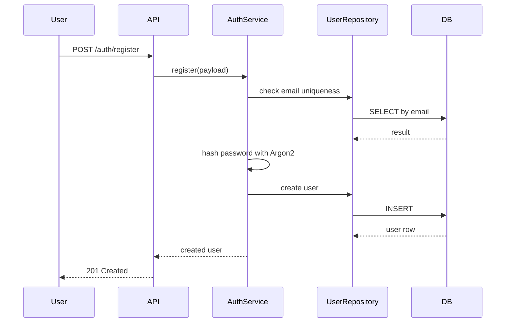

# Authentication Design

## Overview

Authentication is built around secure user sessions and JWT-based access control. The design supports access tokens, refresh tokens, token rotation, revocation, logout, and replay protection without storing raw refresh tokens in the database.

## Registration flow

Requirements:
- email must be unique
- password must be hashed before persistence
- timezone must be validated against IANA names if possible
- account status defaults to active

## Login flow

1. User submits email and password.
2. API authenticates user against stored Argon2 hash.
3. If valid, it creates a new access token and refresh token pair.
4. Refresh token is stored as a hash in `RefreshSession` and issued via secure transport.
5. Response includes access token and refresh token metadata.

## JWT design

### Access token
- Type: access
- Default TTL: 15 minutes
- Claims include user id, token type, session id or family id, expiration, and issuer metadata
- Used for protected API requests

### Refresh token
- Type: refresh
- Default TTL: 7 days
- Used only for issuing a new access token
- Stored only as hash in PostgreSQL
- Must include a unique token family value for rotation

## Refresh rotation

The refresh flow is:

1. Client presents refresh token.
2. API validates token signature and token type.
3. The system hashes the incoming token and searches for a matching active refresh session.
4. If the session is valid and not revoked, the server issues a new refresh token and marks the current one as replaced.
5. The old refresh token becomes invalid immediately.

This prevents indefinite reuse of a single refresh token and reduces replay risk.

## Replay prevention

A replay attack is blocked by checking:
- token family validity
- revocation state
- replacement chain
- expiration state

If a refresh token is used after it has been rotated or revoked, the system rejects it with a `401` or `403` and invalidates the session family.

## Logout and logout-all

### Logout
- Revokes the current session.
- Invalidates the active refresh record.
- Access token may remain valid until expiry, but protected routes will be rejected if token claims no longer map to valid active sessions.

### Logout-all
- Revokes all active refresh sessions for the current user.
- This protects against full-session compromise.

## Cookie and CSRF strategy

Recommended transport:
- Store refresh token in an `HttpOnly` secure cookie.
- Set `SameSite=Lax` or `Strict` depending on frontend architecture.
- Use `Secure` in production and `Secure` + `SameSite=None` only when cross-site is required.

CSRF:
- If refresh token is stored in cookie only, protect the refresh endpoint with CSRF validation for browser-based requests.
- Prefer a same-site SPA flow or rotate tokens via a backend endpoint that verifies the origin and CSRF token.

## Token type confusion defense

The JWT payload must include an explicit `token_type` claim (`access` or `refresh`).

Validation must enforce:
- access token accepted only on access endpoints
- refresh token accepted only on refresh endpoints
- reject mismatched token types even when otherwise valid

## Session lifecycle

- User registers; a user row is created.
- User logs in; refresh session is inserted with hashed token.
- User refreshes token; old record is replaced.
- User logs out; selected session or all sessions become invalid.
- Expired tokens are garbage-collected and not treated as active resources.

## Security decisions

- Do not store raw refresh tokens in the DB.
- Use constant-time comparisons for hash validation.
- Use a secure secret for JWT signing and environment-configured expiration values.
- Keep token algorithms explicit and validated.
- Reject stale or malformed tokens before business logic execution.
