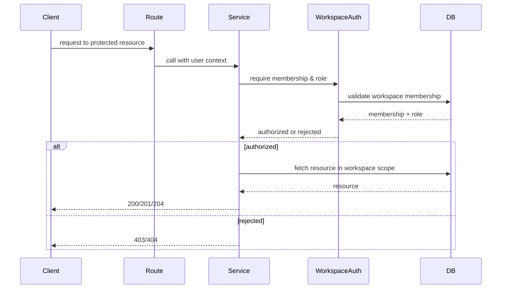

# Authorization Design

## Core principle

Authorization for this application is workspace-centric. A user is only allowed to access a workspace if they are a valid member of that workspace and their role grants the required permission. This prevents access violations and reduces IDOR exposure.

## Workspace roles

- `owner`
- `admin`
- `member`

## Permission matrix

| Action | Owner | Admin | Member |
|---|---|---|---|
| Read workspace | Yes | Yes | Yes |
| Update workspace | Yes | Yes | No |
| Archive workspace | Yes | No | No |
| Invite member | Yes | Yes | No |
| Revoke invitation | Yes | Yes | No |
| Accept invitation | Yes (if invited) | Yes (if invited) | Yes (if invited) |
| Remove member | Yes | Yes | No |
| Update member role | Yes | Yes, limited | No |
| Create Todo | Yes | Yes | Yes |
| Update Todo | Yes | Yes | Yes, if allowed by policy |
| Delete Todo | Yes | Yes | Yes, if allowed by policy |
| Manage Tag | Yes | Yes | No |
| Manage Label | Yes | Yes | No |
| Read notifications | Yes | Yes | Yes |

## Ownership rules

- Owner cannot be removed by the regular member-management path.
- Admin cannot transfer ownership to themselves or another user through the admin route.
- Workspace must always have a valid owner.
- A user who is not a workspace member cannot access any workspace resource.

## Resource ownership patterns

Resource access checks should be performed in this order:

1. User is authenticated.
2. User has valid workspace membership.
3. User has the required role/permission.
4. Resource is checked for belonging to the same workspace.
5. Special permissions are evaluated, such as owner-only actions.

This pattern prevents cross-workspace access and IDOR issues.

## Cross-workspace protection

Every resource access must ensure:

- `workspace_id` belongs to the authenticated user’s accessible workspaces
- Todo belongs to the same workspace as the route context
- Notification belongs to the current user
- Reminder belongs to a Todo in the current user’s accessible workspace
- Tag/Label belongs to the same workspace in context

## IDOR prevention strategy

The backend must never trust client-provided IDs alone. It should enforce checks such as:

- user id in path must match current user for personal resources
- workspace membership must be resolved from the authenticated identity
- object existence is checked in the same workspace scope
- forbidden contexts return `403` instead of leaking data

## Invitation permissions

- Admins can invite members when the business policy allows it.
- Members cannot create invitations.
- Invitation acceptance must validate that the invite email matches the authenticated user.
- The invitation must have non-expired, accepted/revoked state rules.

## Permission checks and service reuse

Shared logic should be centralized in a common authorization helper or workspace service dependency, for example:

- `require_workspace_access(workspace_id, user)`
- `require_workspace_permission(workspace_id, user, ["owner", "admin"])`
- `require_member_or_owner(workspace_id, user)`

This keeps logic consistent across Todo, Tag, Label, Reminder, and Notification modules.

## Authorization flow diagram

## Recommended authorization behavior

- Use `403` for forbidden access to a valid resource.
- Use `404` when the resource is not found or not visible within the current scope.
- Avoid leaking membership existence or hidden resource existence to unauthorized users.
- Keep authorization logic in service layer and not route layer.
