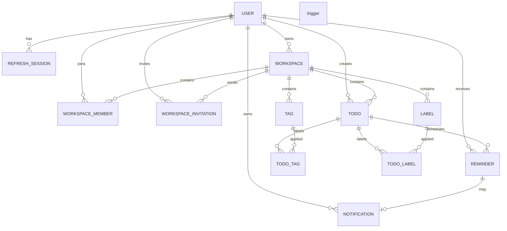

# Database Design

## Core design principle

The database is PostgreSQL and the schema is designed for relational integrity, concurrency safety, and predictable access patterns. The project uses UUID primary keys, timezone-aware timestamps in UTC, and explicit constraints around membership, invitations, filters, and reminders.

## Entity list

- User
- RefreshSession
- Workspace
- WorkspaceMember
- WorkspaceInvitation
- Todo
- Tag
- Label
- TodoTag
- TodoLabel
- Reminder
- Notification

## Entity analysis

### User

Purpose:
- Root user identity and account metadata.

Fields:
- `id` UUID PK
- `email` VARCHAR(255) unique not null
- `password_hash` VARCHAR(255) not null
- `full_name` VARCHAR(255) not null
- `timezone` VARCHAR(64) not null default `UTC`
- `status` VARCHAR(32) not null default `active`
- `created_at` TIMESTAMPTZ not null
- `updated_at` TIMESTAMPTZ not null

Constraints:
- unique email
- check status in (`active`, `inactive`, `suspended`, `deleted`)

Indexes:
- unique index on `email`
- index on `status`

Relationships:
- one-to-many with RefreshSession
- one-to-many with Workspace as owner
- one-to-many with WorkspaceMember
- one-to-many with WorkspaceInvitation as inviter
- one-to-many with Todo as creator
- one-to-many with Reminder
- one-to-many with Notification

### RefreshSession

Purpose:
- Track refresh-token metadata with rotation and revocation support.

Fields:
- `id` UUID PK
- `user_id` UUID FK -> User.id
- `token_family` UUID not null
- `token_hash` VARCHAR(255) not null
- `expires_at` TIMESTAMPTZ not null
- `revoked_at` TIMESTAMPTZ nullable
- `replaced_by` UUID nullable FK -> RefreshSession.id
- `created_at` TIMESTAMPTZ not null
- `updated_at` TIMESTAMPTZ not null

Constraints:
- token_hash unique per active session family
- expires_at > created_at
- check token family not null

Indexes:
- index on `user_id`, `expires_at`
- index on `token_family`
- index on `revoked_at`

Behavior:
- Raw refresh token is never stored.
- Replay detection uses family and revocation checks.

### Workspace

Purpose:
- Collaborative container for Todo resources and membership.

Fields:
- `id` UUID PK
- `name` VARCHAR(255) not null
- `description` TEXT nullable
- `owner_id` UUID FK -> User.id not null
- `is_archived` BOOLEAN default false
- `created_at` TIMESTAMPTZ not null
- `updated_at` TIMESTAMPTZ not null

Constraints:
- check `name` not empty
- owner must exist

Indexes:
- index on `owner_id`
- index on `is_archived`
- full-text or trigram optional later for search if needed

Relationships:
- many-to-one with User as owner
- one-to-many with WorkspaceMember
- one-to-many with WorkspaceInvitation
- one-to-many with Todo
- one-to-many with Tag
- one-to-many with Label

### WorkspaceMember

Purpose:
- Membership record for user-to-workspace access.

Fields:
- `id` UUID PK
- `workspace_id` UUID FK -> Workspace.id
- `user_id` UUID FK -> User.id
- `role` VARCHAR(32) not null
- `joined_at` TIMESTAMPTZ not null
- `created_at` TIMESTAMPTZ not null
- `updated_at` TIMESTAMPTZ not null

Constraints:
- unique `(workspace_id, user_id)`
- `role` in (`owner`, `admin`, `member`)

Indexes:
- index on `(workspace_id, role)`
- index on `(user_id, workspace_id)`

Behavior:
- Owner membership may coexist as a special role.
- One user can access multiple workspaces.

### WorkspaceInvitation

Purpose:
- Invite a non-member or external collaborator to a workspace.

Fields:
- `id` UUID PK
- `workspace_id` UUID FK -> Workspace.id
- `inviter_id` UUID FK -> User.id
- `email` VARCHAR(255) not null
- `role` VARCHAR(32) not null
- `token_hash` VARCHAR(255) not null
- `status` VARCHAR(32) not null
- `expires_at` TIMESTAMPTZ not null
- `accepted_at` TIMESTAMPTZ nullable
- `created_at` TIMESTAMPTZ not null
- `updated_at` TIMESTAMPTZ not null

Constraints:
- unique `token_hash`
- check `status` in (`pending`, `accepted`, `revoked`, `expired`)
- check `role` in (`admin`, `member`)

Indexes:
- index on `(workspace_id, status, expires_at)`
- index on `email`
- index on `inviter_id`

Behavior:
- Token is hashed; raw token is ephemeral.
- Accept only if email matches the user and invitation is still valid.

### Todo

Purpose:
- A Todo item within a workspace.

Fields:
- `id` UUID PK
- `workspace_id` UUID FK -> Workspace.id
- `created_by` UUID FK -> User.id
- `title` VARCHAR(255) not null
- `description` TEXT nullable
- `status` VARCHAR(32) not null default `todo`
- `priority` VARCHAR(32) not null default `medium`
- `due_at` TIMESTAMPTZ nullable
- `completed_at` TIMESTAMPTZ nullable
- `created_at` TIMESTAMPTZ not null
- `updated_at` TIMESTAMPTZ not null

Constraints:
- status in (`todo`, `in_progress`, `completed`)
- priority in (`low`, `medium`, `high`, `urgent`)
- check `completed_at` is null when status != `completed`

Indexes:
- index on `(workspace_id, created_at DESC, id DESC)`
- index on `(workspace_id, status)`
- index on `(workspace_id, priority)`
- index on `(workspace_id, due_at)`
- index on `(workspace_id, due_at, status)`
- index on `created_by`

Behavior:
- One Todo belongs to one workspace.
- No cross-workspace movement by default.

### Tag

Purpose:
- Keyword classification inside a workspace.

Fields:
- `id` UUID PK
- `workspace_id` UUID FK -> Workspace.id
- `name` VARCHAR(120) not null
- `created_at` TIMESTAMPTZ not null
- `updated_at` TIMESTAMPTZ not null

Constraints:
- unique `(workspace_id, name)`

Indexes:
- index on `(workspace_id, name)`

Relationships:
- many-to-many via TodoTag

### Label

Purpose:
- Visual classification with color metadata.

Fields:
- `id` UUID PK
- `workspace_id` UUID FK -> Workspace.id
- `name` VARCHAR(120) not null
- `color` VARCHAR(16) not null
- `created_at` TIMESTAMPTZ not null
- `updated_at` TIMESTAMPTZ not null

Constraints:
- unique `(workspace_id, name)`
- check color matches hex format `^#[0-9A-Fa-f]{6}$`

Indexes:
- index on `(workspace_id, name)`

### TodoTag

Purpose:
- Junction table for Todo-Tag relationships.

Fields:
- `todo_id` UUID FK -> Todo.id
- `tag_id` UUID FK -> Tag.id
- `created_at` TIMESTAMPTZ not null

Constraints:
- composite PK (`todo_id`, `tag_id`)
- unique pair

Indexes:
- index on `tag_id`
- index on `todo_id`

### TodoLabel

Purpose:
- Junction table for Todo-Label relationships.

Fields:
- `todo_id` UUID FK -> Todo.id
- `label_id` UUID FK -> Label.id
- `created_at` TIMESTAMPTZ not null

Constraints:
- composite PK (`todo_id`, `label_id`)
- unique pair

Indexes:
- index on `label_id`
- index on `todo_id`

### Reminder

Purpose:
- Scheduled reminder for a Todo assigned to a user.

Fields:
- `id` UUID PK
- `todo_id` UUID FK -> Todo.id
- `user_id` UUID FK -> User.id
- `remind_at` TIMESTAMPTZ not null
- `status` VARCHAR(32) not null default `pending`
- `processed_at` TIMESTAMPTZ nullable
- `created_at` TIMESTAMPTZ not null
- `updated_at` TIMESTAMPTZ not null

Constraints:
- status in (`pending`, `processed`, `cancelled`)
- `processed_at` is not null when status = `processed`

Indexes:
- index on `(user_id, status, remind_at)`
- index on `(todo_id, status)`
- index on `remind_at`

Behavior:
- A reminder can be cancelled or processed.
- Automatic reminder generation is tied to due_date warnings.

### Notification

Purpose:
- Persisted in-app notification message tied to a user.

Fields:
- `id` UUID PK
- `user_id` UUID FK -> User.id
- `todo_id` UUID FK -> Todo.id nullable
- `reminder_id` UUID FK -> Reminder.id nullable
- `title` VARCHAR(255) not null
- `message` TEXT not null
- `type` VARCHAR(32) not null default `info`
- `is_read` BOOLEAN default false
- `read_at` TIMESTAMPTZ nullable
- `created_at` TIMESTAMPTZ not null

Constraints:
- type in (`info`, `warning`, `success`, `reminder`)
- unique `(reminder_id)` if reminder-based notifications must be single-instance

Indexes:
- index on `(user_id, created_at DESC)`
- index on `(user_id, is_read)`
- index on `todo_id`

## Relationship summary

## Relationship cardinality

- User to RefreshSession: 1:N
- User to Workspace: 1:N ownership
- User to WorkspaceMember: 1:N membership
- Workspace to WorkspaceMember: 1:N
- Workspace to WorkspaceInvitation: 1:N
- Workspace to Todo: 1:N
- Workspace to Tag: 1:N
- Workspace to Label: 1:N
- Todo to TodoTag: 1:N
- Tag to TodoTag: 1:N
- Todo to TodoLabel: 1:N
- Label to TodoLabel: 1:N
- Todo to Reminder: 1:N
- User to Reminder: 1:N
- Reminder to Notification: 1:0..1
- User to Notification: 1:N

## Constraints and data integrity

- Email is unique in `User`.
- Each user can only have one membership in a workspace.
- Tags and labels are unique per workspace.
- TodoTag and TodoLabel pairs are unique.
- A workspace cannot lose its owner without a valid reassignment rule.
- Role values are limited to the supported enum set.
- Not all tables are soft-deleted; archive is used for workspaces when appropriate.

## Cascade behavior

Recommended rules:

- Deleting a `User` should delete or anonymize refresh session data according to retention requirements.
- Deleting a `Workspace` should cascade to members, invitations, todos, tags, and labels unless a softer retention strategy is chosen.
- Deleting a `Todo` should cascade reminders and related junction rows.
- Deleting a `Tag` or `Label` should remove TodoTag/TodoLabel rows but not the Todo itself.
- Deleting a `Reminder` should delete dependent notifications if they are directly reminder-linked and not else required.

## Indexing rationale

- `User.email`: ensures quick login and unique validation.
- `WorkspaceMember`: supports membership and authorization checks by workspace and user.
- `WorkspaceInvitation`: supports pending invitation lookups and expiry filtering.
- `Todo`: key filters for workspace, status, due date, and ordering by creation time.
- `Reminder`: supports worker polling for due reminders in near real time.
- `Notification`: supports per-user inbox queries and unread filtering.

## ERD explanation

The schema is intentionally relational and normalized. Tags and labels are independent domain entities connected through join tables so that multiple Todos can share the same labels/tags without duplicating the underlying metadata. The invite and membership model ensures access control is explicitly enforced at the database relationship layer as well as the service layer.
