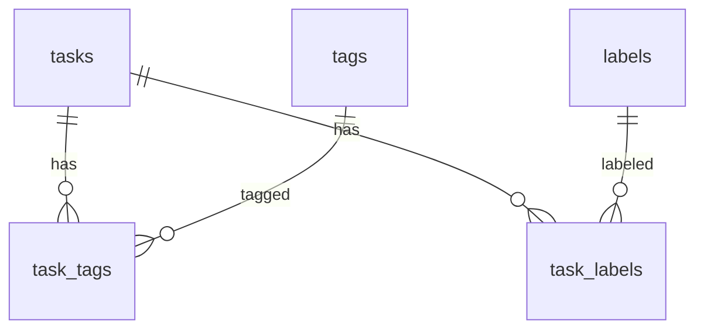

# Database — Design

## 1. Prinsip Desain

1. **PostgreSQL 16** sebagai satu-satunya database.
2. **UUID sebagai primary key** di semua tabel aplikasi. UUID dibuat di aplikasi
   (`google/uuid`, varian **v7**) agar time-ordered dan ramah index.
3. **Semua waktu `timestamptz` dan disimpan UTC.** Tidak ada `timestamp without time zone`.
4. **Nama tabel plural snake_case**, kolom snake_case, FK berakhiran `_id`, timestamp
   berakhiran `_at`.
5. **Integritas di database, bukan hanya di aplikasi.** FK, unique, check constraint, dan
   composite FK dipakai aktif.
6. **Workspace adalah batas data.** Relasi many-to-many membawa `workspace_id` dan
   divalidasi oleh composite FK.
7. **Soft delete hanya untuk entitas yang perlu histori**: `users`, `workspaces`, `tasks`.
8. **Enum disimpan sebagai `varchar` + CHECK**, bukan tipe `ENUM` PostgreSQL. Alasan:
   menambah nilai tidak memerlukan `ALTER TYPE` yang rumit dan GORM lebih mudah memetakan.
9. **Tidak menggunakan `AutoMigrate`** di runtime. Schema dikelola Goose (lihat
   `migrations.md`).

## 2. Tipe Data yang Dipakai

| Kebutuhan | Tipe | Alasan |
|---|---|---|
| ID | `uuid` | Global unik, tidak membocorkan jumlah data, aman di URL |
| Nama pendek | `varchar(n)` | Batas eksplisit + validasi aplikasi |
| Deskripsi/pesan | `text` | Tidak perlu batas DB; divalidasi aplikasi |
| Waktu | `timestamptz` | Menyimpan instan UTC |
| Email | `varchar(254)` | Batas RFC 5321 |
| Hash | `varchar(64)` | SHA-256 hex (64 char) |
| Status/role | `varchar(16)` + CHECK | Fleksibel, tetap tervalidasi |
| IP | `inet` | Tipe native PostgreSQL, validasi otomatis |
| Counter | `integer` | `attempts` |
| JSON bebas | `jsonb` | Tidak dipakai Phase 0; disiapkan jika perlu metadata |

Tidak menggunakan `serial`/`bigserial` karena ID harus tidak dapat ditebak dan konsisten
lintas tabel. Tidak menggunakan `citext` agar tidak bergantung ekstensi; pencarian
case-insensitive memakai `lower()` + unique index.

## 3. Ringkasan Tabel

| No | Tabel | Pemilik module | Soft delete | Baris diperkirakan |
|---|---|---|---|---|
| 1 | `users` | `users` | Ya | puluhan ribu |
| 2 | `user_sessions` | `auth` | Tidak (revoked_at) | 10× users |
| 3 | `workspaces` | `workspaces` | Ya | ribuan |
| 4 | `workspace_members` | `workspaces` | Tidak | 5–20× workspaces |
| 5 | `workspace_invitations` | `workspaces` | Tidak (status) | rendah |
| 6 | `tasks` | `tasks` | Ya | ratusan ribu |
| 7 | `tags` | `tags` | Tidak | puluhan per workspace |
| 8 | `labels` | `labels` | Tidak | belasan per workspace |
| 9 | `task_tags` | `tasks` | Tidak | ~2–5× tasks |
| 10 | `task_labels` | `tasks` | Tidak | ~1–2× tasks |
| 11 | `reminders` | `reminders` | Tidak (status) | ~0.5× tasks |
| 12 | `notifications` | `notifications` | Tidak (`read_at`) | tinggi |

Tabel teknis Goose: `goose_db_version` (dibuat otomatis oleh Goose).

---

## 4. Tabel `users`

### 4.1 Fungsi

Menyimpan identitas dan kredensial pengguna. Satu baris = satu akun.

### 4.2 Kolom

| Kolom | Tipe | Null | Default | Keterangan |
|---|---|---|---|---|
| `id` | `uuid` | Tidak | — | PK, UUIDv7 dari aplikasi |
| `name` | `varchar(100)` | Tidak | — | Nama tampilan |
| `email` | `varchar(254)` | Tidak | — | Login identifier, disimpan lowercase |
| `password_hash` | `varchar(100)` | Tidak | — | bcrypt hash (60 char) |
| `timezone` | `varchar(64)` | Tidak | `'UTC'` | IANA timezone |
| `created_at` | `timestamptz` | Tidak | `now()` | UTC |
| `updated_at` | `timestamptz` | Tidak | `now()` | UTC |
| `deleted_at` | `timestamptz` | Ya | `NULL` | Soft delete |

### 4.3 Constraint

- PK: `users_pkey (id)`.
- Unique: `ux_users_email_lower` pada `lower(email)` **WHERE `deleted_at IS NULL`**.
- Check: `char_length(trim(name)) BETWEEN 1 AND 100`.
- Check: `char_length(timezone) BETWEEN 1 AND 64`.
- Check: `email = lower(email)` (normalisasi dijaga DB).

### 4.4 Alasan Partial Unique Email

Jika unique bersifat penuh, email tidak dapat dipakai lagi setelah akun dihapus. Dengan
partial unique, akun baru boleh memakai email yang sama setelah akun lama dihapus, sementara
akun aktif tetap unik. Login dan lookup **wajib** menambahkan `deleted_at IS NULL`. Risiko
dua baris dengan email sama (satu terhapus) diterima dan didokumentasikan.

Alternatif yang ditolak: mengubah email menjadi `deleted+uuid@domain` saat delete. Itu
merusak audit dan membingungkan. Anonimisasi email saat delete juga tidak dilakukan pada
Phase 0 karena belum ada fitur delete account.

### 4.5 Relasi

- 1:N `user_sessions` (cascade saat hard delete).
- 1:N `workspaces` sebagai `owner_id` (restrict).
- 1:N `workspace_members`.
- 1:N `workspace_invitations` sebagai `invited_by`.
- 1:N `tasks` sebagai `created_by`, 1:N sebagai `assignee_id`.
- 1:N `reminders`, `notifications`.

### 4.6 Index

| Index | Kolom | Alasan |
|---|---|---|
| `ux_users_email_lower` | `lower(email)` partial | Login lookup + keunikan |
| `ix_users_deleted_at` | `deleted_at` | Housekeeping/listing |

---

## 5. Tabel `user_sessions`

### 5.1 Fungsi

Menyimpan refresh token (hash) dan status session untuk revocation dan rotasi. Access token
tidak disimpan.

### 5.2 Kolom

| Kolom | Tipe | Null | Default | Keterangan |
|---|---|---|---|---|
| `id` | `uuid` | Tidak | — | PK, sekaligus `sid` di JWT |
| `user_id` | `uuid` | Tidak | — | FK users |
| `family_id` | `uuid` | Tidak | — | Kelompok rotasi |
| `refresh_token_hash` | `varchar(64)` | Tidak | — | SHA-256 hex |
| `user_agent` | `varchar(512)` | Ya | `NULL` | Snapshot UA |
| `ip_address` | `inet` | Ya | `NULL` | IP login/refresh |
| `expires_at` | `timestamptz` | Tidak | — | Batas absolut family |
| `revoked_at` | `timestamptz` | Ya | `NULL` | NULL = aktif |
| `replaced_by_session_id` | `uuid` | Ya | `NULL` | Self-FK saat rotasi |
| `created_at` | `timestamptz` | Tidak | `now()` | |
| `updated_at` | `timestamptz` | Tidak | `now()` | |

### 5.3 Constraint

- PK `(id)`.
- FK `user_id → users(id) ON DELETE CASCADE`.
- FK `replaced_by_session_id → user_sessions(id) ON DELETE SET NULL`.
- Unique `refresh_token_hash`.
- Check `expires_at > created_at`.
- Check `revoked_at IS NULL OR revoked_at >= created_at`.

### 5.4 Alasan Menyimpan Hash, Bukan Token

Refresh token bersifat bearer. Jika tabel bocor, hash SHA-256 tidak dapat dipakai langsung.
SHA-256 cukup (bukan bcrypt) karena token memiliki 256 bit entropi acak, sehingga brute force
tidak praktis dan verifikasi harus cepat (setiap refresh).

### 5.5 Relasi

- N:1 `users`.
- Self-reference untuk rantai rotasi.
- Family: semua session hasil rotasi berbagi `family_id`.

### 5.6 Index

| Index | Kolom | Alasan |
|---|---|---|
| `ux_sessions_token_hash` | `refresh_token_hash` | Lookup refresh (unique) |
| `ix_sessions_user` | `(user_id)` | Logout-all, cascade user, daftar session |
| `ix_sessions_family` | `(family_id)` | Revoke family saat reuse |
| `ix_sessions_expires` | `(expires_at)` | Housekeeping session expired |

### 5.7 Cascade

Hard delete user → session terhapus. User soft delete tidak memicu cascade; service harus
mencabut session secara eksplisit saat menghapus akun (Phase 2).

---

## 6. Tabel `workspaces`

### 6.1 Fungsi

Menyimpan ruang kerja. Workspace adalah akar isolasi data.

### 6.2 Kolom

| Kolom | Tipe | Null | Default | Keterangan |
|---|---|---|---|---|
| `id` | `uuid` | Tidak | — | PK |
| `name` | `varchar(100)` | Tidak | — | Nama workspace |
| `description` | `text` | Ya | `NULL` | Deskripsi |
| `owner_id` | `uuid` | Tidak | — | FK users, denormalisasi owner |
| `created_at` | `timestamptz` | Tidak | `now()` | |
| `updated_at` | `timestamptz` | Tidak | `now()` | |
| `deleted_at` | `timestamptz` | Ya | `NULL` | Soft delete |

### 6.3 Constraint

- PK `(id)`.
- FK `owner_id → users(id) ON DELETE RESTRICT`.
- Check `char_length(trim(name)) BETWEEN 1 AND 100`.
- Check `char_length(coalesce(description,'')) <= 1000`.

### 6.4 Alasan `owner_id` Diduplikasi

`workspace_members.role = 'OWNER'` sudah menunjukkan owner, tetapi `owner_id` di tabel
workspace:

- Mempercepat pengecekan "apakah user owner" tanpa join.
- Menjadi referensi yang stabil untuk audit.
- Konsistensi dijaga di service (create/transfer) dan diverifikasi oleh test integrasi.
  Tidak ada FK komposit ke membership karena akan menyulitkan transfer ownership.

### 6.5 Relasi

- N:1 `users` (owner).
- 1:N `workspace_members` (cascade).
- 1:N `workspace_invitations` (cascade).
- 1:N `tasks` (cascade).
- 1:N `tags`, `labels` (cascade).
- 1:N `reminders` (cascade).
- 1:N `notifications` (SET NULL saat hard delete).

### 6.6 Index

| Index | Kolom | Alasan |
|---|---|---|
| `ix_workspaces_owner` | `(owner_id) WHERE deleted_at IS NULL` | List workspace milik owner |
| `ix_workspaces_deleted` | `(deleted_at)` | Filter aktif |

### 6.7 Soft Delete

Workspace dihapus → `deleted_at` diisi. Semua query wajib `deleted_at IS NULL`. Task di
dalamnya tidak diubah; akses terputus karena workspace tidak dapat dijangkau. Ini keputusan
agar delete workspace tidak menjadi operasi massal yang berat dan dapat di-restore.

Dua konsekuensi operasional yang wajib dijalankan service dalam transaksi yang sama:

1. **Reminder PENDING/FAILED milik workspace di-`CANCELLED`.** Tanpa ini, worker akan tetap
   memproses reminder dari workspace yang sudah dihapus dan membuat notifikasi yatim.
2. **Worker wajib memeriksa status workspace sebelum mengirim.** Klaim reminder hanya boleh
   memproses baris yang workspace-nya `deleted_at IS NULL` dan task-nya juga
   `deleted_at IS NULL`; jika tidak, reminder di-`CANCELLED` tanpa membuat notifikasi.
   Pemeriksaan ini adalah jaring pengaman jika cancel massal terlewat (mis. race dengan
   proses delete). Detail ada di `../architecture/notification-worker.md`.

---

## 7. Tabel `workspace_members`

### 7.1 Fungsi

Menghubungkan user dengan workspace dan menyimpan role. Sumber kebenaran otorisasi workspace.

### 7.2 Kolom

| Kolom | Tipe | Null | Default | Keterangan |
|---|---|---|---|---|
| `id` | `uuid` | Tidak | — | PK |
| `workspace_id` | `uuid` | Tidak | — | FK workspaces |
| `user_id` | `uuid` | Tidak | — | FK users |
| `role` | `varchar(10)` | Tidak | `'MEMBER'` | OWNER/ADMIN/MEMBER |
| `joined_at` | `timestamptz` | Tidak | `now()` | Waktu bergabung |
| `created_at` | `timestamptz` | Tidak | `now()` | |
| `updated_at` | `timestamptz` | Tidak | `now()` | |

### 7.3 Constraint

- PK `(id)`.
- FK `workspace_id → workspaces(id) ON DELETE CASCADE`.
- FK `user_id → users(id) ON DELETE CASCADE`.
- **Unique `(workspace_id, user_id)`** — satu user satu kali per workspace.
- **Partial unique `(workspace_id) WHERE role = 'OWNER'`** — tepat satu owner.
- Check `role IN ('OWNER','ADMIN','MEMBER')`.

### 7.4 Mengapa `id` Tetap Ada

Baseline meminta `id`. Tabel pivot murni bisa memakai composite PK, tetapi membership adalah
entitas dengan atribut (`role`, `joined_at`) sehingga PK UUID lebih konsisten dan
memudahkan referensi audit. Unique `(workspace_id, user_id)` tetap menjadi kunci bisnis.

### 7.5 Relasi

- N:1 `workspaces`, N:1 `users`.
- Tidak ada soft delete; keluar workspace = hard delete baris.
- Histori keanggotaan tidak disimpan (tidak diminta). Jika audit dibutuhkan, tambahkan
  tabel `workspace_member_events` di masa depan.

### 7.6 Index

| Index | Kolom | Alasan |
|---|---|---|
| `ux_members_workspace_user` | `(workspace_id, user_id)` | Cek akses O(1) |
| `ux_members_single_owner` | `(workspace_id) WHERE role='OWNER'` | Integritas owner |
| `ix_members_user` | `(user_id, workspace_id)` | List "workspace saya" |
| `ix_members_workspace_role` | `(workspace_id, role)` | List member per role |

### 7.7 Cascade

- Workspace hard delete → member terhapus.
- User hard delete → member terhapus.
- Workspace soft delete tidak memicu cascade; akses ditutup oleh filter `workspaces.deleted_at`.

---

## 8. Tabel `workspace_invitations`

### 8.1 Fungsi

Menyimpan undangan bergabung ke workspace dengan token satu kali pakai.

### 8.2 Kolom

| Kolom | Tipe | Null | Default | Keterangan |
|---|---|---|---|---|
| `id` | `uuid` | Tidak | — | PK |
| `workspace_id` | `uuid` | Tidak | — | FK workspaces |
| `invited_by` | `uuid` | Tidak | — | FK users |
| `email` | `varchar(254)` | Tidak | — | Email tujuan, lowercase |
| `role` | `varchar(10)` | Tidak | `'MEMBER'` | Role saat accept |
| `token_hash` | `varchar(64)` | Tidak | — | SHA-256 token |
| `status` | `varchar(16)` | Tidak | `'PENDING'` | PENDING/ACCEPTED/CANCELLED/EXPIRED |
| `expires_at` | `timestamptz` | Tidak | — | Masa berlaku |
| `accepted_at` | `timestamptz` | Ya | `NULL` | Waktu diterima |
| `email_delivery_status` | `varchar(16)` | Tidak | `'PENDING'` | PENDING/SENT/FAILED/SKIPPED |
| `created_at` | `timestamptz` | Tidak | `now()` | |
| `updated_at` | `timestamptz` | Tidak | `now()` | |

### 8.3 Constraint

- PK `(id)`.
- FK `workspace_id → workspaces(id) ON DELETE CASCADE`.
- FK `invited_by → users(id) ON DELETE RESTRICT`.
- Unique `token_hash`.
- **Partial unique `(workspace_id, lower(email)) WHERE status = 'PENDING'`** — cegah undangan
  ganda yang aktif.
- Check `status IN ('PENDING','ACCEPTED','CANCELLED','EXPIRED')`.
- Check `role IN ('ADMIN','MEMBER')`.
- Check `email = lower(email)`.
- Check `expires_at > created_at`.
- Check `(status = 'ACCEPTED') = (accepted_at IS NOT NULL)`.
- Check `email_delivery_status IN ('PENDING','SENT','FAILED','SKIPPED')`.

### 8.4 Alasan `role` Ditambahkan

Tanpa `role`, sistem tidak tahu role apa yang diberikan saat accept. Baseline tidak
menyebutkannya, tetapi endpoint create invitation secara implisit membutuhkannya. Default
`MEMBER`; OWNER tidak diizinkan.

### 8.5 Mengapa `email_delivery_status` Ditambahkan

Pengiriman email bisa gagal (SMTP down). Kita perlu membedakan undangan yang valid tetapi
emailnya gagal terkirim. Status ini tidak memengaruhi validitas token.

### 8.6 Relasi

- N:1 workspace, N:1 inviter.
- Tidak ada relasi langsung ke invitee (invitee mungkin belum punya akun). Saat accept,
  dicocokkan lewat email.

### 8.7 Index

| Index | Kolom | Alasan |
|---|---|---|
| `ux_invitations_token_hash` | `token_hash` | Lookup accept (unique) |
| `ux_invitations_pending_email` | `(workspace_id, lower(email)) WHERE status='PENDING'` | Cegah duplikat |
| `ix_invitations_workspace_created` | `(workspace_id, created_at DESC, id DESC)` | List + cursor |
| `ix_invitations_status_expires` | `(status, expires_at)` | Penandaan EXPIRED |

### 8.8 Retensi

Undangan tidak dihapus. `CANCELLED`/`EXPIRED` tetap ada untuk audit. Baris `ACCEPTED`
menjadi bukti keanggotaan.

---

## 9. Tabel `tasks`

### 9.1 Fungsi

Menyimpan pekerjaan di dalam workspace, termasuk status, prioritas, due date, assignee, dan
relasi ke tag/label.

### 9.2 Kolom

| Kolom | Tipe | Null | Default | Keterangan |
|---|---|---|---|---|
| `id` | `uuid` | Tidak | — | PK |
| `workspace_id` | `uuid` | Tidak | — | FK workspaces |
| `title` | `varchar(200)` | Tidak | — | Judul |
| `description` | `text` | Ya | `NULL` | Deskripsi |
| `status` | `varchar(16)` | Tidak | `'TODO'` | TODO/IN_PROGRESS/DONE |
| `priority` | `varchar(10)` | Tidak | `'MEDIUM'` | LOW/MEDIUM/HIGH/URGENT |
| `due_at` | `timestamptz` | Ya | `NULL` | UTC |
| `completed_at` | `timestamptz` | Ya | `NULL` | Diisi saat DONE |
| `created_by` | `uuid` | Tidak | — | FK users |
| `assignee_id` | `uuid` | Ya | `NULL` | FK users |
| `created_at` | `timestamptz` | Tidak | `now()` | |
| `updated_at` | `timestamptz` | Tidak | `now()` | |
| `deleted_at` | `timestamptz` | Ya | `NULL` | Soft delete |

### 9.3 Constraint

- PK `(id)`.
- **Unique `(id, workspace_id)`** — diperlukan untuk composite FK dari pivot/reminder.
- FK `workspace_id → workspaces(id) ON DELETE CASCADE`.
- FK `created_by → users(id) ON DELETE RESTRICT`.
- FK `assignee_id → users(id) ON DELETE SET NULL`.
- Check `char_length(trim(title)) BETWEEN 1 AND 200`.
- Check `char_length(coalesce(description,'')) <= 10000`.
- Check `status IN ('TODO','IN_PROGRESS','DONE')`.
- Check `priority IN ('LOW','MEDIUM','HIGH','URGENT')`.
- Check `(status = 'DONE') = (completed_at IS NOT NULL)`.
- Check `deleted_at IS NULL OR deleted_at >= created_at`.

### 9.4 Alasan `assignee_id` ON DELETE SET NULL

Jika user dihapus permanen, task tidak boleh ikut hilang. Assignee menjadi kosong; histori
`created_by` tetap dijaga `RESTRICT` (user yang membuat task tidak boleh dihapus permanen
selama task masih ada). Karena user memakai soft delete, aturan ini jarang terpicu.

### 9.5 Mengapa Tidak Ada `position` / Urutan Manual

Tidak diminta dan menambah kompleksitas (reorder massal, cursor). Sorting memakai
`created_at`, `updated_at`, `due_at`, `priority`, `title`. Jika drag-and-drop dibutuhkan,
tambahkan `position numeric` + endpoint reorder di masa depan.

### 9.6 Relasi

- N:1 workspace.
- N:1 users (creator, assignee).
- N:M tags via `task_tags`.
- N:M labels via `task_labels`.
- 1:N reminders.

### 9.7 Index

Lihat detail di [`index-strategy.md`](index-strategy.md). Ringkas:

| Index | Kolom | Alasan |
|---|---|---|
| `ix_tasks_workspace_created` | `(workspace_id, created_at DESC, id DESC) WHERE deleted_at IS NULL` | List default + cursor |
| `ix_tasks_workspace_due` | `(workspace_id, due_at, id) WHERE deleted_at IS NULL AND status <> 'DONE'` | Today/Upcoming/Overdue |
| `ix_tasks_workspace_status_created` | `(workspace_id, status, created_at DESC, id DESC) WHERE deleted_at IS NULL` | Filter status |
| `ix_tasks_workspace_priority` | `(workspace_id, priority, created_at DESC, id DESC) WHERE deleted_at IS NULL` | Filter priority |
| `ix_tasks_workspace_assignee` | `(workspace_id, assignee_id) WHERE deleted_at IS NULL` | Filter assignee |
| `ix_tasks_workspace_updated` | `(workspace_id, updated_at DESC, id DESC) WHERE deleted_at IS NULL` | Sort updated |
| `ix_tasks_worker_due` | `(due_at, id) WHERE status <> 'DONE' AND deleted_at IS NULL` | Scan worker due soon/overdue |

### 9.8 Soft Delete

Task dihapus → `deleted_at` diisi; pivot tag/label **tidak** dihapus agar restore
mempertahankan metadata. Semua query wajib `deleted_at IS NULL`. Reminder PENDING untuk task
tersebut di-`CANCELLED` dalam transaksi yang sama.

---

## 10. Tabel `tags`

### 10.1 Fungsi

Kata kunci bebas per workspace untuk mengelompokkan task.

### 10.2 Kolom

| Kolom | Tipe | Null | Default |
|---|---|---|---|
| `id` | `uuid` | Tidak | — |
| `workspace_id` | `uuid` | Tidak | — |
| `name` | `varchar(50)` | Tidak | — |
| `created_at` | `timestamptz` | Tidak | `now()` |
| `updated_at` | `timestamptz` | Tidak | `now()` |

### 10.3 Constraint

- PK `(id)`.
- Unique `(id, workspace_id)` untuk composite FK.
- FK `workspace_id → workspaces(id) ON DELETE CASCADE`.
- Unique `(workspace_id, lower(name))`.
- Check `char_length(trim(name)) BETWEEN 1 AND 50`.

### 10.4 Relasi

- N:1 `workspaces` (cascade saat hard delete).
- N:M `tasks` via `task_tags`.
- Tidak ada relasi ke `users`; tag adalah milik workspace, bukan per user.

### 10.5 Soft Delete

Tidak ada. Tag dihapus hard delete; pivot ikut terhapus (`ON DELETE CASCADE`). Tag mudah
dibuat ulang dan tidak memerlukan histori.

### 10.6 Index

`ux_tags_workspace_name (workspace_id, lower(name))`, `ix_tags_workspace (workspace_id, name)`.

---

## 11. Tabel `labels`

### 11.1 Fungsi

Kategori berwarna per workspace. Berbeda dari tag: label wajib memiliki warna dan
dimaksudkan sebagai dimensi terbatas.

### 11.2 Kolom

| Kolom | Tipe | Null | Default |
|---|---|---|---|
| `id` | `uuid` | Tidak | — |
| `workspace_id` | `uuid` | Tidak | — |
| `name` | `varchar(50)` | Tidak | — |
| `color` | `varchar(7)` | Tidak | — |
| `created_at` | `timestamptz` | Tidak | `now()` |
| `updated_at` | `timestamptz` | Tidak | `now()` |

### 11.3 Constraint

- PK `(id)`.
- Unique `(id, workspace_id)` untuk composite FK.
- FK `workspace_id → workspaces(id) ON DELETE CASCADE`.
- Unique `(workspace_id, lower(name))`.
- Check `char_length(trim(name)) BETWEEN 1 AND 50`.
- Check `color ~ '^#[0-9A-Fa-f]{6}$'`.

### 11.4 Relasi

- N:1 `workspaces` (cascade saat hard delete).
- N:M `tasks` via `task_labels`.
- Tidak ada relasi ke `users`; label adalah milik workspace.

### 11.5 Soft Delete

Tidak ada. Sama seperti tag, label dihapus hard delete dan pivot ikut terhapus. Warna bukan
data audit sehingga tidak perlu dipertahankan setelah dihapus.

### 11.6 Index

`ux_labels_workspace_name (workspace_id, lower(name))`, `ix_labels_workspace (workspace_id, name)`.

---

## 12. Tabel `task_tags`

### 12.1 Fungsi

Relasi many-to-many task ↔ tag, **dalam workspace yang sama**.

### 12.2 Kolom

| Kolom | Tipe | Null | Keterangan |
|---|---|---|---|
| `task_id` | `uuid` | Tidak | Bagian PK |
| `tag_id` | `uuid` | Tidak | Bagian PK |
| `workspace_id` | `uuid` | Tidak | Denormalisasi untuk integritas |
| `created_at` | `timestamptz` | Tidak | Default `now()` |

### 12.3 Constraint Kunci

- **PK `(task_id, tag_id)`** — mencegah duplikat.
- **Composite FK `(task_id, workspace_id) → tasks(id, workspace_id) ON DELETE CASCADE`**.
- **Composite FK `(tag_id, workspace_id) → tags(id, workspace_id) ON DELETE CASCADE`**.

Dengan kedua FK ini, database **menolak** pasangan task dan tag yang berasal dari workspace
berbeda, karena `workspace_id` harus cocok dengan kedua sisi. Ini pertahanan terakhir jika
service lalai memvalidasi.

### 12.4 Mengapa `workspace_id` Diduplikasi

Tanpa kolom ini, composite FK tidak mungkin. Denormalisasi ini sengaja dan konsisten
(kedua FK memaksa nilai yang sama). Biaya penyimpanan kecil (16 byte per baris) sebanding
dengan jaminan integritas.

Alternatif yang ditolak:

- **Trigger** pengecekan workspace: lebih sulit di-debug, performa tidak lebih baik.
- **Validasi aplikasi saja**: satu bug dapat mencampur data antar workspace.
- **FK ke task dan tag + cek di aplikasi**: tidak menjamin apa pun di level DB.

### 12.5 Index

| Index | Kolom | Alasan |
|---|---|---|
| PK `(task_id, tag_id)` | | Cek duplikat & hapus per task |
| `ix_task_tags_tag` | `(tag_id, workspace_id)` | Filter task berdasarkan tag |
| `ix_task_tags_workspace` | `(workspace_id, task_id)` | Query per workspace |

### 12.6 Relasi

- N:1 `tasks` via composite FK (cascade).
- N:1 `tags` via composite FK (cascade).
- Tidak ada soft delete. Baris pivot dihapus saat task/tag dihapus, atau saat user melepas
  tag dari task. Task yang di-soft-delete **tidak** menghapus pivot, sehingga restore task
  mempertahankan tag.

---

## 13. Tabel `task_labels`

Struktur dan aturan identik dengan `task_tags`, dengan `label_id` menggantikan `tag_id`.

### 13.1 Struktur

- PK `(task_id, label_id)`.
- Composite FK `(task_id, workspace_id) → tasks(id, workspace_id) ON DELETE CASCADE`.
- Composite FK `(label_id, workspace_id) → labels(id, workspace_id) ON DELETE CASCADE`.
- Index `(label_id, workspace_id)`, `(workspace_id, task_id)`.

### 13.2 Relasi

- N:1 `tasks` dan N:1 `labels` via composite FK (cascade).
- Tidak ada soft delete. Sama seperti `task_tags`, pivot tidak dihapus saat task
  di-soft-delete agar restore mempertahankan label.

---

## 14. Tabel `reminders`

### 14.1 Fungsi

Menyimpan jadwal pengingat untuk task. Sekaligus menjadi **job table** worker.

### 14.2 Kolom

| Kolom | Tipe | Null | Default | Keterangan |
|---|---|---|---|---|
| `id` | `uuid` | Tidak | — | PK |
| `workspace_id` | `uuid` | Tidak | — | Denormalisasi dari task |
| `task_id` | `uuid` | Tidak | — | FK tasks |
| `user_id` | `uuid` | Tidak | — | Penerima |
| `scheduled_at` | `timestamptz` | Tidak | — | UTC |
| `status` | `varchar(16)` | Tidak | `'PENDING'` | PENDING/PROCESSING/SENT/FAILED/CANCELLED |
| `attempts` | `integer` | Tidak | `0` | Jumlah percobaan |
| `last_error` | `varchar(500)` | Ya | `NULL` | Error terakhir |
| `next_attempt_at` | `timestamptz` | Ya | `NULL` | Backoff retry |
| `locked_at` | `timestamptz` | Ya | `NULL` | Waktu claim |
| `sent_at` | `timestamptz` | Ya | `NULL` | Waktu sukses |
| `created_at` | `timestamptz` | Tidak | `now()` | |
| `updated_at` | `timestamptz` | Tidak | `now()` | |

### 14.3 Constraint

- PK `(id)`.
- **Composite FK `(task_id, workspace_id) → tasks(id, workspace_id) ON DELETE CASCADE`**.
- FK `user_id → users(id) ON DELETE CASCADE`.
- FK `workspace_id → workspaces(id) ON DELETE CASCADE`.
- Unique `(task_id, scheduled_at)` — cegah reminder identik ganda.
- Check `status IN ('PENDING','PROCESSING','SENT','FAILED','CANCELLED')`.
- Check `attempts >= 0`.
- Check `(status = 'SENT') = (sent_at IS NOT NULL)`.

### 14.4 Mengapa `workspace_id` dan `user_id` Eksplisit

- `workspace_id`: memungkinkan query/otorisasi dan composite FK tanpa join ke task.
- `user_id`: worker tidak perlu menebak penerima; aturan "assignee, fallback creator"
  dijalankan saat create reminder, bukan saat worker (agar perubahan assignee setelah
  reminder dibuat tidak mengubah penerima secara tak terduga).

### 14.5 Status

| Status | Arti |
|---|---|
| `PENDING` | Menunggu jadwal |
| `PROCESSING` | Sedang diklaim worker |
| `SENT` | Notifikasi berhasil dibuat |
| `FAILED` | Gagal, menunggu retry |
| `CANCELLED` | Task dihapus/selesai atau dibatalkan user |

### 14.6 Index

| Index | Kolom | Alasan |
|---|---|---|
| `ix_reminders_due` | `(scheduled_at, id) WHERE status IN ('PENDING','FAILED')` | Claim worker |
| `ix_reminders_task` | `(task_id, scheduled_at)` | List reminder per task |
| `ix_reminders_workspace` | `(workspace_id, scheduled_at)` | Observasi |
| `ix_reminders_stale` | `(locked_at) WHERE status='PROCESSING'` | Recovery |

### 14.7 Relasi

- N:1 `tasks` dan N:1 `workspaces` via composite FK (cascade).
- N:1 `users` (penerima) via `user_id` (cascade saat user hard delete).
- Tidak ada soft delete. Status adalah state mesin, bukan penghapusan. Reminder
  `SENT`/`CANCELLED` dipertahankan untuk audit dan observasi.
- Saat task di-soft-delete atau workspace dihapus, reminder PENDING/FAILED di-`CANCELLED`
  dalam transaksi yang sama (lihat §6.7 dan §9.8).

---

## 15. Tabel `notifications`

### 15.1 Fungsi

Inbox notifikasi in-app per user, dengan deduplikasi.

### 15.2 Kolom

| Kolom | Tipe | Null | Default | Keterangan |
|---|---|---|---|---|
| `id` | `uuid` | Tidak | — | PK |
| `user_id` | `uuid` | Tidak | — | Penerima |
| `workspace_id` | `uuid` | Ya | `NULL` | Konteks |
| `task_id` | `uuid` | Ya | `NULL` | Konteks task |
| `type` | `varchar(32)` | Tidak | — | Jenis notifikasi |
| `title` | `varchar(150)` | Tidak | — | Snapshot |
| `message` | `text` | Tidak | — | Snapshot |
| `dedupe_key` | `varchar(200)` | Tidak | — | Idempotensi |
| `read_at` | `timestamptz` | Ya | `NULL` | NULL = unread |
| `created_at` | `timestamptz` | Tidak | `now()` | |
| `updated_at` | `timestamptz` | Tidak | `now()` | |

### 15.3 Constraint

- PK `(id)`.
- FK `user_id → users(id) ON DELETE CASCADE`.
- FK `workspace_id → workspaces(id) ON DELETE SET NULL`.
- FK `task_id → tasks(id) ON DELETE SET NULL`.
- **Unique `dedupe_key`**.
- Check `type IN ('REMINDER','TASK_DUE_SOON','TASK_OVERDUE','WORKSPACE_INVITATION','INVITATION_ACCEPTED')`.
- Check `read_at IS NULL OR read_at >= created_at`.

### 15.4 Mengapa `dedupe_key` Unique Global

Dedupe key dibuat unik secara global (bukan per user) dengan prefix yang mengandung ID
sumber, mis. `reminder:{uuid}`. Ini menjamin satu reminder hanya menghasilkan satu
notifikasi, bahkan jika worker berjalan paralel. Tidak ada risiko tabrakan karena UUID
sumber unik. Jika di masa depan key tidak mengandung UUID unik, tambahkan `user_id` ke
dalam key.

### 15.5 Mengapa `workspace_id`/`task_id` ON DELETE SET NULL

Notifikasi adalah histori. Jika workspace/task dihapus permanen, notifikasi tetap ada tetapi
tanpa link. Ini lebih baik daripada cascade yang menghapus histori user.

### 15.6 Mengapa Snapshot `title`/`message`

Task dapat berubah judul atau dihapus. Notifikasi harus menampilkan apa yang terjadi saat
itu. Join ke task juga akan memperlambat inbox dan menyulitkan retensi.

### 15.7 Index

| Index | Kolom | Alasan |
|---|---|---|
| `ix_notifications_user_created` | `(user_id, created_at DESC, id DESC)` | Inbox + cursor |
| `ix_notifications_unread` | `(user_id, created_at DESC, id DESC) WHERE read_at IS NULL` | Badge unread |
| `ux_notifications_dedupe` | `(dedupe_key)` unique | Idempotensi |
| `ix_notifications_workspace` | `(workspace_id, created_at DESC)` | Filter workspace |

### 15.8 Relasi

- N:1 `users` (penerima) via `user_id` (cascade saat user hard delete).
- N:1 `workspaces` via `workspace_id` (`SET NULL` untuk menjaga histori).
- N:1 `tasks` via `task_id` (`SET NULL` untuk menjaga histori).
- Tidak ada soft delete dan tidak ada status selain `read_at`. Notifikasi tidak pernah
  dihapus oleh alur bisnis; retensi/partisi dibahas di §20.

---

## 16. Integritas Workspace Scope

### 16.1 Tiga Lapis Pertahanan

| Lapis | Mekanisme | Contoh |
|---|---|---|
| 1. Routing/otorisasi | `RequireMember` memakai `workspace_id` dari path | Non-member → 404 |
| 2. Query | Semua query memfilter `workspace_id` | `WHERE workspace_id=? AND id=?` |
| 3. Database | Composite FK untuk relasi lintas tabel | `task_tags(tag_id, workspace_id) → tags(id, workspace_id)` |

### 16.2 Relasi yang Dijaga



Composite FK memastikan:

- `task_tags.workspace_id` = workspace task.
- `task_tags.workspace_id` = workspace tag.
- Maka workspace task = workspace tag, secara transitif.

Hal yang sama berlaku untuk `task_labels` dan `reminders`.

### 16.3 Yang Tidak Dijaga Database

- `tasks.assignee_id` harus member workspace. Ini **tidak** dapat dijaga FK sederhana karena
  membership adalah baris di tabel lain. Dijaga service + test integrasi.
- `tasks.created_by` harus member saat pembuatan. Dijaga service.
- `notifications.user_id` harus penerima yang tepat. Dijaga worker/service.
- `workspaces.owner_id` harus konsisten dengan `workspace_members.role='OWNER'`. Dijaga
  service dan diverifikasi test.

### 16.4 Validasi Service untuk Assignee

```text
memberIDs = access.MemberIDs(workspace_id)
if assignee_id != null && !memberIDs.contains(assignee_id) -> 422 ASSIGNEE_NOT_MEMBER
```

### 16.5 Validasi Service untuk Tag/Label

```text
validTags = tagCatalog.ExistingIDs(workspace_id, tag_ids)
if len(validTags) != len(unique(tag_ids)) -> 422 INVALID_TAG
```

Jika lolos, insert pivot dengan `workspace_id` yang sama; composite FK menjadi pengaman
akhir.

---

## 17. Aturan Cascade dan Restrict

| FK | ON DELETE | Alasan |
|---|---|---|
| `user_sessions.user_id → users` | CASCADE | Session tidak berguna tanpa user |
| `user_sessions.replaced_by_session_id → user_sessions` | SET NULL | Menghindari siklus penghapusan |
| `workspaces.owner_id → users` | RESTRICT | Workspace tidak boleh tanpa owner |
| `workspace_members.workspace_id → workspaces` | CASCADE | Membership tidak berguna tanpa workspace |
| `workspace_members.user_id → users` | CASCADE | |
| `workspace_invitations.workspace_id → workspaces` | CASCADE | |
| `workspace_invitations.invited_by → users` | RESTRICT | Audit pembuat undangan |
| `tasks.workspace_id → workspaces` | CASCADE | |
| `tasks.created_by → users` | RESTRICT | Audit pembuat task |
| `tasks.assignee_id → users` | SET NULL | Task tetap ada |
| `tags.workspace_id`, `labels.workspace_id` | CASCADE | |
| `task_tags.task_id/tag_id` (composite) | CASCADE | Pivot ikut terhapus |
| `task_labels.task_id/label_id` (composite) | CASCADE | |
| `reminders.task_id/workspace_id` (composite) | CASCADE | |
| `reminders.user_id → users` | CASCADE | |
| `notifications.user_id → users` | CASCADE | |
| `notifications.workspace_id → workspaces` | SET NULL | Histori tetap |
| `notifications.task_id → tasks` | SET NULL | Histori tetap |

Catatan: karena workspace/task/user memakai soft delete, cascade biasanya hanya terpicu
pada hard delete operasional (housekeeping) atau test cleanup.

---

## 18. Ringkasan Soft Delete

| Tabel | Soft delete | Query wajib | Catatan |
|---|---|---|---|
| `users` | `deleted_at` | `deleted_at IS NULL` | Login, lookup |
| `workspaces` | `deleted_at` | `deleted_at IS NULL` | Semua akses workspace |
| `tasks` | `deleted_at` | `deleted_at IS NULL` | List/detail |
| `tags` | Tidak | — | Hard delete + cascade pivot |
| `labels` | Tidak | — | Hard delete + cascade pivot |
| `workspace_members` | Tidak | — | Hard delete |
| `workspace_invitations` | Tidak | — | Status, bukan delete |
| `user_sessions` | Tidak | `revoked_at IS NULL` | Revocation |
| `reminders` | Tidak | Status | Job state |
| `notifications` | Tidak | `read_at` | Read state |

GORM: gunakan `gorm.DeletedAt` hanya pada tiga tabel dengan soft delete. Untuk tabel lain,
jangan menambahkan field tersebut agar GORM tidak otomatis memfilter.

---

## 19. Pemetaan GORM (Rencana)

| Tabel | Struct | Catatan tag |
|---|---|---|
| `users` | `users/models.User` | `Email` unique index partial ditangani migration, bukan tag |
| `user_sessions` | `auth/models.UserSession` | `RefreshTokenHash` unique |
| `workspaces` | `workspaces/models.Workspace` | `DeletedAt gorm.DeletedAt` |
| `workspace_members` | `workspaces/models.WorkspaceMember` | composite unique |
| `workspace_invitations` | `workspaces/models.WorkspaceInvitation` | |
| `tasks` | `tasks/models.Task` | `DeletedAt gorm.DeletedAt` |
| `tags` | `tags/models.Tag` | |
| `labels` | `labels/models.Label` | |
| `task_tags` | `tasks/models.TaskTag` | composite PK |
| `task_labels` | `tasks/models.TaskLabel` | composite PK |
| `reminders` | `reminders/models.Reminder` | |
| `notifications` | `notifications/models.Notification` | |

Aturan:

- `TableName()` eksplisit untuk semua model.
- Tidak memakai `Preload` otomatis pada list besar; join eksplisit atau query terpisah.
- `UpdateColumn`/`UpdateColumns` untuk menghindari hook yang tidak perlu.
- Transaksi lewat `database.FromContext(ctx, r.db)`.

---

## 20. Kapasitas dan Pertumbuhan

| Tabel | Estimasi 1 tahun | Strategi |
|---|---|---|
| `tasks` | 1–5 juta | Index workspace + cursor; arsip opsional |
| `notifications` | 5–20 juta | Index user + read; retensi Phase 9 |
| `user_sessions` | 1–2 juta | Hapus session expired berkala |
| `reminders` | 1–3 juta | Hapus reminder SENT/CANCELLED lama (opsional) |
| `task_tags` | 5–15 juta | Cascade delete, index tag |

Retensi/partisi belum diimplementasikan pada Phase 0. Jika volume notifikasi menjadi
masalah, pertimbangkan partisi bulanan berdasarkan `created_at` (Phase 9).

---

## 21. Keputusan dan Trade-off

| Keputusan | Alasan | Alternatif |
|---|---|---|
| UUIDv7 | Time-ordered, index-friendly, tetap tidak bisa ditebak | UUIDv4 (acak, fragmentasi index), bigserial (bocor jumlah) |
| `varchar` + CHECK untuk enum | Migrasi mudah | Native enum (ALTER TYPE berat) |
| Soft delete user/workspace/task | Restore & audit | Hard delete (kehilangan histori) |
| Hard delete tag/label | Mudah dibuat ulang | Soft delete (menambah filter di semua query) |
| Composite FK workspace | Integritas lintas workspace | Trigger/aplikasi saja |
| Partial unique email | Email dapat dipakai ulang setelah delete | Unique penuh |
| `owner_id` denormalisasi | Cek owner cepat | Hanya role membership |
| Notifikasi snapshot | Histori stabil, inbox cepat | Join ke task |
| Unique `(task_id, scheduled_at)` | Cegah reminder ganda | Izinkan duplikat |
| Tanpa `position` task | Tidak diminta | Reorder kompleks |
