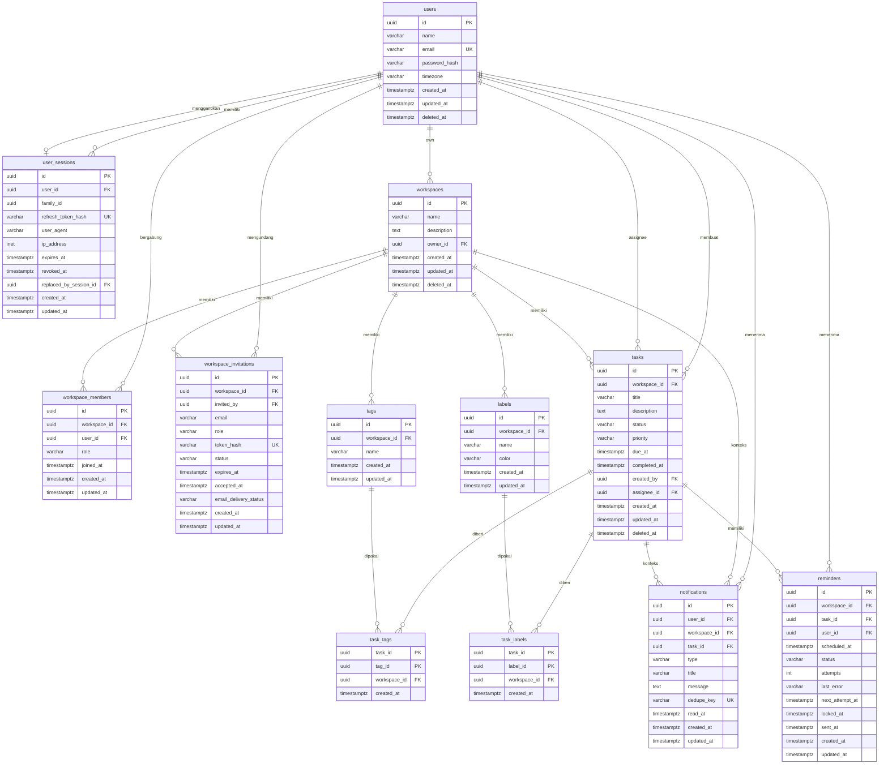
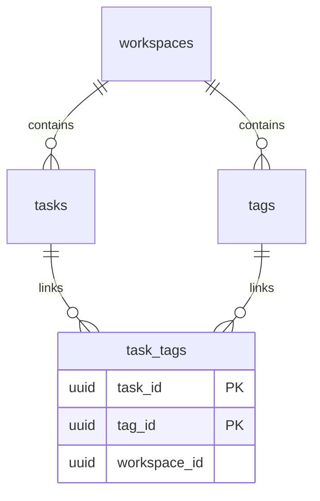
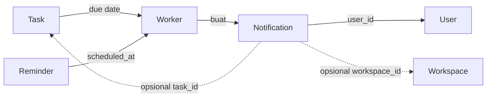
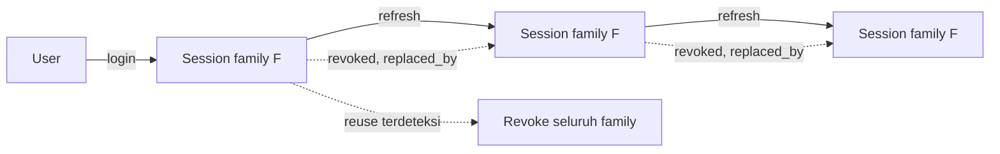

# Database — Entity Relationship Diagram

## 1. ERD Lengkap



> Catatan Mermaid: atribut `PK, FK` pada `task_tags.task_id` dan `task_labels.task_id`
> mewakili kunci komposit. Di database, composite foreign key mencakup
> `(task_id, workspace_id)` dan `(tag_id, workspace_id)`, bukan hanya kolom ID.

## 2. Kardinalitas dan Penjelasan Relasi

| Relasi | Kardinalitas | FK | On Delete | Penjelasan |
|---|---|---|---|---|
| users → user_sessions | 1:N | `user_id` | CASCADE | Satu user banyak device/session |
| user_sessions → user_sessions | 1:0..1 | `replaced_by_session_id` | SET NULL | Rantai rotasi refresh token |
| users → workspaces | 1:N | `owner_id` | RESTRICT | Satu user dapat memiliki banyak workspace |
| users ↔ workspaces (membership) | M:N via `workspace_members` | | CASCADE | User dapat menjadi member banyak workspace |
| users → workspace_invitations | 1:N | `invited_by` | RESTRICT | Undangan mencatat pengundang |
| workspaces → workspace_invitations | 1:N | `workspace_id` | CASCADE | Undangan milik satu workspace |
| workspaces → tasks | 1:N | `workspace_id` | CASCADE | Task selalu dalam satu workspace |
| users → tasks (creator) | 1:N | `created_by` | RESTRICT | Task mencatat pembuat |
| users → tasks (assignee) | 1:N | `assignee_id` | SET NULL | Assignee opsional |
| workspaces → tags | 1:N | `workspace_id` | CASCADE | Tag scoped workspace |
| workspaces → labels | 1:N | `workspace_id` | CASCADE | Label scoped workspace |
| tasks ↔ tags | M:N via `task_tags` | composite | CASCADE | Tag hanya dari workspace yang sama |
| tasks ↔ labels | M:N via `task_labels` | composite | CASCADE | Label hanya dari workspace yang sama |
| tasks → reminders | 1:N | `(task_id, workspace_id)` | CASCADE | Satu task banyak reminder |
| users → reminders | 1:N | `user_id` | CASCADE | Penerima reminder |
| users → notifications | 1:N | `user_id` | CASCADE | Inbox personal |
| workspaces → notifications | 1:N | `workspace_id` | SET NULL | Konteks opsional |
| tasks → notifications | 1:N | `task_id` | SET NULL | Konteks opsional |

## 3. Relasi Khusus: Workspace Scope

### 3.1 Mengapa `task_tags` Membawa `workspace_id`



Database memiliki dua composite FK:

```text
(task_id,  workspace_id) -> tasks(id, workspace_id)
(tag_id,   workspace_id) -> tags(id,  workspace_id)
```

Jika service mencoba memasang tag dari workspace B ke task workspace A, salah satu FK akan
gagal karena `workspace_id` tidak dapat memenuhi keduanya sekaligus. Ini menjamin invariant
"tag dan task harus satu workspace" tanpa trigger.

### 3.2 Relasi yang Membutuhkan Validasi Service

| Invariant | Mengapa tidak bisa FK | Validasi |
|---|---|---|
| Assignee adalah member workspace | Membership bukan kolom task | `MemberIDs` |
| Creator adalah member saat create | Sama | `RequireMember` |
| Owner konsisten dengan membership OWNER | Dua tabel, circular jika FK ketat | Service + test |
| Penerima reminder adalah member | Sama | Saat create, penerima = assignee/creator yang sudah member |
| Notifikasi ditujukan ke user yang tepat | Worker bukan atas nama user | Dedupe + data reminder |

## 4. Alur Data Notifikasi



- Worker membaca reminder/task.
- Notifikasi menyimpan `user_id` penerima dan snapshot pesan.
- `workspace_id`/`task_id` bersifat konteks dan dapat menjadi NULL setelah hard delete.

## 5. Alur Data Session



- Semua session hasil rotasi berbagi `family_id`.
- `replaced_by_session_id` membentuk rantai untuk audit.
- Reuse token lama → seluruh family dicabut.

## 6. Derajat Normalisasi

| Tabel | Normalisasi | Denormalisasi yang disengaja |
|---|---|---|
| `users` | 3NF | — |
| `user_sessions` | 3NF | `family_id` untuk grouping |
| `workspaces` | 3NF | `owner_id` untuk cek cepat |
| `workspace_members` | 3NF | — |
| `workspace_invitations` | 3NF | `email` disalin (invitee mungkin belum punya akun) |
| `tasks` | 3NF | — |
| `tags`, `labels` | 3NF | — |
| `task_tags`, `task_labels` | Pivot | `workspace_id` untuk composite FK |
| `reminders` | 3NF | `workspace_id`, `user_id` untuk worker tanpa join |
| `notifications` | 3NF + snapshot | `title`, `message` snapshot |

Setiap denormalisasi memiliki alasan integritas atau performa dan dijaga konsisten oleh
constraint atau service.

## 7. Catatan Implementasi Mermaid

- Mermaid tidak menampilkan partial index, check constraint, dan composite FK secara
  eksplisit. Semua ada di [`database-design.md`](database-design.md).
- Tipe `timestamptz` ditulis apa adanya agar sesuai PostgreSQL.
- `UK` pada `users.email` mewakili unique index `lower(email) WHERE deleted_at IS NULL`.
- `UK` pada `notifications.dedupe_key` adalah unique global.
- Relasi `users ||--o| user_sessions` menggambarkan self-reference `replaced_by_session_id`;
  kardinalitas sebenarnya 1:0..1 per baris.
