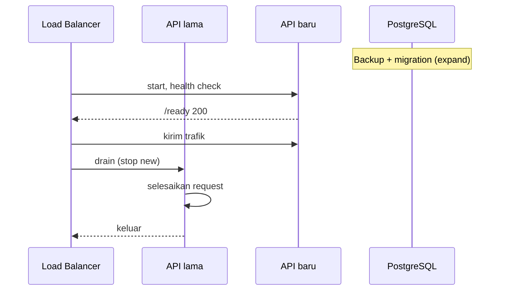

# Deployment — Docker Production

## 1. Prinsip

1. **Image minimal**: tanpa compiler, shell, atau package manager.
2. **Non-root**: user `nonroot` (UID 65532).
3. **Immutable**: konfigurasi dari environment, bukan dari file di image.
4. **Satu binary**: API + worker dalam image yang sama, peran diatur env.
5. **Graceful shutdown**: selesai request dan batch sebelum keluar.
6. **Health check** terpisah: liveness (`/health`) dan readiness (`/ready`).
7. **Migration terpisah**: job sebelum rollout, bukan startup API.
8. **Tidak ada secret di image/layer**.

## 2. Multi-Stage Build

```dockerfile
# syntax=docker/dockerfile:1.7

FROM golang:1.24-alpine AS base
WORKDIR /src
RUN apk add --no-cache git ca-certificates
COPY go.mod go.sum ./
RUN go mod download

FROM base AS builder
ARG VERSION=dev
ARG COMMIT=unknown
COPY . .
RUN CGO_ENABLED=0 GOOS=linux go build \
    -trimpath \
    -ldflags="-s -w -X main.version=${VERSION} -X main.commit=${COMMIT}" \
    -o /out/api ./cmd/api

FROM gcr.io/distroless/static-debian12:nonroot AS production
WORKDIR /app
COPY --from=builder /out/api /app/api
EXPOSE 8080
USER nonroot:nonroot
ENTRYPOINT ["/app/api"]
```

Catatan:

- `time/tzdata` di-import di aplikasi agar tidak perlu file zoneinfo.
- Tidak ada `HEALTHCHECK` di Dockerfile production (dipasang di orchestrator/compose) agar
  image tetap portabel. Health check didefinisikan di compose/Kubernetes.
- `EXPOSE 8080` hanya dokumentasi; port aktual dari `APP_PORT`.

## 3. Image Tagging

| Tag | Kapan | Contoh |
|---|---|---|
| `latest` | Build branch utama | `todoit-api:latest` |
| `v1.2.3` | Release | `todoit-api:v1.2.3` |
| `sha-<short>` | Setiap commit | `todoit-api:sha-a1b2c3d` |
| `staging` | Deploy staging | `todoit-api:staging` |

Production **tidak** memakai `latest`; gunakan tag immutable (`sha` atau semver) agar
rollback deterministik.

## 4. Runtime Security

| Kontrol | Nilai |
|---|---|
| User | `nonroot:nonroot` (65532) |
| Root filesystem | `read_only: true` |
| Temporary files | `tmpfs: /tmp` |
| Capabilities | Drop all |
| `no-new-privileges` | `true` |
| Seccomp | Default Docker |
| Port | > 1024 (8080) |
| Binary | Statis, tanpa shell |

Contoh compose production:

```yaml
services:
  api:
    image: todoit-api:${VERSION}
    ports:
      - "8080:8080"
    env_file:
      - .env.production
    read_only: true
    tmpfs:
      - /tmp:size=64m
    security_opt:
      - no-new-privileges:true
    cap_drop:
      - ALL
    restart: unless-stopped
    healthcheck:
      test: ["CMD", "/app/api", "healthcheck"]
      interval: 15s
      timeout: 3s
      retries: 3
      start_period: 10s
    stop_grace_period: 30s
```

Catatan health check: distroless tidak memiliki `curl`/`wget`. Dua opsi:

1. Binary menyediakan subcommand `api healthcheck` yang melakukan HTTP GET ke
   `http://127.0.0.1:8080/health`.
2. Orkestrator melakukan HTTP probe langsung (Kubernetes).

**Keputusan:** sediakan subcommand `healthcheck` (kecil, tanpa dependency) agar compose
portabel.

## 5. Resource Limits

Contoh:

```yaml
deploy:
  resources:
    limits:
      cpus: "1.0"
      memory: 512M
    reservations:
      cpus: "0.25"
      memory: 128M
```

- `GOMAXPROCS` mengikuti limit CPU; Go 1.24 mendukung `automaxprocs` atau
  `runtime.NumCPU` dengan cgroup awareness. Set `GOMAXPROCS` eksplisit jika perlu.
- `GOGC` default 100; turunkan jika memori ketat (mis. 75).
- DB pool (`DB_MAX_OPEN_CONNS`) harus mempertimbangkan jumlah replika × pool ≤
  `max_connections` PostgreSQL (default 100).

Contoh: 3 replika × 25 koneksi = 75, sisakan untuk migration/ops.

## 6. Graceful Shutdown

```text
SIGTERM
  → srv.Shutdown(ctx 15s)       // berhenti terima request, selesaikan yang aktif
  → cancel worker context
  → worker tunggu batch (max 20s)
  → db.Close()
  → exit 0
```

Konfigurasi:

| Env | Default |
|---|---|
| `HTTP_SHUTDOWN_TIMEOUT` | `15s` |
| `WORKER_SHUTDOWN_TIMEOUT` | `20s` |
| `SERVER_READ_TIMEOUT` | `10s` |
| `SERVER_WRITE_TIMEOUT` | `30s` |
| `SERVER_IDLE_TIMEOUT` | `60s` |

Compose: `stop_grace_period: 30s` > total shutdown agar Docker tidak mengirim `SIGKILL`
terlalu cepat.

Anti-pattern: `os.Exit` di tengah handler, atau menutup DB sebelum HTTP selesai.

## 7. Health Check

| Probe | Endpoint | Kegagalan berarti |
|---|---|---|
| Liveness | `/health` | Proses hang → restart |
| Readiness | `/ready` | DB tidak siap → keluarkan dari load balancer |

Aturan:

- Liveness **tidak** memeriksa DB (mencegah restart loop saat DB down).
- Readiness memeriksa DB dengan timeout 2 detik.
- Worker tidak memengaruhi readiness (keputusan Phase 0).
- `start_period` 10 detik memberi waktu koneksi awal.
- Jangan expose health ke publik tanpa pembatasan di production (boleh, tetapi rate limit
  ringan).

## 8. Migration di Production

Migration dijalankan sebagai **job terpisah** sebelum rollout:

```yaml
  migrate:
    image: todoit-api-migrate:${VERSION}
    command: ["goose", "-dir", "/app/migrations", "postgres", "${DATABASE_URL}", "up"]
    env_file:
      - .env.production
    restart: "no"
```

- Image migration dapat memakai stage `builder` (membawa Go + goose) atau image kecil
  berisi binary `goose` + folder migrations.
- Pipeline: backup → migrate → deploy API → health check.
- Jika migrate gagal, deploy berhenti.
- Satu instance migration; Goose memakai lock untuk mencegah konkurensi.

## 9. Scaling

### 9.1 API

- Stateless → tambah replika di belakang load balancer.
- Sticky session tidak diperlukan (JWT).
- Rate limiter in-memory per instance (batasan didokumentasikan).
- `DB_MAX_OPEN_CONNS` × replika ≤ kapasitas DB.

### 9.2 Worker

| Model | Konfigurasi |
|---|---|
| Satu instance (default) | `WORKER_ENABLED=true` pada satu container |
| Semua instance | Aman karena `SKIP LOCKED`, tetapi beban DB naik |
| Replika khusus worker | Image sama, command sama, `WORKER_ENABLED=true`, tanpa port publik |

Tidak perlu service terpisah; cukup replika dengan env berbeda.

### 9.3 Database

- Connection pooler (PgBouncer) opsional jika replika banyak.
- Baca berat dapat memakai read replica di masa depan (tidak Phase 0).

## 10. Logging dan Observability

- Log JSON ke stdout/stderr; orchestrator yang mengumpulkan.
- Jangan log ke file di dalam container (read-only fs).
- Field wajib: `time`, `level`, `msg`, `request_id`, `method`, `path`, `status`,
  `latency_ms`, `user_id` (jika ada).
- Redaksi: `Authorization`, `password`, `refresh_token`, `token`.
- Level production: `info`; debug hanya sementara dengan flag.
- Metrics/tracing: Phase 9 (opsional), tidak menghalangi deployment.

## 11. TLS dan Reverse Proxy

- TLS diterminasi di reverse proxy/load balancer (Nginx, Traefik, cloud LB).
- Aplikasi hanya HTTP di port internal.
- Set `trusted_proxies` di Gin agar `ClientIP` benar.
- Header keamanan (HSTS, X-Content-Type-Options) di proxy.
- Jangan mengekspos port 8080 ke internet tanpa proxy di production.

## 12. Zero-Downtime Deployment



Syarat:

- Migration kompatibel dengan versi lama (expand-contract).
- Readiness baru 200 sebelum trafik dialihkan.
- Graceful shutdown pada versi lama.
- Tidak ada perubahan kontrak API yang breaking.

## 13. Rollback

| Skenario | Tindakan |
|---|---|
| Bug aplikasi | Deploy image tag sebelumnya |
| Migration kompatibel | Rollback image saja |
| Migration tidak kompatibel | Restore backup + rollback image |
| Data rusak | Restore snapshot, investigasi |

Simpan minimal 3 image terakhir di registry.

## 14. Backup

- PostgreSQL: `pg_dump` harian + WAL archiving (Phase 9).
- Volume persisten untuk data, tetapi **backup tidak boleh hanya mengandalkan volume**.
- Uji restore berkala.
- Enkripsi backup dan simpan di storage terpisah.

## 15. Contoh Pipeline Deploy

```text
1. CI: lint, test, build image, scan vulnerability
2. Push image dengan tag sha
3. Staging: migrate → deploy → smoke test
4. Approval manual
5. Production: backup → migrate → deploy canary/rolling → health check
6. Monitor error rate & latency 15 menit
7. Jika gagal: rollback image
```

## 16. Checklist Production Readiness

- [ ] Image production dibangun dari stage `production`.
- [ ] Non-root, read-only fs, cap drop.
- [ ] Tidak ada `.env` di image.
- [ ] Secret dari secret manager/env runtime.
- [ ] `DB_SSLMODE=require` (atau `verify-full`) di production.
- [ ] Health check liveness & readiness.
- [ ] Graceful shutdown + `stop_grace_period`.
- [ ] Migration job terpisah + backup.
- [ ] Resource limit dan pool DB dihitung.
- [ ] Log JSON ke stdout.
- [ ] Swagger dimatikan.
- [ ] CORS allowlist.
- [ ] Rate limit aktif.
- [ ] Worker hanya di instance yang diinginkan.
- [ ] Rollback image tersedia.
- [ ] Monitoring/alerting dasar.
- [ ] Dokumentasi runbook.

## 17. Keputusan dan Trade-off

| Keputusan | Alasan | Alternatif |
|---|---|---|
| Distroless | Minimal, tanpa shell | Alpine (lebih besar, ada shell) |
| Static binary | Portabel | CGO (butuh libc) |
| Non-root | Mengurangi dampak exploit | Root (berisiko) |
| Read-only fs | Mencegah modifikasi | Writable (risiko) |
| Health subcommand | Portabel di distroless | curl/wget (tidak ada) |
| Migration job | Aman, terkontrol | Auto-migrate (race) |
| Worker in-process | Sederhana | Service terpisah |
| TLS di proxy | Standar | TLS di app (kompleks) |
| Tanpa service mesh | Tidak perlu | Mesh (overhead) |
