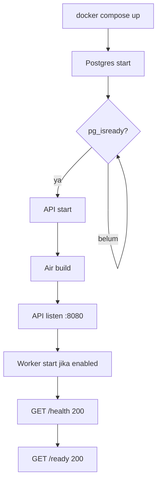

# Development — Docker

## 1. Tujuan

Menyediakan environment development yang:

- Reproducible (versi Go dan PostgreSQL sama dengan CI/production).
- Mendukung hot reload tanpa rebuild image.
- Memakai PostgreSQL nyata, bukan SQLite.
- Tidak memerlukan instalasi Go/PostgreSQL di host (opsional).
- Memisahkan database development dan test.

## 2. Rencana Dockerfile Multi-Stage

> Phase 0 hanya merancang. File `Dockerfile` dibuat pada Phase 1.

```dockerfile
# ---------- base ----------
FROM golang:1.24-alpine AS base
WORKDIR /app
RUN apk add --no-cache git ca-certificates tzdata
COPY go.mod go.sum ./
RUN go mod download

# ---------- development ----------
FROM base AS development
RUN go install github.com/air-verse/air@latest
COPY . .
EXPOSE 8080
CMD ["air", "-c", ".air.toml"]

# ---------- test ----------
FROM base AS test
COPY . .
CMD ["go", "test", "./...", "-race", "-count=1"]

# ---------- builder ----------
FROM base AS builder
ARG VERSION=dev
COPY . .
RUN CGO_ENABLED=0 GOOS=linux go build \
    -trimpath \
    -ldflags="-s -w -X main.version=${VERSION}" \
    -o /out/api ./cmd/api

# ---------- production ----------
FROM gcr.io/distroless/static-debian12:nonroot AS production
WORKDIR /app
COPY --from=builder /out/api /app/api
COPY --from=builder /etc/ssl/certs/ca-certificates.crt /etc/ssl/certs/
EXPOSE 8080
USER nonroot:nonroot
ENTRYPOINT ["/app/api"]
```

### 2.1 Alasan Setiap Stage

| Stage | Alasan |
|---|---|
| `base` | Cache `go mod download`; semua stage berbagi dependency layer |
| `development` | Hot reload dengan Air; source di-bind mount saat compose |
| `test` | Menjalankan test di image yang sama dengan CI; tidak membawa tool dev ke production |
| `builder` | Kompilasi statis (`CGO_ENABLED=0`) agar binary jalan di distroless |
| `production` | Runtime minimal, non-root, tanpa shell/compiler |

Catatan:

- `tzdata` di production diperlukan jika memakai `time.LoadLocation` dan image distroless
  tidak menyediakan zoneinfo. Alternatif: `import _ "time/tzdata"` di `main.go`
  (menambah ~450 KB binary, menghilangkan ketergantungan file). **Keputusan Phase 1:**
  gunakan `time/tzdata` agar image tetap distroless murni, dan tetap salin `tzdata` sebagai
  cadangan.
- `CGO_ENABLED=0` membuat binary statis; driver PostgreSQL murni Go (`pgx`/`lib/pq`) tidak
  memerlukan CGO.
- `-trimpath` menghilangkan path build dari binary.
- `ldflags -s -w` mengecilkan binary; `main.version` diisi saat build.
- `distroless/static:nonroot` sudah memiliki user `nonroot` (UID 65532).

## 3. File Compose

### 3.1 `docker-compose.yml` (base)

Berisi service inti yang dipakai bersama:

```yaml
services:
  postgres:
    image: postgres:16-alpine
    environment:
      POSTGRES_USER: root
      POSTGRES_PASSWORD: dev@123
      POSTGRES_DB: todolist
    ports:
      - "5432:5432"
    volumes:
      - postgres_data:/var/lib/postgresql/data
    healthcheck:
      test: ["CMD-SHELL", "pg_isready -U root -d todolist"]
      interval: 5s
      timeout: 3s
      retries: 10

  api:
    build:
      context: .
      target: development
    env_file:
      - .env.development
    ports:
      - "8080:8080"
    depends_on:
      postgres:
        condition: service_healthy
    volumes:
      - .:/app
      - go_mod_cache:/go/pkg/mod
      - go_build_cache:/root/.cache/go-build

volumes:
  postgres_data:
  go_mod_cache:
  go_build_cache:
```

### 3.2 `docker-compose.dev.yml` (override)

```yaml
services:
  api:
    command: air -c .air.toml
    environment:
      APP_ENV: development
      LOG_LEVEL: debug
    volumes:
      - .:/app
    develop:
      watch:
        - action: sync
          path: .
          target: /app
          ignore:
            - tmp/
            - .git/
```

Catatan: bind mount `.:/app` sudah cukup untuk hot reload. `develop.watch` adalah alternatif
modern; pilih salah satu agar tidak duplikat. **Keputusan:** gunakan bind mount sederhana
untuk kompatibilitas.

### 3.3 `docker-compose.prod.yml` (production-like)

```yaml
services:
  api:
    build:
      context: .
      target: production
      args:
        VERSION: ${VERSION:-local}
    image: todoit-api:${VERSION:-local}
    env_file:
      - .env.production
    ports:
      - "8080:8080"
    read_only: true
    tmpfs:
      - /tmp
    security_opt:
      - no-new-privileges:true
    restart: unless-stopped
```

Tidak memakai bind mount source. Tidak membawa `.env` ke image (env_file disuntikkan saat
runtime oleh Compose).

### 3.4 Service Migrasi

```yaml
  migrate:
    image: todoit-api-migrate:${VERSION:-local}
    build:
      context: .
      target: builder
    command: >
      sh -c "goose -dir /app/migrations postgres \"$DATABASE_URL\" up"
    env_file:
      - .env.development
    depends_on:
      postgres:
        condition: service_healthy
    profiles: ["tools"]
```

Dijalankan manual:

```bash
docker compose --profile tools run --rm migrate
```

Alasan tidak otomatis: menghindari race dan memberi kontrol kapan schema berubah.

## 4. Hot Reload

Menggunakan **Air** (`github.com/air-verse/air`).

`.air.toml` (rencana):

```toml
root = "."
tmp_dir = "tmp"

[build]
  cmd = "go build -o ./tmp/api ./cmd/api"
  bin = "./tmp/api"
  include_ext = ["go", "yaml", "toml"]
  exclude_dir = ["tmp", "vendor", "tests", "docs", "migrations"]
  delay = 500
  stop_on_error = true
  send_interrupt = true
  kill_delay = "2s"

[log]
  time = true
```

Aturan:

- Air hanya untuk development.
- Binary hasil build di `tmp/` diabaikan git dan Docker context.
- Perubahan `migrations/` tidak memicu restart API (migration dijalankan manual).
- Perubahan `.env` memerlukan restart container (env dibaca saat start).

## 5. Volume dan Persistensi

| Volume | Isi | Persist? |
|---|---|---|
| `postgres_data` | Data PostgreSQL | Ya |
| `go_mod_cache` | Module cache | Ya (mempercepat rebuild) |
| `go_build_cache` | Build cache | Ya |
| `.:/app` | Source code | Bind mount host |
| `tmp/` | Binary Air | Tidak (host) |

Perintah reset data development:

```bash
docker compose down -v   # menghapus volume, termasuk database
```

**Peringatan:** `-v` menghapus seluruh data development. Jangan dijalankan di production.

## 6. Environment Development

`.env.development` (rencana, tidak di-commit):

```env
APP_ENV=development
APP_PORT=8080
LOG_LEVEL=debug

DB_HOST=postgres
DB_PORT=5432
DB_USER=root
DB_PASSWORD=dev@123
DB_NAME=todolist
DB_SSLMODE=disable
DB_MAX_OPEN_CONNS=25
DB_MAX_IDLE_CONNS=10

JWT_SECRET=dev-only-secret-minimum-32-characters
JWT_ISSUER=todoit-api
JWT_AUDIENCE=todoit-client
ACCESS_TOKEN_TTL=15m
REFRESH_TOKEN_TTL=720h
BCRYPT_COST=12

WORKER_ENABLED=true
WORKER_INTERVAL=30s
WORKER_BATCH_SIZE=50

CURSOR_SECRET=dev-only-cursor-secret-minimum-32-chars

SMTP_HOST=
SMTP_PORT=587
SMTP_FROM=no-reply@todoit.local
NOTIFICATION_EMAIL_ENABLED=false

CORS_ALLOWED_ORIGINS=http://localhost:5173,http://localhost:3000
SWAGGER_ENABLED=true
```

Aturan:

- `.env.development` **tidak** di-commit (masuk `.gitignore`).
- `.env.example` di-commit dengan placeholder.
- Kredensial dev tidak boleh dipakai di staging/production.
- Password `dev@123` di URL harus di-encode `dev%40123`.

## 7. Database Development

| Aspek | Nilai |
|---|---|
| Host (dalam compose) | `postgres` |
| Host (dari host machine) | `localhost` |
| Port | `5432` |
| Database utama | `todolist` |
| Database test | `todolist_test` |
| User | `root` |
| Password | `dev@123` |
| SSL | `disable` |

Pembuatan database test:

- Script `infra/postgres/init/00-create-test-database.sql` (Phase 1) membuat
  `todolist_test` saat container pertama kali dibuat.
- Test integration memakai `DB_NAME=todolist_test` dan melakukan truncate/migrate sendiri.
- Test **tidak boleh** menyentuh `todolist` development.

Health check:

```bash
docker compose exec postgres pg_isready -U root -d todolist
```

## 8. Perintah Harian

```bash
# start semua
docker compose -f docker-compose.yml -f docker-compose.dev.yml up -d

# lihat log API
docker compose logs -f api

# shell ke container API
docker compose exec api sh

# jalankan migration
docker compose --profile tools run --rm migrate

# jalankan test
docker compose run --rm api go test ./... -race

# hentikan tanpa hapus data
docker compose down

# reset total (hapus data)
docker compose down -v
```

## 9. Urutan Startup



- `depends_on: condition: service_healthy` memastikan API menunggu Postgres.
- API tidak menjalankan migration otomatis. Jika schema belum ada, `/ready` gagal (bukan
  crash loop) sampai migration dijalankan.
- Worker start setelah koneksi DB berhasil.

## 10. Debugging

| Masalah | Penyebab umum | Solusi |
|---|---|---|
| API restart terus | Config invalid | Lihat log; perbaiki `.env` |
| `/ready` 503 | Migration belum jalan / DB belum siap | Jalankan migrate, cek `pg_isready` |
| Port 5432 dipakai | PostgreSQL host berjalan | Hentikan service host atau ubah port mapping |
| Hot reload tidak jalan | Air tidak menemukan perubahan / volume salah | Cek bind mount, `tmp/`, permission |
| Permission denied di volume | UID container vs host | Jalankan sebagai user yang sama atau perbaiki permission |
| `time.LoadLocation` gagal | zoneinfo tidak ada | Import `time/tzdata` atau salin zoneinfo |
| Password DB gagal | Karakter `@` tidak di-encode | Gunakan `%40` di URL |
| Module download lambat | Cache belum ada | Biarkan volume cache terisi |

## 11. Keamanan Development

- Credential dev hanya untuk lokal; jangan reuse.
- Jangan expose PostgreSQL ke internet; mapping `127.0.0.1:5432:5432` lebih aman daripada
  `5432:5432`.
- Jangan commit `.env`.
- Swagger UI aktif di dev; matikan di production.
- Port API dev boleh terbuka di localhost.

## 12. CI vs Local

| Aspek | Local | CI |
|---|---|---|
| Go version | Image `golang:1.24-alpine` | Sama |
| PostgreSQL | `postgres:16-alpine` | Service container `postgres:16-alpine` |
| Test DB | `todolist_test` | `todolist_test` |
| Race detector | Opsional | Wajib (`-race`) |
| Migration | Manual | Otomatis sebelum test |
| Cache | Volume | Cache layer CI |

Kesamaan versi mengurangi "works on my machine".

## 13. Checklist Phase 1

- [ ] `Dockerfile` dengan 5 stage.
- [ ] `docker-compose.yml` + `.dev.yml` + `.prod.yml`.
- [ ] `.dockerignore` mengecualikan `.git`, `.env*`, `tmp`, `docs`, `tests`, binary.
- [ ] `.air.toml`.
- [ ] `scripts/migrate.sh`, `scripts/wait-for-db.sh`, `scripts/seed.sh`.
- [ ] `.env.example`, `.env.development`, `.env.test`.
- [ ] Database test otomatis dibuat.
- [ ] Health check container.
- [ ] Dokumentasi cara menjalankan.
- [ ] Tidak ada secret di image.

## 14. Keputusan dan Trade-off

| Keputusan | Alasan | Alternatif |
|---|---|---|
| Multi-stage 5 stage | Pemisahan jelas dev/test/prod | Satu stage (image besar) |
| Air | Populer, config sederhana | Compileonchange custom |
| Bind mount source | Hot reload cepat | Rebuild image setiap perubahan |
| Postgres 16-alpine | Ringan, cukup | Postgres full (image besar) |
| Distroless production | Serangan surface kecil | Alpine (ada shell) |
| Migration manual | Kontrol & aman | Auto-migrate saat start |
| `time/tzdata` | Tidak bergantung file zoneinfo | Salin zoneinfo |
| Database test terpisah | Isolasi | Pakai DB dev (berisiko) |
