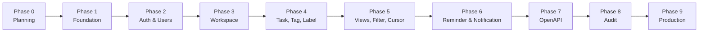

# Implementation Roadmap

## 1. Ringkasan

| Phase | Fokus | Endpoint kumulatif | Status |
|---|---|---|---|
| 0 | Analysis & Technical Planning | 0 | Selesai (dokumen) |
| 1 | Project Foundation & Infrastructure | 2 | Belum |
| 2 | Authentication & User Management | 10 | Belum |
| 3 | Workspace, Membership & Invitation | 22 | Belum |
| 4 | Tasks, Tags & Labels | 37 | Belum |
| 5 | Today, Upcoming, Overdue, Filters & Cursor | 40 | Belum |
| 6 | Reminders & Notifications | 47 | Belum |
| 7 | OpenAPI Completion & Contract Validation | 47 | Belum |
| 8 | Full Testing, Security & Quality Audit | 47 | Belum |
| 9 | Production Readiness & Final Documentation | 47 | Belum |

Aturan eksekusi:

- Satu Phase diselesaikan dan direview sebelum lanjut.
- Tidak ada Phase yang dimulai tanpa instruksi eksplisit.
- Setiap Phase menghasilkan dokumentasi dan test, bukan hanya kode.
- Phase 0 **tidak** menghasilkan source code.

## 2. Phase 1 — Project Foundation & Infrastructure

### 2.1 Objective

Menyiapkan kerangka aplikasi yang dapat dijalankan, diuji, dan di-deploy, tanpa fitur bisnis.

### 2.2 Scope

- Inisialisasi module Go, dependency inti.
- Config loader + validasi env.
- Koneksi PostgreSQL (GORM), pool, health probe.
- Transactor + context DB.
- Structured logging (`slog`).
- Middleware global: request ID, logging, recovery, CORS, body limit.
- Error envelope + error mapping dasar.
- Router factory + registrasi module kosong.
- Health endpoints.
- Goose setup (tanpa tabel bisnis).
- Dockerfile multi-stage + compose dev/prod.
- CI skeleton (lint, unit test, build).
- Script migrate/seed/wait-for-db.

### 2.3 Module

`cmd/api`, `internal/config`, `internal/database`, `internal/middleware`,
`internal/shared/{errors,response,logging,validator,pagination,utils}`.

### 2.4 Migration

- Tidak ada tabel bisnis.
- `goose` terpasang dan `goose_db_version` terbentuk saat migration pertama dijalankan.
- Struktur folder `migrations/` siap.

### 2.5 Endpoint

| Method | Path |
|---|---|
| GET | `/health` |
| GET | `/ready` |

### 2.6 Unit Test Wajib

- Config parsing (valid, missing, invalid range, production SSL guard).
- Error mapping ke HTTP.
- Middleware request ID (header ada/tidak).
- Recovery menangkap panic.
- Response envelope helper.
- Cursor codec (walau belum dipakai endpoint).
- Timezone helper (walau belum dipakai endpoint).

### 2.7 Integration Test

- Koneksi DB berhasil.
- `/health` 200 tanpa DB.
- `/ready` 200 dengan DB, 503 saat DB dimatikan.
- Graceful shutdown (server berhenti, tidak panic).
- Migration up/down dari kosong.

### 2.8 Dokumentasi

- README cara menjalankan.
- `docs/development/docker-development.md` diperbarui dengan perintah aktual.
- Catatan dependency (`go.mod`).

### 2.9 Acceptance Criteria

- [ ] `docker compose up` menjalankan API + PostgreSQL.
- [ ] `/health` dan `/ready` sesuai kontrak.
- [ ] Hot reload berfungsi.
- [ ] Config invalid → exit non-zero dengan pesan jelas.
- [ ] Log JSON di staging/production, text di dev.
- [ ] Tidak ada secret di image/repo.
- [ ] `go test ./...` lulus.
- [ ] `golangci-lint` bersih (atau aturan minimal disepakati).
- [ ] Graceful shutdown teruji.

### 2.10 Dependency

- Phase 0 selesai.

---

## 3. Phase 2 — Authentication & User Management

### 3.1 Objective

Menyediakan register, login, refresh rotation, logout, dan profil user.

### 3.2 Scope

- Model `User`, `UserSession`.
- Repository user (dipakai port) dan session.
- Service auth: password hashing, token signing, session, rotation, reuse detection.
- Middleware auth + `TokenVerifier`.
- Endpoint auth dan users.
- Rate limit login/refresh.
- Seed user development.

### 3.3 Module

`internal/auth`, `internal/users`, `internal/middleware/auth.go`,
`internal/shared/utils/uuid.go`.

### 3.4 Migration

| File | Isi |
|---|---|
| `00001_create_users.sql` | Tabel `users`, unique email partial |
| `00002_create_user_sessions.sql` | Tabel `user_sessions`, index token/family/user |
| `00013` (sebagian) | Index `users`, `user_sessions` |

### 3.5 Endpoint

| Method | Path |
|---|---|
| POST | `/api/v1/auth/register` |
| POST | `/api/v1/auth/login` |
| POST | `/api/v1/auth/refresh` |
| POST | `/api/v1/auth/logout` |
| POST | `/api/v1/auth/logout-all` |
| GET | `/api/v1/auth/me` |
| GET | `/api/v1/users/me` |
| PATCH | `/api/v1/users/me` |

### 3.6 Unit Test Wajib

- Password policy (panjang, komposisi, 72 byte).
- Hash/verify bcrypt.
- Generate/verify access token (issuer, audience, algorithm, expired).
- Refresh token generation + SHA-256.
- Rotasi session: old revoked, new created, family sama.
- Reuse detection: family revoked.
- Logout idempoten.
- Timing equalizer (dummy hash) dipanggil saat user tidak ada.
- Timezone validation di update profil.
- Email normalization.

### 3.7 Integration Test

- Register → login → akses `/auth/me`.
- Register email duplikat → 409.
- Login salah → 401 generik.
- Refresh → token baru; token lama tidak dapat dipakai.
- Reuse token lama → semua family revoked.
- Logout → session tidak valid.
- Logout-all → semua session invalid.
- Rate limit login → 429.
- Soft-deleted user tidak dapat login.
- Password hash tidak muncul di response mana pun.

### 3.8 Dokumentasi

- `docs/architecture/authentication-flow.md` diperbarui jika ada penyimpangan.
- Contoh curl di README.
- Entri OpenAPI awal untuk auth/users.

### 3.9 Acceptance Criteria

- [ ] Semua endpoint sesuai kontrak.
- [ ] Access token 15 menit, refresh 30 hari.
- [ ] Rotasi + reuse detection teruji.
- [ ] Session dicabut saat logout.
- [ ] Tidak ada password/token di log.
- [ ] Rate limit aktif.
- [ ] Test unit + integration lulus.
- [ ] Coverage service auth ≥ 85%.

### 3.10 Dependency

- Phase 1 (config, DB, middleware, response).

---

## 4. Phase 3 — Workspace, Membership & Invitation

### 4.1 Objective

Menyediakan workspace terisolasi, role, dan undangan via email.

### 4.2 Scope

- Model `Workspace`, `WorkspaceMember`, `WorkspaceInvitation`.
- Service workspace + authorization policy.
- Port `WorkspaceAccess`, `UserDirectory`, `UserWriter`.
- Invitation token + email (SMTP/logger).
- Cursor pagination untuk member/invitation/workspace.
- Audit log dasar (opsional Phase 3/8).

### 4.3 Module

`internal/workspaces`, `internal/shared/mailer`.

### 4.4 Migration

| File | Isi |
|---|---|
| `00003_create_workspaces.sql` | `workspaces` |
| `00004_create_workspace_members.sql` | membership + unique owner |
| `00005_create_workspace_invitations.sql` | invitation + unique pending |
| `00013` (sebagian) | index workspace/member/invitation |

### 4.5 Endpoint

| Method | Path |
|---|---|
| POST | `/api/v1/workspaces` |
| GET | `/api/v1/workspaces` |
| GET | `/api/v1/workspaces/{workspace_id}` |
| PATCH | `/api/v1/workspaces/{workspace_id}` |
| DELETE | `/api/v1/workspaces/{workspace_id}` |
| GET | `/api/v1/workspaces/{workspace_id}/members` |
| PATCH | `/api/v1/workspaces/{workspace_id}/members/{user_id}` |
| DELETE | `/api/v1/workspaces/{workspace_id}/members/{user_id}` |
| POST | `/api/v1/workspaces/{workspace_id}/invitations` |
| GET | `/api/v1/workspaces/{workspace_id}/invitations` |
| DELETE | `/api/v1/workspaces/{workspace_id}/invitations/{invitation_id}` |
| POST | `/api/v1/invitations/accept` |
| POST | `/api/v1/invitations/{token}/accept` (alias) |

### 4.6 Unit Test Wajib

- Permission matrix (semua kombinasi role × action).
- Owner protection (remove/demote).
- Role escalation (ADMIN → ADMIN/OWNER).
- Create workspace membuat owner membership.
- Accept invitation: status, expiry, email mismatch, already member.
- Invitation duplicate pending.
- Token hashing.
- Cursor member/invitation.
- Email template (subject, link, no token in log).

### 4.7 Integration Test

- Workspace isolation (user B → 404).
- Tidak ada workspace tanpa owner.
- Partial unique owner (dua owner gagal).
- Invite → accept → member.
- Cancel invitation.
- Expired invitation → 410.
- Invitation email mismatch → 403.
- Remove member/leave.
- Soft delete workspace → 404.
- List workspace hanya milik user.

### 4.8 Dokumentasi

- `docs/architecture/workspace-authorization.md` diperbarui dengan implementasi nyata.
- Contoh alur undangan.
- OpenAPI workspace/member/invitation.

### 4.9 Acceptance Criteria

- [ ] Semua endpoint sesuai kontrak.
- [ ] Permission matrix teruji negatif.
- [ ] Owner tidak dapat dihapus/diturunkan.
- [ ] Undangan idempoten/aman.
- [ ] Email gagal tidak menggagalkan pembuatan undangan.
- [ ] Tidak ada kebocoran workspace (404).
- [ ] Cursor berfungsi.
- [ ] Test lulus.

### 4.10 Dependency

- Phase 2 (user, auth, middleware).

---

## 5. Phase 4 — Tasks, Tags & Labels

### 5.1 Objective

Menyediakan CRUD task lengkap dengan tag, label, assignee, dan due date.

### 5.2 Scope

- Model `Task`, `Tag`, `Label`, pivot.
- Repository task (termasuk replace pivot).
- Service task + validasi assignee/tag/label.
- Port `TagCatalog`, `LabelCatalog`.
- CRUD tag/label.
- Soft delete task + cancel reminder (belum ada reminder; siapkan hook).
- Cursor dasar untuk task (list default).

### 5.3 Module

`internal/tasks`, `internal/tags`, `internal/labels`.

### 5.4 Migration

| File | Isi |
|---|---|
| `00006_create_tasks.sql` | `tasks` + unique `(id, workspace_id)` |
| `00007_create_tags.sql` | `tags` + unique `(id, workspace_id)` |
| `00008_create_labels.sql` | `labels` + check color |
| `00009_create_task_tags.sql` | pivot + composite FK |
| `00010_create_task_labels.sql` | pivot + composite FK |
| `00013` (sebagian) | index task/pivot/tag/label |

### 5.5 Endpoint

| Method | Path |
|---|---|
| POST | `/api/v1/workspaces/{workspace_id}/tasks` |
| GET | `/api/v1/workspaces/{workspace_id}/tasks` |
| GET | `/api/v1/workspaces/{workspace_id}/tasks/{task_id}` |
| PATCH | `/api/v1/workspaces/{workspace_id}/tasks/{task_id}` |
| DELETE | `/api/v1/workspaces/{workspace_id}/tasks/{task_id}` |
| POST | `/api/v1/workspaces/{workspace_id}/tasks/{task_id}/complete` |
| POST | `/api/v1/workspaces/{workspace_id}/tasks/{task_id}/reopen` |
| POST/GET/PATCH/DELETE | `/api/v1/workspaces/{workspace_id}/tags...` (4) |
| POST/GET/PATCH/DELETE | `/api/v1/workspaces/{workspace_id}/labels...` (4) |

### 5.6 Unit Test Wajib

- Validasi title/description/status/priority/due_at.
- Assignee non-member → 422.
- Tag/label lintas workspace → 422.
- Replace pivot (termasuk array kosong).
- Complete/reopen idempotensi + `completed_at`.
- Status transition.
- Soft delete tidak muncul di list.
- Uniqueness tag/label case-insensitive.
- Color format.
- Cursor default list.
- Error mapping.

### 5.7 Integration Test

- CRUD task lengkap.
- Task workspace lain → 404.
- Pivot benar-benar tersimpan.
- Composite FK menolak tag lintas workspace (uji DB langsung).
- Cascade delete tag/label.
- Soft delete task.
- List task dengan pagination dasar.
- Assignee member valid.
- Creator tetap ada setelah member keluar.

### 5.8 Dokumentasi

- Contoh payload task.
- OpenAPI task/tag/label.
- Catatan keputusan tag vs label.

### 5.9 Acceptance Criteria

- [ ] CRUD task/tag/label sesuai kontrak.
- [ ] Workspace scope dijaga service + DB.
- [ ] Pivot replace benar.
- [ ] Complete/reopen idempoten.
- [ ] Tidak ada tag/label lintas workspace.
- [ ] Test lulus.

### 5.10 Dependency

- Phase 3 (workspace access, membership).

---

## 6. Phase 5 — Today, Upcoming, Overdue, Filters & Cursor Pagination

### 6.1 Objective

Menyediakan view produktivitas, filter lengkap, sorting, dan cursor pagination yang stabil.

### 6.2 Scope

- Query builder filter task.
- Cursor codec final + HMAC + filter hash.
- Timezone helper final.
- View Today/Upcoming/Overdue.
- Index tuning + `EXPLAIN` test.
- Frontend-facing meta (`timezone`, `range_start`, `range_end`).
- `q` search basic (ILIKE).

### 6.3 Module

`internal/tasks` (services/repositories), `internal/shared/pagination`,
`internal/shared/utils`.

### 6.4 Migration

- `00013_indexes_and_hardening.sql` final:
  - `ix_tasks_workspace_due`
  - `ix_tasks_workspace_status_created`
  - `ix_tasks_workspace_priority`
  - `ix_tasks_workspace_assignee`
  - `ix_tasks_workspace_updated`
  - `ix_tasks_worker_due`
- Tidak ada kolom baru.
- Opsional: index `lower(title)` (hanya jika terbukti perlu).

### 6.5 Endpoint

| Method | Path |
|---|---|
| GET | `/api/v1/workspaces/{workspace_id}/tasks/views/today` |
| GET | `/api/v1/workspaces/{workspace_id}/tasks/views/upcoming` |
| GET | `/api/v1/workspaces/{workspace_id}/tasks/views/overdue` |

Plus penyempurnaan `GET /tasks` (filter/sort/cursor).

### 6.6 Unit Test Wajib

- Cursor encode/decode, signature, filter hash mismatch.
- Sort/order semua kombinasi.
- Tie-breaker id.
- Limit clamp.
- Today range Jakarta/New York, DST.
- Upcoming range.
- Overdue condition.
- Filter AND/OR.
- `due_from > due_to` → 422.
- `q` escaping.
- Invalid tag filter → 422.

### 6.7 Integration Test

- 3 halaman cursor tanpa duplikat/hilang.
- Cursor dengan filter berbeda → 422.
- Today/Upcoming/Overdue dengan data lintas timezone.
- Task DONE tidak muncul di view.
- Task tanpa due date tidak muncul.
- `EXPLAIN` memakai index (bukan seq scan) pada dataset 10k.
- Filter tag AND.
- Sort priority/title.

### 6.8 Dokumentasi

- `docs/api/cursor-pagination.md` diperbarui dengan implementasi.
- `docs/architecture/timezone-handling.md` diverifikasi.
- Contoh response view.

### 6.9 Acceptance Criteria

- [ ] View tanggal akurat untuk minimal 2 timezone + DST.
- [ ] Cursor stabil & tidak dapat dimanipulasi.
- [ ] Filter konsisten dengan cursor.
- [ ] Index terpakai (dibuktikan `EXPLAIN`).
- [ ] Tidak ada offset pagination sebagai mekanisme utama.
- [ ] Test lulus.

### 6.10 Dependency

- Phase 4 (task, tag, label).

---

## 7. Phase 6 — Reminders & Notifications

### 7.1 Objective

Menyediakan reminder terjadwal, notifikasi in-app, dan worker yang aman.

### 7.2 Scope

- Model `Reminder`, `Notification`.
- CRUD reminder.
- Notification inbox + mark read.
- Worker: claim `FOR UPDATE SKIP LOCKED`, dedupe, retry, stale recovery.
- Due soon/overdue scan.
- Email opsional + logger adapter.
- Graceful shutdown worker.

### 7.3 Module

`internal/reminders`, `internal/notifications`, `internal/shared/mailer`.

### 7.4 Migration

| File | Isi |
|---|---|
| `00011_create_reminders.sql` | `reminders` + composite FK + index due |
| `00012_create_notifications.sql` | `notifications` + unique dedupe + index inbox |
| `00013` (sebagian) | index worker/inbox final |

### 7.5 Endpoint

| Method | Path |
|---|---|
| POST | `/api/v1/workspaces/{workspace_id}/tasks/{task_id}/reminders` |
| GET | `/api/v1/workspaces/{workspace_id}/tasks/{task_id}/reminders` |
| PATCH | `/api/v1/workspaces/{workspace_id}/tasks/{task_id}/reminders/{reminder_id}` |
| DELETE | `/api/v1/workspaces/{workspace_id}/tasks/{task_id}/reminders/{reminder_id}` |
| GET | `/api/v1/notifications` |
| PATCH | `/api/v1/notifications/{notification_id}/read` |
| POST | `/api/v1/notifications/read-all` |

### 7.6 Unit Test Wajib

- Validasi `scheduled_at` (masa depan, offset wajib).
- Limit 5 reminder PENDING.
- Edit/delete hanya status tertentu.
- Penerima default (assignee → creator).
- Dedupe key generator.
- Retry backoff.
- Stale lock recovery.
- Notification mark read idempoten.
- Cursor notifikasi.

### 7.7 Integration Test

- Reminder due → notification tepat satu.
- Dua worker paralel → satu notifikasi.
- Crash setelah insert → retry tidak duplikat.
- Task dihapus → reminder CANCELLED.
- Task DONE → reminder CANCELLED.
- Inbox hanya milik user.
- `read-all` dengan filter workspace.
- Worker shutdown tidak meninggalkan `PROCESSING` permanen.
- SMTP gagal → in-app tetap dibuat.

### 7.8 Dokumentasi

- `docs/architecture/notification-worker.md` diperbarui dengan implementasi.
- Contoh konfigurasi worker.
- OpenAPI reminder/notification.

### 7.9 Acceptance Criteria

- [ ] Reminder terkirim dalam ±1 interval.
- [ ] Tidak ada notifikasi duplikat.
- [ ] Worker aman multi-instance.
- [ ] Graceful shutdown teruji.
- [ ] Retry dan stale recovery bekerja.
- [ ] Inbox personal dan cursor.
- [ ] Test lulus.

### 7.10 Dependency

- Phase 5 (task, due date, index).

---

## 8. Phase 7 — OpenAPI Completion & API Contract Validation

### 8.1 Objective

Menjadikan OpenAPI 3.0.3 sebagai kontrak resmi yang lengkap dan tervalidasi.

### 8.2 Scope

- `docs/openapi/openapi.yaml` lengkap untuk 47 endpoint.
- Swagger UI.
- Schema component (DTO, error, envelope, pagination).
- Validasi spec di CI.
- Test contract route ↔ spec.
- Contoh request/response.
- Dokumentasi autentikasi di spec (`bearerAuth`).

### 8.3 Module

Tidak ada module baru. Perubahan pada `internal/*/routes`, `docs/openapi`,
`tests/unit/openapi_test.go`.

### 8.4 Migration

Tidak ada.

### 8.5 Endpoint

Tidak ada endpoint baru. Semua 47 endpoint harus tercakup.

### 8.6 Unit Test Wajib

- Spec valid terhadap OpenAPI 3.0.3.
- Semua route Gin ada di spec.
- Semua path spec ada di route.
- Enum spec = enum Go.
- Error code spec = konstanta Go.
- Contoh response memenuhi schema.

### 8.7 Integration Test

- Smoke test setiap endpoint memakai contoh dari spec (minimal happy path).
- Validasi response terhadap schema.

### 8.8 Dokumentasi

- `docs/openapi/openapi.yaml`.
- `docs/api/*` disinkronkan.
- README cara membuka Swagger.

### 8.9 Acceptance Criteria

- [ ] 47 endpoint terdokumentasi.
- [ ] Spec valid & lint bersih.
- [ ] Tidak ada drift route/spec.
- [ ] Swagger UI berfungsi.
- [ ] Contoh request dapat dijalankan.

### 8.10 Dependency

- Phase 2–6 (seluruh endpoint).

---

## 9. Phase 8 — Full Testing, Security & Quality Audit

### 9.1 Objective

Memastikan kualitas, keamanan, dan ketahanan sebelum production.

### 9.2 Scope

- Lengkapi test yang kurang (coverage target).
- Security audit: IDOR, role escalation, JWT, rate limit, headers, CORS.
- Race detector, fuzz test parser/cursor.
- Load test dasar (k6/JMeter).
- Dependency vulnerability scan (`govulncheck`, image scan).
- Audit logging (opsional).
- Performance tuning query/index.
- Dokumentasi hasil audit.

### 9.3 Module

Semua module (perbaikan), `tests/`, `scripts/`.

### 9.4 Migration

- Hanya jika audit menemukan index/constraint kurang.
- Tidak ada perubahan schema yang breaking.

### 9.5 Endpoint

Tidak ada endpoint baru (kecuali perbaikan kontrak).

### 9.6 Unit Test Wajib

- Coverage service ≥ 85%, controller ≥ 80%, shared ≥ 80%.
- Fuzz cursor decoder (tidak panic).
- Fuzz validator (tidak panic).
- Test permission matrix lengkap.
- Test error mapping lengkap.

### 9.7 Integration Test

- Seluruh skenario Phase 2–6 dijalankan di CI.
- Concurrency: dua worker, dua refresh paralel, dua accept invitation.
- Isolasi workspace menyeluruh.
- Rate limit.
- Load: 100 RPS list task, p95 < 300 ms (dataset 100k).
- DB down → readiness 503, recover.
- Migration up/down/up.

### 9.8 Dokumentasi

- `docs/development/testing-strategy.md` diperbarui.
- Laporan audit keamanan.
- Catatan performa (EXPLAIN, benchmark).
- Risiko residual.

### 9.9 Acceptance Criteria

- [ ] Semua test lulus, `-race` bersih.
- [ ] Tidak ada temuan kritis/tinggi yang belum dimitigasi.
- [ ] Coverage target tercapai.
- [ ] Load test sesuai target.
- [ ] Tidak ada IDOR/role escalation.
- [ ] Dependency scan bersih (atau diterima dengan alasan).
- [ ] Audit log (jika ada) tidak memuat secret.

### 9.10 Dependency

- Phase 7 (kontrak lengkap).

---

## 10. Phase 9 — Production Readiness & Final Documentation

### 10.1 Objective

Menyiapkan deployment production yang aman, terdokumentasi, dan dapat dioperasikan.

### 10.2 Scope

- Finalisasi Docker production (non-root, read-only, health).
- Secret manager integration.
- Migration job + backup/restore.
- Observability: metrics, tracing, alerting (opsional).
- Runbook operasional.
- Disaster recovery.
- Retensi data (notifikasi/session/reminder).
- Load balancer/TLS.
- Rollback drill.
- Dokumentasi final & handover.

### 10.3 Module

Infrastruktur + seluruh module (hardening), `docs/deployment`, `docs/operations`.

### 10.4 Migration

- Index tambahan berdasarkan observasi production.
- Retensi/partisi (jika perlu).
- Tidak ada perubahan breaking.

### 10.5 Endpoint

Tidak ada endpoint baru. Mungkin menambah `/metrics` (internal) jika disetujui.

### 10.6 Unit Test Wajib

- Config production (SSL wajib, secret valid).
- Healthcheck subcommand.
- Graceful shutdown dengan timeout.
- Retensi job (jika ada).

### 10.7 Integration Test

- Deploy staging end-to-end.
- Migrasi dari data mirip production.
- Backup → restore → aplikasi berjalan.
- Rollback image.
- Failover DB (jika tersedia).
- Smoke test production-like.

### 10.8 Dokumentasi

- `docs/deployment/docker-production.md` final.
- `docs/deployment/environment-strategy.md` final.
- Runbook: deploy, rollback, incident, backup, restore.
- Checklist go-live.
- Dokumentasi retensi & retensi data.

### 10.9 Acceptance Criteria

- [ ] Image production lolos scan & non-root.
- [ ] Secret dari manager, bukan env file di repo.
- [ ] Backup & restore teruji.
- [ ] Rollback teruji.
- [ ] Monitoring & alerting dasar aktif.
- [ ] Runbook lengkap.
- [ ] Go-live checklist ditandatangani.
- [ ] Dokumentasi konsisten dengan implementasi.

### 10.10 Dependency

- Phase 8 (audit selesai).

---

## 11. Dependency Graph Phase

Tidak ada Phase yang boleh dimulai sebelum dependency-nya selesai dan diterima.

## 12. Estimasi Kompleksitas Relatif

| Phase | Kompleksitas | Risiko utama |
|---|---|---|
| 1 | Sedang | Konfigurasi Docker, lifecycle |
| 2 | Tinggi | Keamanan token, rotasi |
| 3 | Tinggi | Otorisasi, invitation |
| 4 | Sedang | Integritas pivot |
| 5 | Tinggi | Cursor + timezone + index |
| 6 | Tinggi | Concurrency, idempotensi |
| 7 | Sedang | Disiplin kontrak |
| 8 | Tinggi | Cakupan test, performa |
| 9 | Sedang | Operasional, secret |

Estimasi waktu tidak dicantumkan karena bergantung pada tim; urutan dan dependency lebih
penting.

## 13. Definition of Done per Phase (Umum)

Setiap Phase dianggap selesai jika:

- [ ] Scope Phase terpenuhi.
- [ ] Endpoint berfungsi sesuai kontrak.
- [ ] Unit test dan integration test lulus.
- [ ] Tidak ada TODO kritis di kode.
- [ ] Dokumentasi diperbarui.
- [ ] OpenAPI diperbarui (jika ada endpoint).
- [ ] Code review disetujui.
- [ ] Tidak ada regresi pada Phase sebelumnya.
- [ ] Demo/staging dapat dijalankan.

## 14. Yang Tidak Dilakukan Otomatis

- Phase 1 tidak dimulai setelah Phase 0 tanpa instruksi.
- Tidak ada deployment production otomatis pada Phase 0–8.
- Tidak ada fitur di luar requirement tanpa persetujuan (reset password, transfer ownership,
  subtask, realtime, dsb).

## 15. Backlog Teridentifikasi (Belum Disepakati)

| Item | Alasan ditunda |
|---|---|
| Reset password | Butuh email flow & keputusan produk |
| Verifikasi email | Belum diminta |
| Transfer ownership | Butuh endpoint & aturan khusus |
| Decline/resend invitation | Tidak ada di kontrak |
| Session list/revoke per device | Tidak diminta |
| Realtime notifikasi (SSE/WebSocket) | Polling cukup |
| Attachment | Tidak diminta |
| Recurring task / subtask | Tidak diminta |
| Full-text search | Trigram ditunda |
| Export data | Tidak diminta |
| Audit log lengkap | Phase 8/9 opsional |
| Retensi notifikasi otomatis | Phase 9 |
| Multi-owner workspace | Model satu owner dipilih |
| Offset pagination untuk admin | Tidak ada admin UI |
| Rate limit terdistribusi | In-memory cukup untuk awal |

Item backlog tidak boleh diimplementasikan tanpa persetujuan eksplisit.
