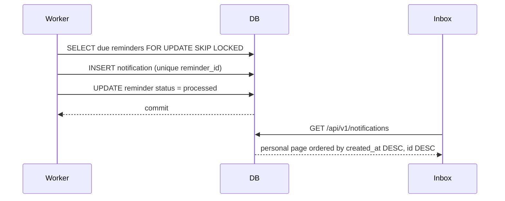

# Notification System

## Purpose

Notifications are persistent in-app messages created when a due reminder is
delivered. They are personal to the recipient and remain in the inbox until the
user marks them read.

Phase 5 does not add email, SMS, or push delivery. The notification record is the
delivery mechanism.

## Data model

`notifications` stores a snapshot of the delivered message.

| Column | Type | Notes |
|---|---|---|
| `id` | UUID | Primary key |
| `user_id` | UUID | Required recipient, `ON DELETE CASCADE` |
| `todo_id` | UUID | Nullable, `ON DELETE SET NULL` |
| `reminder_id` | UUID | Nullable, unique, `ON DELETE SET NULL` |
| `title` | string(255) | Snapshot title |
| `message` | text | Snapshot message |
| `type` | string | `todo_reminder` or `due_date_reminder` |
| `is_read` | boolean | Read state |
| `read_at` | timestamptz | Required when `is_read = true` |
| `created_at` | timestamptz | Delivery timestamp |

### Snapshot semantics

`title` and `message` are copied at delivery time. If the Todo is renamed or
deleted later, the notification keeps its original wording. This preserves the
meaning of historical inbox entries.

### Notification types

| Type | Source | Title |
|---|---|---|
| `todo_reminder` | Manual reminder | `Todo Reminder` |
| `due_date_reminder` | Automatic reminder | `Upcoming Todo Due Date` |

## Ownership

- Every notification belongs to exactly one user.
- List, detail, mark-read, and read-all operations are scoped to the
  authenticated user.
- A notification owned by another user is reported as `NOTIFICATION_NOT_FOUND`
  (404), never as a permission error, to avoid leaking existence.

## Uniqueness and idempotency

`notifications.reminder_id` has a unique constraint. The worker creates at most
one notification per reminder, even if multiple worker processes race or the
worker restarts.

The database also enforces read-state consistency:

```text
(is_read = false AND read_at IS NULL)
OR
(is_read = true AND read_at IS NOT NULL)
```

## Indexes

- `ix_notifications_user_id`
- `ix_notifications_todo_id`
- `ix_notifications_reminder_id`
- `ix_notifications_is_read`
- `ix_notifications_user_created_at`
- `ix_notifications_user_created_id` — keyset pagination
- `ix_notifications_user_unread`

## Delivery flow



## Read state

- New notifications start unread with `read_at = NULL`.
- Marking one notification read sets `is_read = true` and `read_at = now`.
- Repeated mark-read calls are idempotent and preserve the first `read_at`.
- Mark-all-read updates only the current user's unread notifications in one SQL
  statement and returns the number of changed rows.
- Already-read notifications keep their original `read_at`.

## Retention and deletion

- Notifications are not deleted when a Todo or reminder is removed.
- `todo_id` and `reminder_id` become `NULL`, preserving the snapshot.
- Deleting a user cascades to that user's notifications.
- There is no automatic retention purge in Phase 5.

## Pagination

Notification listing uses signed cursor pagination, never `OFFSET`:

- order: `created_at DESC, id DESC`
- default page size: 20
- maximum page size: 100
- optional `is_read` filter
- cursor bound to the user and the filter

See [`notification-api.md`](notification-api.md) for the wire format.

## Operational guarantees

- A notification is created in the same transaction that marks its reminder
  processed.
- If the transaction fails, the reminder stays pending and is retried.
- If a duplicate insert is detected, the worker reconciles the reminder to
  processed using the existing notification.
- Notification history survives Todo and reminder deletion.
