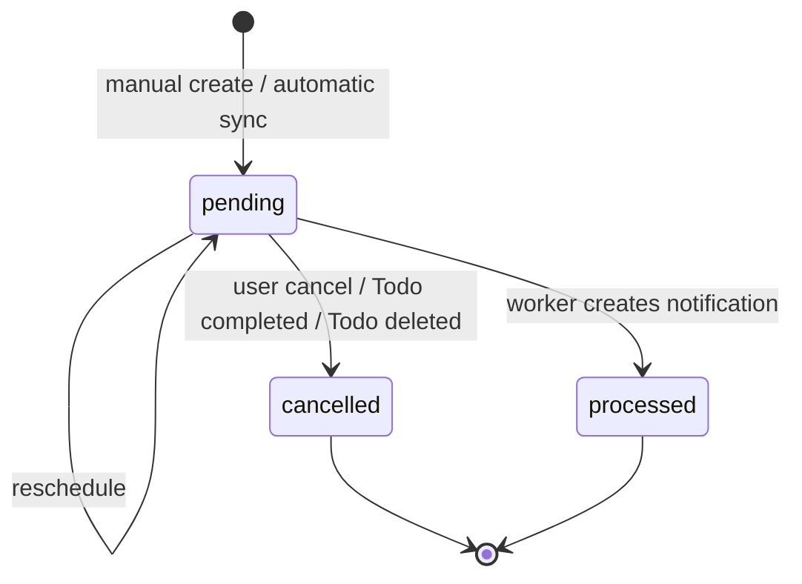

# Reminder Lifecycle

## State machine



Only `pending` reminders are mutable or deliverable. `processed` and
`cancelled` are terminal states.

## Transitions

| Trigger | Actor | Result |
|---|---|---|
| Manual reminder created | Owner via API | New `pending` row with `source = manual` |
| Todo created or updated with a future `due_at` | Todo service | Automatic `pending` row created or moved |
| Todo `due_at` cleared or moved into the past | Todo service | Pending automatic reminder cancelled |
| Todo marked `completed` | Todo service | Every pending reminder for the Todo cancelled |
| Todo reopened with a future `due_at` | Todo service | New automatic reminder scheduled |
| Todo deleted | Todo service / database | Reminders cascade-deleted; notification history preserved |
| Reminder rescheduled | Owner via API | `remind_at` and `updated_at` changed |
| Reminder cancelled | Owner via API | `status = cancelled`, `processed_at = NULL` |
| Reminder becomes due | Worker | Notification created, `status = processed` |
| Reminder no longer deliverable | Worker | `status = cancelled`, no notification |

## Manual reminder flow

1. The client calls `POST /api/v1/todos/{todo_id}/reminders`.
2. The service verifies Todo existence and workspace membership.
3. The recipient is forced to the authenticated user.
4. `remind_at` is normalized to UTC and must be in the future.
5. A duplicate pending reminder for the same Todo, user, and instant is
   rejected with `REMINDER_DUPLICATE`.
6. The row is inserted as `pending` / `manual`.

Rescheduling follows the same validation. Only the owner may update a pending
manual reminder. Automatic reminders cannot be rescheduled through the API.

## Automatic reminder flow

Automatic reminders are a projection of the Todo due date:

```text
trigger_at = due_at - DEFAULT_DUE_REMINDER_MINUTES
```

If `trigger_at` is already in the past but `due_at` is still in the future, the
reminder is scheduled at the current time so the worker delivers it on the next
poll. See [`automatic-due-reminder.md`](automatic-due-reminder.md).

## Completion and reopening

Completing a Todo cancels **all** pending reminders for that Todo, including
manual reminders. This prevents a completed task from producing new alerts.

Reopening a Todo schedules a new automatic reminder only when:

- automatic reminders are enabled,
- the Todo has a future `due_at`, and
- no pending automatic reminder already exists for the creator.

Manual reminders are not recreated automatically.

## Deletion and history

- Deleting a Todo cascades to its reminders.
- Notifications are not cascade-deleted. Their `todo_id` and `reminder_id`
  foreign keys use `ON DELETE SET NULL`, so the inbox keeps the snapshot title
  and message even after the source rows disappear.

## Cancellation semantics

- Cancelling an already cancelled reminder is idempotent and returns 204.
- A processed reminder cannot be cancelled.
- Cancellation is a soft state change; rows are retained for audit and
  uniqueness rules.

## Worker transition safety

The worker processes one batch in a single transaction:

1. Select due `pending` reminders with `FOR UPDATE SKIP LOCKED`.
2. Re-check state and `remind_at` inside a savepoint.
3. Create the notification and mark the reminder `processed` atomically.
4. Commit the batch.

If the notification insert fails, the savepoint is rolled back and the reminder
remains `pending` for a later poll. If another worker already created the
notification, the reminder is reconciled to `processed` and counted as a
duplicate instead of failing.

## Idempotency guarantees

- A unique constraint on `notifications.reminder_id` guarantees at most one
  notification per reminder.
- Re-running the worker never creates a second notification.
- Re-sending the same manual reminder time is rejected by the partial unique
  index.
- Rescheduling an already processed or cancelled reminder is rejected.
