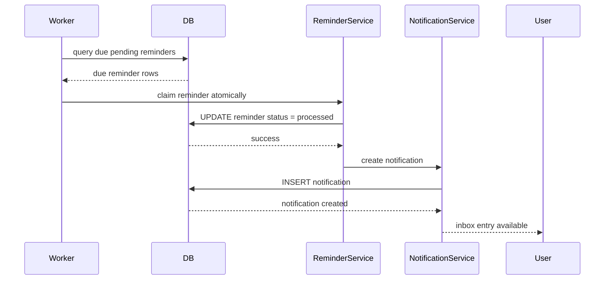

# Reminder and Notification Design

## Reminder lifecycle

A reminder is a scheduled notification trigger linked to a specific Todo and user. It always uses UTC timestamps internally, while evaluation is aligned to the user’s timezone for due-date contextual reminder logic.

### Reminder states

- `pending`
- `processed`
- `cancelled`

### Automatic reminder default

Default reminder window: `60 minutes before due date`.

### Reminder creation rules

- Only create automatic reminders when a Todo has a `due_at` value.
- Manual reminder creation is allowed when the user wants additional custom reminders.
- If a Todo’s due date changes, any pending automatic reminder should be recalculated or reissued in a consistent way.
- If a Todo is completed or deleted, the system must not continue processing the reminder.

## Notification lifecycle

Notification is a persistent in-app message. It is created by the worker after a reminder becomes due and must be saved in PostgreSQL for later retrieval.

Fields:
- `id`
- `user_id`
- `todo_id` (nullable)
- `reminder_id` (nullable)
- `title`
- `message`
- `type`
- `is_read`
- `read_at`
- `created_at`

## Worker architecture

The notification worker is a database-backed background process in the same modular monolith. It polls for due reminders, executes them transactionally, and writes notifications without duplicating work.

### Worker responsibilities

- Fetch due `pending` reminders in a lock-safe query
- Mark chosen reminders as processing or processed
- Create notification rows
- Handle restart recovery and idempotency
- Gracefully shut down without losing scheduled work

## Concurrency strategy

Recommended approach:

- Use a transaction to select due reminders with a conditional update or `FOR UPDATE SKIP LOCKED` pattern.
- Only one worker should claim a single reminder.
- Each reminder can be uniquely tied to a reminder_id or unique notification constraint to avoid duplicates.
- Worker must set `status` to `processed` before or during notification creation to prevent double-claiming.

## Idempotency

A reminder should be processed once even if multiple workers race to claim it.

Recommended design:
- unique index or business-level constraint to ensure one notification per reminder when needed
- transactional state change before notification insertion
- failure-safe retry logic with explicit `status` semantics

## Sequence diagram

## Failure handling

- If worker crashes after marking a reminder processed but before creating the notification, a repair path or retry-safe reconciliation job must recheck `processed` status and create missing notifications.
- If the notification insert fails, the reminder should remain in a recoverable state, not silently vanish.
- If due-date logic translates to UTC incorrectly, the worker may trigger or miss notifications; therefore, timezone conversion must be validated with tests.

## Notification retrieval and read state

Notification retrieval must be user-scoped and include:
- unread only filter
- read filter
- pagination by `created_at DESC`
- read-all action

The resource must never expose another user’s notifications.

## Endpoint behavior

- `GET /api/v1/notifications` list notifications for current user
- `GET /api/v1/notifications/{id}` detail for current user
- `POST /api/v1/notifications/{id}/read` mark read
- `POST /api/v1/notifications/read-all` mark all current user notifications as read

## Operational considerations

- Worker should handle graceful shutdown with SIGTERM by finishing current transaction and stopping loop.
- The worker loop should continue after application restarts by scanning pending reminders.
- Persistent notification records allow the system to recover without relying on in-memory state.
- The worker should not create duplicate notifications for the same reminder.
