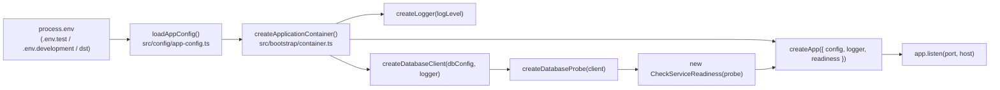
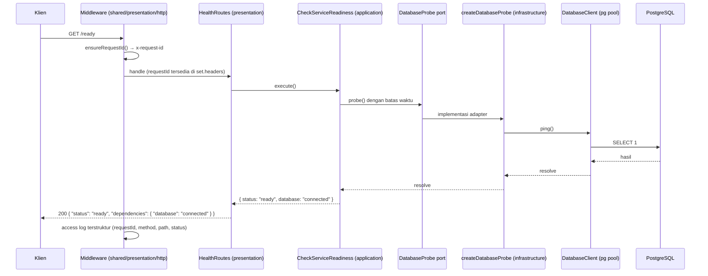
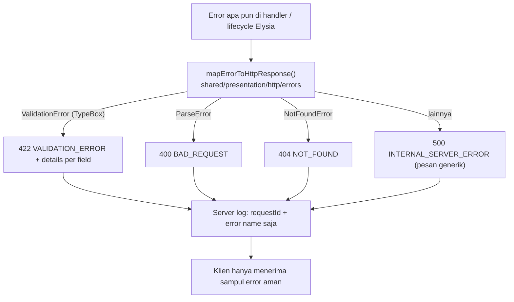

# Gambaran Besar Arsitektur

Backend ini adalah **satu codebase modular monolith** dengan **Clean Architecture** di dalam
setiap business module. Satu proses, satu deployment unit, tetapi batas antar module dijaga
sehingga framework, ORM, dan driver dapat diganti tanpa menyentuh business logic.

## Struktur layer

```mermaid
flowchart TD
    subgraph Presentation["Presentation (HTTP)"]
        ROUTES["Elysia routes<br/>modules/*/presentation/http"]
        ERRORS["Error envelope + request id<br/>shared/presentation/http"]
        OPENAPI["OpenAPI/Scalar + CORS<br/>shared/presentation/http/plugins"]
    end

    subgraph Application["Application"]
        USECASE["Use cases & DTO<br/>modules/*/application"]
        PORTS["Port / contract<br/>modules/*/application/ports"]
    end

    subgraph Domain["Domain"]
        RULES["Entities, value objects, domain errors<br/>(belum ada pada Phase 1)"]
    end

    subgraph Infrastructure["Infrastructure"]
        DBCLIENT["DatabaseClient (pg pool + Drizzle)<br/>shared/infrastructure/database"]
        PROBES["Adapter implementasi port<br/>modules/*/infrastructure"]
        LOGGING["Structured logger<br/>shared/infrastructure/logging"]
    end

    DB[("PostgreSQL")]

    ROUTES --> USECASE
    ROUTES --> ERRORS
    USECASE --> RULES
    USECASE -.-"mengonsumsi contract"--> PORTS
    PORTS -.->|diimplementasi oleh| PROBES
    PROBES --> DBCLIENT
    DBCLIENT --> DB
    Infrastructure -->|dihubungkan di| COMPOSE["Composition Root<br/>src/bootstrap/container.ts"]
    COMPOSE --> ROUTES
```

Arah dependency hanya satu: **Presentation → Application → Domain**. Infrastructure berada di
luar lingkaran dalam dan bergantung pada contract yang didefinisikan layer dalam, bukan
sebaliknya.

## Layer dan realisasinya di Phase 1

| Layer | Isi | Lokasi pada Phase 1 |
|-------|-----|---------------------|
| Domain | Entity, value object, domain error, business rule, repository contract. | Belum ada. Modul health tidak punya business rule sehingga tidak dipaksasi membuat domain kosong. |
| Application | Use case, application service, DTO input/output, port. | `src/modules/health/application/check-service-readiness.ts`, `src/modules/health/application/ports/database-probe.ts`. |
| Infrastructure | Koneksi database, driver, ORM, mapper, adapter. | `src/shared/infrastructure/database/client.ts`, `src/shared/infrastructure/database/schema/index.ts`, `src/shared/infrastructure/logging/logger.ts`, `src/modules/health/infrastructure/database-probe.ts`. |
| Presentation | Route Elysia, schema request/response, metadata dokumentasi, error HTTP. | `src/modules/health/presentation/http/health.routes.ts`, `src/shared/presentation/http/**`. |
| Config | Validasi environment dan bentuk konfigurasi yang dipakai bersama. | `src/config/env-schema.ts`, `src/config/env.ts`, `src/config/app-config.ts`. |
| Bootstrap | Composition root dan perakit aplikasi. | `src/main.ts`, `src/bootstrap/container.ts`, `src/bootstrap/create-app.ts`, `src/bootstrap/register-modules.ts`. |

## Composition Root

Hanya `src/bootstrap/container.ts` yang tahu implementasi konkret mana yang dipakai:



Hasilnya:

- Application hanya mengenal interface `DatabaseProbe`, tidak mengenal `pg` atau Drizzle.
- Test dapat mengganti `DatabaseProbe` dengan stub tanpa menyentuh route (lihat
  `tests/helpers/test-app.ts`).
- Tidak ada singleton global dan tidak ada `process.env` yang dibaca di luar `src/config/env.ts`.

## Alur request sampai database

Contoh untuk `GET /ready`:



Bila `SELECT 1` gagal atau melebihi batas waktu, use case mengembalikan
`{ status: "unavailable" }` dan presentation memetakan ke **HTTP 503** dengan sampul error
standar `{ "error": { "code": "SERVICE_UNAVAILABLE", "message": "...", "requestId": "..." } }`.
Detail koneksi tidak pernah ikut terkirim.

## Alur error



## Kenapa Modular Monolith, bukan microservices

1. **Ukuran domain belum menuntut pemisahan proses.** Satu tim, satu deployment, satu database
   development — biaya operasional microservices (networking, observability terdistribusi,
   deployment terpisah) tidak sebanding pada fase ini.
2. **Batas module tetap dipaksa.** Karena tiap module punya layer sendiri dan hanya berkomunikasi
   lewat contract, pemecahan menjadi service di kemudian hari menjadi perubahan deployment,
   bukan perubahan business logic.
3. **Transaksi lebih sederhana.** Operation Todo dapat memakai satu transaksi PostgreSQL tanpa
   perlu saga atau eventual consistency antar service.
4. **Testing lebih cepat.** `createApp()` dirakit di memori dan diuji lewat `app.handle(Request)`
   tanpa membuka port, sesuatu yang jauh lebih mahal pada arsitektur terdistribusi.

Lihat [modular-monolith.md](modular-monolith.md) untuk batas module dan aturan komunikasinya.
