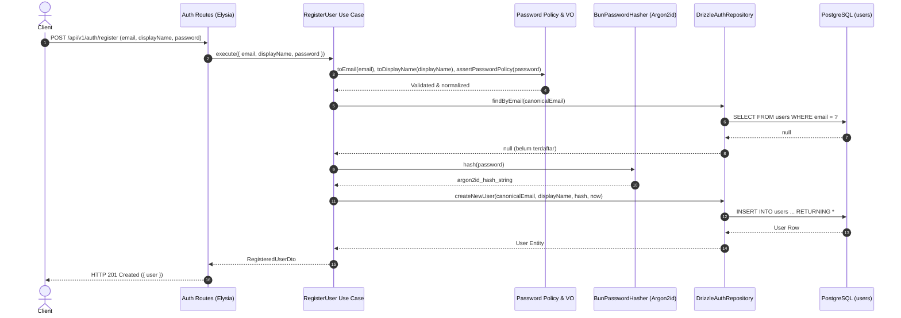
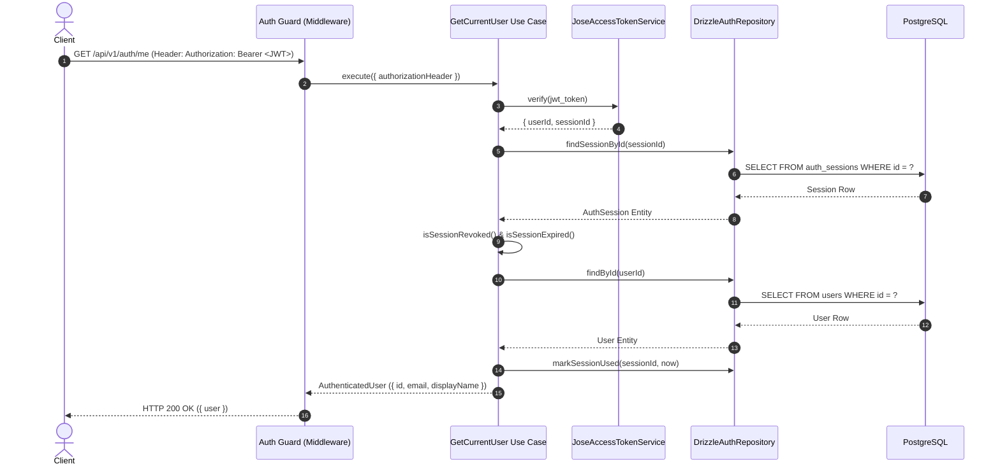

# Arsitektur Modul Autentikasi

Dokumen ini mendokumentasikan arsitektur, rancangan Clean Architecture, serta alur kerja autentikasi dan manajemen session pada Todo Backend Application.

---

## 1. Prinsip dan Struktur Clean Architecture

Modul autentikasi dirancang mengikuti prinsip Clean Architecture dan Modular Monolith:

- **Domain Layer**:
  - Entitas: `User`, `AuthSession`, `RefreshToken`.
  - Value Objects: `Email`, `DisplayName`.
  - Aturan Bisnis & Kebijakan: `assertPasswordPolicy`, aturan keaktifan session & token.
  - Kontrak Repository: `UserRepository`, `AuthSessionRepository`.
  - Bebas dari import Elysia, Drizzle, jose, atau dependensi eksternal.
- **Application Layer**:
  - Use Cases: `RegisterUser`, `LoginUser`, `RefreshSession`, `LogoutUser`, `GetCurrentUser`.
  - Ports (Abstraksi): `PasswordHasher`, `AccessTokenService`, `RefreshTokenGenerator`, `TokenLifetimePolicy`, `Clock`, `SecurityLog`.
  - DTOs: `AuthenticatedUser`, `AuthResultDto`.
  - Dapat diuji secara terisolasi tanpa server HTTP maupun database PostgreSQL.
- **Infrastructure Layer**:
  - Database: `DrizzleAuthRepository` (Drizzle ORM & transaksi PostgreSQL).
  - Keamanan: `BunPasswordHasher` (Argon2id), `JoseAccessTokenService` (jose JWT HS256), `CryptoRefreshTokenGenerator` (SHA-256 dan 256-bit cryptographically secure random bytes).
  - Mapper: `toUserEntity`, `toAuthSessionEntity`, `toRefreshTokenEntity`.
- **Presentation Layer**:
  - Elysia Routes: `/api/v1/auth/register`, `/api/v1/auth/login`, `/api/v1/auth/refresh`, `/api/v1/auth/logout`, `/api/v1/auth/me`.
  - Request Guards & Middleware: `createAuthGuard`.
  - Validasi & Dokumentasi: TypeBox schemas untuk runtime check dan OpenAPI Scalar.

Arah dependensi:
```text
Presentation Layer (Elysia)
        ↓
Application Layer (Use Cases, Ports)
        ↓
Domain Layer (Entities, Value Objects, Contracts)
        ↑ (implements ports & repositories)
Infrastructure Layer (Drizzle, jose, Bun.password)
```

---

## 2. Alur Registrasi Pengguna (Registration Flow)

Registrasi memvalidasi format email, display name, serta kompleksitas password (minimal 12 karakter, maksimal 128 karakter). Password di-hash menggunakan Argon2id secara asynchronous sebelum disimpan. Email disimpan dalam bentuk normalisasi (lowercase dan trim).



---

## 3. Alur Masuk Akun (Login Flow)

Login memverifikasi password dan membuat session baru pada database. Timing equalizer hash diterapkan agar email tidak terdaftar memiliki durasi respons yang identik dengan password salah. Access token dikembalikan pada body respons, sedangkan refresh token disematkan pada `HttpOnly` cookie.

```mermaid
sequenceDiagram
    autonumber
    actor Client
    participant HTTP as Auth Routes (Elysia)
    participant UC as LoginUser Use Case
    participant Hasher as BunPasswordHasher (Argon2id)
    participant TokenGen as CryptoRefreshTokenGenerator
    participant TokenSvc as JoseAccessTokenService
    participant Repo as DrizzleAuthRepository
    participant DB as PostgreSQL (auth_sessions, refresh_tokens)

    Client->>HTTP: POST /api/v1/auth/login (email, password)
    HTTP->>UC: execute({ email, password, userAgent })
    UC->>Repo: findByEmail(canonicalEmail)
    Repo-->>UC: User Entity
    UC->>Hasher: verify(password, user.passwordHash)
    Hasher-->>UC: valid = true
    UC->>TokenGen: generate()
    TokenGen-->>UC: { token: opaque_token, hash: sha256_hash }
    UC->>Repo: startSession(userId, tokenHash, sessionExpiresAt, tokenExpiresAt)
    Repo->>DB: BEGIN TRANSACTION<br/>INSERT auth_sessions ...<br/>INSERT refresh_tokens ...<br/>COMMIT
    DB-->>Repo: StartedSession
    Repo-->>UC: StartedSession
    UC->>TokenSvc: generate({ userId, sessionId })
    TokenSvc-->>UC: { token: jwt_access_token, expiresAt }
    UC-->>HTTP: LoginResult
    HTTP->>HTTP: Set-Cookie: todo_refresh=opaque_token; HttpOnly; SameSite=lax; Path=/api/v1/auth
    HTTP-->>Client: HTTP 200 OK ({ user, accessToken, tokenType: "Bearer", expiresIn: 900 })
```

---

## 4. Alur Verifikasi Access Token & Profil (/me)

Request guard membaca header `Authorization: Bearer <token>`, memverifikasi signature JWT dan masa berlaku, serta memeriksa keaktifan session pada database.



---

## 5. Alur Rotasi Refresh Token & Deteksi Reuse

Rotasi refresh token dieksekusi dalam database transaction dengan locking baris (`SELECT FOR UPDATE`). Jika token lama yang sudah dikonsumsi kembali digunakan, sistem mendeteksi token reuse dan langsung mencabut seluruh session user terkait.

```mermaid
sequenceDiagram
    autonumber
    actor Client
    participant HTTP as Auth Routes (Elysia)
    participant UC as RefreshSession Use Case
    participant TokenGen as CryptoRefreshTokenGenerator
    participant Repo as DrizzleAuthRepository
    participant DB as PostgreSQL
    participant SecLog as SecurityLog

    Client->>HTTP: POST /api/v1/auth/refresh (Cookie: todo_refresh)
    HTTP->>UC: execute({ refreshToken })
    UC->>TokenGen: hash(presentedToken)
    TokenGen-->>UC: presentedHash
    UC->>TokenGen: generate()
    TokenGen-->>UC: { token: new_token, hash: replacementHash }
    UC->>Repo: rotateRefreshToken(presentedHash, replacementHash)
    Repo->>DB: BEGIN TRANSACTION<br/>SELECT * FROM refresh_tokens WHERE token_hash = ? FOR UPDATE
    alt Token Sudah Pernah Dikonsumsi (consumed_at IS NOT NULL)
        DB-->>Repo: tokenRow (sudah consumed)
        Repo->>DB: UPDATE auth_sessions SET revoked_at = now() WHERE user_id = ?<br/>COMMIT
        Repo-->>UC: { status: "reused", userId, revokedSessionCount }
        UC->>SecLog: warn("refresh token reuse detected", { userId })
        UC-->>HTTP: throw AuthError.invalidRefreshToken()
        HTTP-->>Client: HTTP 401 Unauthorized
    else Token Usable
        DB-->>Repo: tokenRow (aktif)
        Repo->>DB: INSERT refresh_tokens (new_hash)...<br/>UPDATE refresh_tokens SET consumed_at = now(), replaced_by = new_id...<br/>UPDATE auth_sessions SET last_used_at = now()...<br/>COMMIT
        Repo-->>UC: { status: "rotated", session, replacement }
        UC-->>HTTP: RefreshResult ({ accessToken, newCookieToken })
        HTTP->>HTTP: Set-Cookie: todo_refresh=new_token; HttpOnly
        HTTP-->>Client: HTTP 200 OK ({ accessToken, tokenType: "Bearer", expiresIn: 900 })
    end
```

---

## 6. Alur Logout (Session Revocation)

Logout mencabut session dan menghapus HttpOnly cookie. Operasi bersifat idempoten.

```mermaid
sequenceDiagram
    autonumber
    actor Client
    participant HTTP as Auth Routes (Elysia)
    participant UC as LogoutUser Use Case
    participant TokenGen as CryptoRefreshTokenGenerator
    participant Repo as DrizzleAuthRepository
    participant DB as PostgreSQL

    Client->>HTTP: POST /api/v1/auth/logout (Cookie: todo_refresh)
    HTTP->>UC: execute({ refreshToken })
    UC->>TokenGen: hash(refreshToken)
    TokenGen-->>UC: hash
    UC->>Repo: revokeSessionByRefreshToken(hash, now)
    Repo->>DB: UPDATE auth_sessions SET revoked_at = now() WHERE id = session_id<br/>UPDATE refresh_tokens SET revoked_at = now()
    DB-->>Repo: success
    Repo-->>UC: true
    UC-->>HTTP: done
    HTTP->>HTTP: Clear-Cookie: todo_refresh; Max-Age=0
    HTTP-->>Client: HTTP 204 No Content
```
