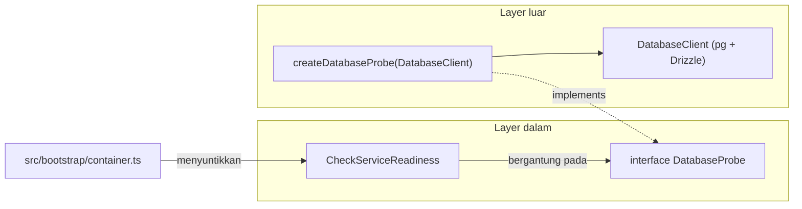

# Clean Architecture pada Proyek Ini

Clean Architecture memisahkan **apa yang aplikasi lakukan** (business rule dan use case) dari
**bagaimana cara melakukannya secara teknis** (HTTP, ORM, driver, framework). Aturan praktisnya:
kode di layer dalam tidak boleh tahu bahwa Elysia, Drizzle, atau PostgreSQL dipakai.

## Tanggung jawab tiap layer

### Domain

Tempat entity, value object, domain error, domain service, dan business rule. Layer ini:

- tidak punya dependency npm apa pun,
- tidak mengimpor Elysia, TypeBox, Drizzle, atau `pg`,
- tidak memakai tipe tabel Drizzle sebagai bentuk entity.

Phase 1 belum menambahkan isi ke sini karena modul pertama (health) tidak punya business rule.
Domain akan muncul bersama modul Todo/Workspace pada phase berikutnya. Struktur folder
`src/modules/<module>/domain/` disiapkan saat isinya nyata, bukan sebagai file kosong.

### Application

Berisi use case, orchestration, DTO input/output, dan **port** (interface) yang harus dipenuhi
luar. Use case menerima abstraction lewat konstruktor, bukan mengambilnya dari container global:

```ts
// src/modules/health/application/check-service-readiness.ts
export class CheckServiceReadiness {
  constructor(
    private readonly databaseProbe: DatabaseProbe,
    private readonly timeoutMs: number = DEFAULT_PROBE_TIMEOUT_MS
  ) {}

  async execute(): Promise<ServiceReadiness> {
    /* orkestrasi: panggil probe, batasi waktu, terjemahkan ke status layanan */
  }
}
```

```ts
// src/modules/health/application/ports/database-probe.ts
export interface DatabaseProbe {
  probe(): Promise<void>;
}
```

Perhatikan bahwa yang berada di Application adalah **keputusan** (berapa lama menunggu, apa arti
"gagal"), bukan cara memeriksa database.

### Infrastructure

Menerjemahkan contract menjadi perintah teknis:

- `src/shared/infrastructure/database/client.ts` — connection pool `pg` + instance Drizzle +
  `ping()` + `close()` (graceful shutdown pool).
- `src/shared/infrastructure/database/schema/index.ts` — entry point skema Drizzle untuk migration.
- `src/modules/health/infrastructure/database-probe.ts` — adapter yang mengimplementasikan
  `DatabaseProbe` dengan memakai `DatabaseClient.ping()`.
- `src/shared/infrastructure/logging/logger.ts` — logger terstruktur JSON.

Drizzle **tidak boleh** dipakai di Presentation maupun Application. Query hanya ada di
Infrastructure.

### Presentation

HTTP saja: route, schema request/response, metadata dokumentasi, error mapping, header, dan
access log. Tidak ada business logic di sini.

```ts
// src/modules/health/presentation/http/health.routes.ts (dipotong)
.get('/ready', async ({ headers, set }) => {
  const readiness = await deps.readiness.execute();

  if (readiness.status === 'ready') {
    return { status: 'ready', dependencies: { database: 'connected' } };
  }

  return status(503, buildErrorPayload(ERROR_CODES.SERVICE_UNAVAILABLE, '...', requestId));
})
```

Route hanya memilih status code dan bentuk body. Keputusan "siap/tidak siap" sudah diambil use case.

## Dependency Inversion

Interface dimiliki layer dalam, implementasi berada di luar, dan keduanya dipertemukan di
composition root:



Karena inversion ini, test unit dapat menyuntikkan probe gagal, probe menggantung, atau probe
berhasil tanpa menjalankan PostgreSQL sama sekali.

## Contoh alur sebuah Use Case (`/ready`)

1. **Presentation** menerima request, menyiapkan `x-request-id`, memanggil use case.
2. **Application** (`CheckServiceReadiness.execute()`) memanggil port `DatabaseProbe.probe()`
   dengan batas waktu.
3. **Infrastructure** (adapter) meneruskan ke `DatabaseClient.ping()` yang menjalankan
   `SELECT 1` lewat pool koneksi.
4. Hasil dikonversikan menjadi `{ status, database }` di Application, lalu Presentation memetakan:
   `ready` → 200, `unavailable` → 503 dengan sampul error standar.
5. Bila layer bawah melempar error tak terduga, `onError` di `src/bootstrap/create-app.ts`
   memetakannya lewat `mapErrorToHttpResponse()` sehingga klien tidak pernah melihat stack trace,
   SQL, atau kredensial.

## Hal yang dilarang agar batas layer tetap nyata

- Entity Domain yang mengimpor tipe dari `drizzle-orm`.
- Use Case yang menerima objek context Elysia (`{ body, query, set, ... }`).
- Repository interface yang dideklarasikan di folder Infrastructure.
- Query `SELECT`/`INSERT` di file route.
- Membaca `process.env` di luar `src/config/env.ts`.
- State mutable singleton pada level module yang membuat test saling memengaruhi.

Aturan lengkap dan cara memeriksa saat menambah module ada di
[dependency-rules.md](dependency-rules.md).
