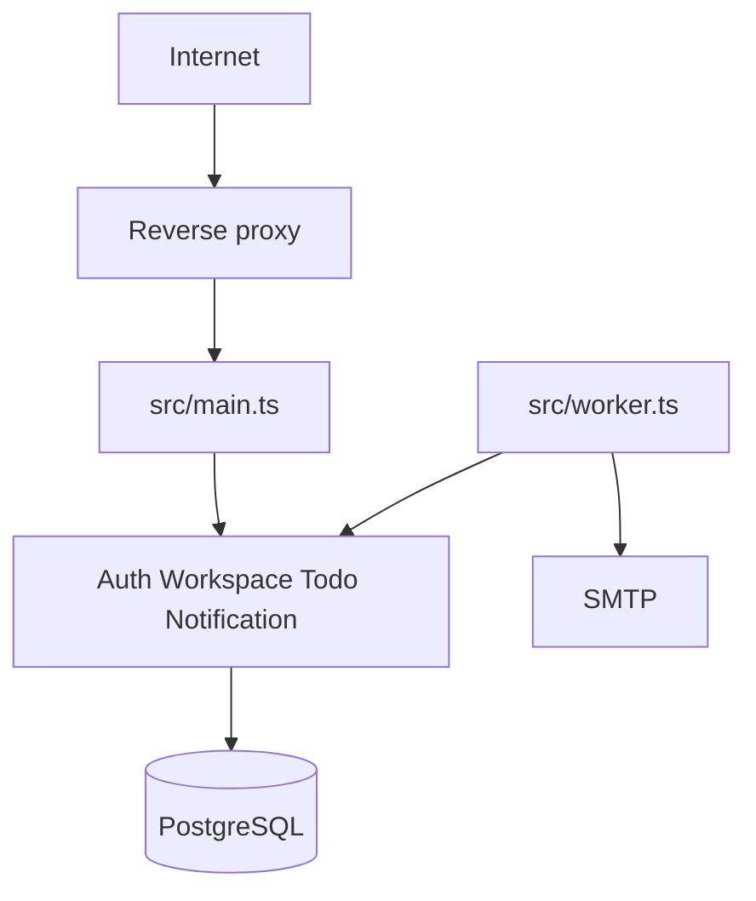

# Arsitektur final

Aplikasi tetap Clean Architecture dan modular monolith. API serta worker berbagi domain, application, dan infrastructure. Tidak ada panggilan HTTP internal antar proses.

Domain tidak mengimpor Elysia, Drizzle, atau Nodemailer. Application tidak membaca `process.env`. Composition root ada di `src/bootstrap`.
