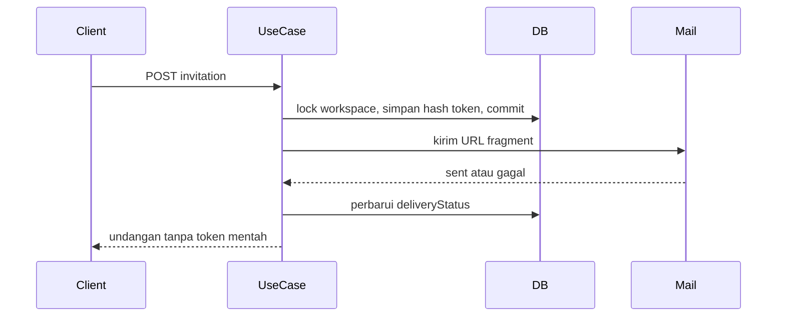

# Arsitektur Undangan

## Siklus hidup

Status tersimpan: `pending`, `accepted`, `declined`, `revoked`, `expired`.

Pending yang `expiresAt`-nya sudah lewat dibaca sebagai `expired` lewat `effectiveStatus`. Tidak ada worker. Pembacaan daftar dan operasi accept/decline/resend menandai baris itu menjadi `expired`.

## Token

`CryptoInvitationTokenGenerator` memakai 32 byte acak (`createOpaqueToken`) lalu SHA-256 hex. Entity hanya menyimpan hash. Resend memanggil `rotateToken`: hash baru, `expiresAt` baru, status kembali `pending`, id undangan tetap.

## Accept

Dalam satu transaksi: `SELECT … FOR UPDATE` pada undangan, cocokkan hash, pastikan pending dan belum kedaluwarsa, email akun sama dengan `normalizedEmail`, workspace aktif, lalu sisipkan anggota dengan role undangan dan tandai `accepted`. Dua accept bersamaan hanya menghasilkan satu baris anggota.

Jika pengguna sudah anggota, role yang ada tidak ditimpa. Undangan ditutup sebagai `accepted` supaya tidak tertinggal pending yang tidak bisa diselesaikan.

## Decline, revoke, resend

Decline membutuhkan login, token, dan email yang sama. Pemanggilan kedua pada status `declined` mengembalikan keadaan yang sama.

Revoke hanya untuk pending. Pemanggilan ulang pada undangan yang sudah `revoked` tetap berhasil tanpa mengubah waktu. Admin hanya mencabut undangan `member` yang ia buat. Owner mencabut semua pending di workspace.

Resend menolak `accepted`, `declined`, dan `revoked`. Pending dan expired boleh dikirim ulang dengan token baru.
