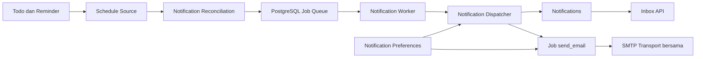

# Arsitektur Notification

Notification adalah bounded context baru di modular monolith yang sama dengan Auth, Workspace, dan Todo. API dan worker memakai domain, application, serta infrastructure yang sama. Perbedaannya hanya entry point: `src/main.ts` menyalakan HTTP, `src/worker.ts` menyalakan loop background.

## Posisi komponen

## Reminder versus Notification

Reminder Phase 4 tetap jadwal. Statusnya hanya `scheduled` atau `cancelled`. Mesin ini tidak mengubah reminder menjadi `sent` atau `delivered`.

Notification adalah pesan yang diterima satu pengguna. Lifecycle-nya `unread` lalu `read` lewat `readAt`. Baris notification tetap ada bila pengiriman email gagal.

## Notification versus Job

Job adalah pekerjaan asynchronous dengan status `pending`, `processing`, `completed`, `failed`, atau `cancelled`. Jenisnya:

- `dispatch_reminder`
- `dispatch_todo_due_soon`
- `send_email`

Payload hanya memuat jadwal dan identitas yang diperlukan, misalnya `dueAt`, `offsetMinutes`, `effectiveAt`, atau `notificationId`. Password SMTP, JWT, dan token undangan tidak disimpan.

## Channel

In-app adalah channel utama dan selalu aktif. Email adalah channel tambahan yang hanya dibuat bila `notification_preferences.email_enabled` bernilai true pada saat dispatch. Preferensi dicek ulang saat job email diproses.

## Kebijakan penerima

`REMINDER_DUE` dikirim ke `reminders.created_by`. `TODO_DUE_SOON` dikirim ke `todos.created_by`. Anggota workspace lain tidak menerima salinan otomatis. Saat job dieksekusi, penerima harus masih menjadi anggota dan workspace belum diarsipkan. Jika tidak, job dibatalkan dan tidak ada baris notification maupun email.

Klien tidak boleh mengirim `recipientUserId` untuk menentukan tujuan notifikasi internal.

## Arah dependency

Presentation HTTP hanya memanggil use case inbox dan preferensi. Application mengenal port `ScheduleSource`, `DispatchContext`, `NotificationEmailSender`, dan `NotificationJobQueue`. Implementasi Drizzle, SQL `FOR UPDATE SKIP LOCKED`, dan Nodemailer berada di infrastructure. Domain tidak mengimpor Elysia, Drizzle, atau SMTP.

Dispatcher memakai `computeReminderEffectiveAt` dari domain Todo agar rumus `before_due` tetap sama dengan Phase 4.
