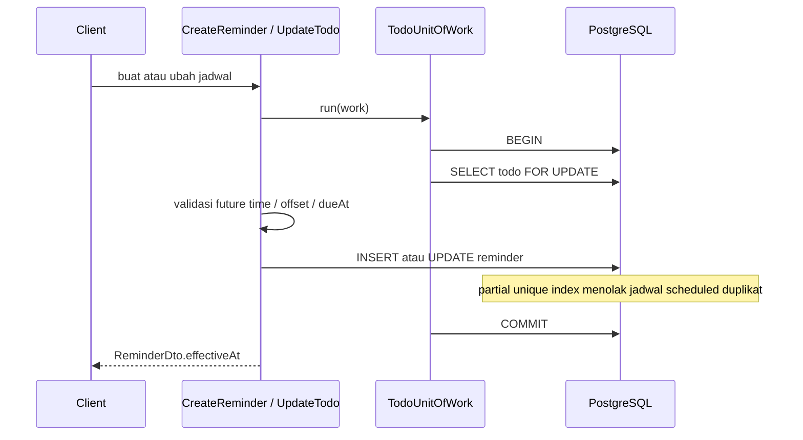

# Arsitektur Reminder

Reminder adalah jadwal yang menempel pada satu Todo. Phase 4 hanya menyimpan dan memvalidasi jadwal. Tidak ada pengiriman email, push, antrian, atau worker.

## 1. Entity

`Reminder` menyimpan:

- `triggerType`: `absolute` atau `before_due`.
- `remindAt`: terisi hanya untuk absolute.
- `offsetMinutes`: terisi hanya untuk before_due, 1–43200.
- `status`: `scheduled` atau `cancelled`.
- `cancelledAt`: wajib bila cancelled, null bila scheduled.

Waktu efektif tidak disimpan.

```text
absolute:   effectiveAt = remindAt
before_due: effectiveAt = todo.dueAt - offsetMinutes
```

Perhitungan yang sama dipakai domain (`computeReminderEffectiveAt`), DTO, dan urutan query repository.

## 2. Siklus hidup



Status awal selalu `scheduled`. Update hanya boleh pada reminder scheduled, dan trigger type tidak berubah. Cancel mengisi `cancelledAt` dan bersifat idempoten. Reminder cancelled tidak diaktifkan kembali; client membuat reminder baru.

Saat Todo menjadi `completed`, `cancelled`, atau soft-deleted, `cancelScheduledByTodoId` berjalan dalam transaksi yang sama. Membuka kembali Todo tidak menghidupkan reminder lama.

## 3. Perubahan dueAt

Di dalam transaksi yang sudah mengunci Todo:

1. Jika `dueAt` berubah dan masih ada reminder `before_due` scheduled, effective time dihitung ulang terhadap nilai baru.
2. `dueAt = null` ditolak dengan `TODO_HAS_RELATIVE_REMINDERS`.
3. Effective time di masa lalu atau sama dengan sekarang ditolak dengan `TODO_DUE_DATE_CONFLICTS_WITH_REMINDERS`.
4. Reminder absolute tidak ikut berubah.

Pembuatan reminder juga mengunci baris Todo, sehingga dueAt tidak dapat berubah di antara pembacaan dan insert.

## 4. Pemisahan dari notifikasi

Reminder `scheduled` berarti jadwal siap dibaca Notification Engine pada fase berikutnya. Phase ini tidak menulis status `sent` atau `delivered`, tidak menyimpan rahasia SMTP, dan tidak menjalankan job.

## 5. Waktu

Use case memakai `Clock` dari `src/shared/domain/clock.ts`. Test memakai `FixedClock`. Business logic reminder tidak memanggil `new Date()` langsung. Input `remindAt` harus ISO 8601 dengan timezone eksplisit, sama seperti `dueAt`, lalu disimpan sebagai `timestamptz`.
