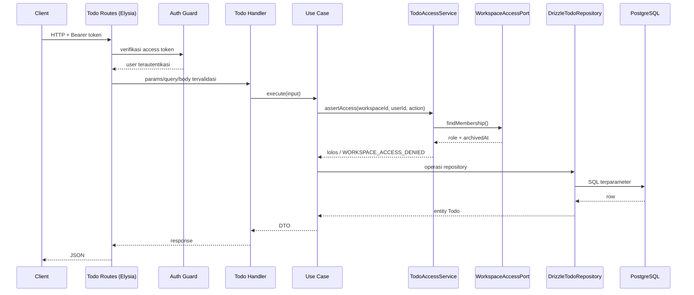

# Arsitektur Todo Module (Phase 3)

Dokumen ini menjelaskan desain **Todo Core Engine** yang ditambahkan pada Phase 3. Modul Todo adalah modul bisnis mandiri di dalam Modular Monolith; ia memakai autentikasi dan keanggotaan workspace dari Phase 2, tetapi tidak mengubah kontrak internal modul tersebut.

## 1. Batas modul

```text
src/modules/todo/
├── domain/
│   ├── entities/todo.ts
│   ├── enums/todo-status.ts
│   ├── enums/todo-priority.ts
│   ├── errors/todo-error.ts
│   └── repositories/todo.repository.ts
├── application/
│   ├── dto/todo.dto.ts
│   ├── policies/todo-access.policy.ts
│   ├── ports/todo-cursor-codec.ts
│   ├── ports/workspace-access.ts
│   ├── services/instant-parser.ts
│   ├── services/todo-access.service.ts
│   ├── services/todo-date-range.service.ts
│   ├── services/todo-listing.service.ts
│   └── use-cases/*.ts
├── infrastructure/
│   ├── mappers/todo.mapper.ts
│   ├── pagination/cursor-encoder.ts
│   └── persistence/{todo.schema.ts,drizzle-todo.repository.ts}
└── presentation/
    └── http/{todo.routes.ts,todo.handlers.ts,todo.schemas.ts}
```

Aturan dependensi yang dijaga:

- **Domain** tidak mengimpor Elysia, Drizzle, HTTP, atau module lain.
- **Application** hanya bergantung pada Domain, port, dan `Clock` bersama.
- **Infrastructure** mengimplementasikan kontrak Domain/Application memakai Drizzle.
- **Presentation** memetakan HTTP ke use case; tidak ada aturan bisnis di route handler.
- Todo **tidak mengimpor repository Workspace secara langsung**. Composition root mengadaptasi `WorkspaceRepository.findWorkspaceWithRole` menjadi `WorkspaceAccessPort` milik Todo.

## 2. Alur request



Autentikasi tetap milik Auth Module (`GetCurrentUser` lewat `createAuthGuard`). Todo hanya memakai `user.id` hasil guard.

## 3. Domain model

`Todo` adalah entity immutable dengan snapshot internal. Seluruh invariant dijaga di entity, bukan hanya di constraint database:

- `title` di-trim, wajib 1–200 karakter.
- `description` di-trim; string kosong menjadi `null`; maksimal 5.000 karakter.
- `status` awal selalu `todo`; `priority` default `low`.
- `dueAt` opsional dan harus `Date` valid.
- `completedAt` hanya boleh terisi ketika status `completed`.
- `createdAt`/`updatedAt` dimiliki server dan memakai `Clock`.
- `deletedAt` menandai soft delete; entity terhapus tidak dapat diubah.
- `complete()` idempoten: bila sudah `completed`, entity yang sama dikembalikan tanpa menggeser timestamp.
- `softDelete()` idempoten pada level entity.

`Todo.restore()` memvalidasi ulang status, priority, tanggal, dan konsistensi `completedAt` saat rehidrasi dari database.

## 4. Authorization

Phase 3 memakai aturan sederhana:

| Role workspace | View | Create | Update | Delete | Complete |
| --- | --- | --- | --- | --- | --- |
| `owner` | ya | ya | ya | ya | ya |
| `admin` | ya | ya | ya | ya | ya |
| `member` | ya | ya | ya | ya | ya |
| bukan member | tidak | tidak | tidak | tidak | tidak |

Workspace yang sudah diarsipkan diperlakukan sebagai tidak dapat diakses. Semua kegagalan otorisasi menghasilkan `WORKSPACE_ACCESS_DENIED` dengan pesan yang sama seperti workspace tidak ditemukan, lalu dipetakan ke **404** untuk mencegah enumerasi.

Pemisahan hak yang lebih rinci (misalnya hanya owner yang boleh menghapus) sengaja ditunda ke fase kolaborasi.

## 5. Service application

- **`TodoAccessService`** — menegakkan membership, status arsip, dan `TodoAccessPolicy`.
- **`TodoDateRangeService`** — menghitung rentang Today/Upcoming/Overdue memakai IANA timezone dan `date-fns-tz`; hasil berupa instant UTC dengan interval `[start, end)`.
- **`TodoListingService`** — satu jalur untuk List, Today, Upcoming, dan Overdue: validasi limit, fingerprint filter, decode cursor, pemanggilan repository, `limit + 1`, dan pembentukan `nextCursor`.
- **`instant-parser.ts`** — memastikan input tanggal memakai ISO 8601 dengan timezone eksplisit dan tanggal kalender benar-benar valid.

## 6. Port dan implementasi

| Port | Implementasi production | Tujuan |
| --- | --- | --- |
| `TodoRepository` | `DrizzleTodoRepository` | Isolasi domain dari Drizzle/PostgreSQL. |
| `WorkspaceAccessPort` | adapter di `container.ts` | Todo tidak bergantung pada repository Workspace. |
| `TodoCursorCodec` | `Base64UrlCursorCodec` | Encode/decode cursor opaque dan fingerprint filter. |

`Clock` berada di `src/shared/domain/clock.ts` dan dipakai Auth maupun Todo. Pemindahan ini menghindari dependensi Todo ke module Auth.

## 7. Error dan pemetaan HTTP

| Error code | HTTP | Kapan |
| --- | --- | --- |
| `TODO_NOT_FOUND` | 404 | Todo tidak ada, sudah dihapus, atau bukan milik workspace pada path. |
| `WORKSPACE_ACCESS_DENIED` | 404 | Bukan member, workspace tidak ada, atau sudah diarsipkan. |
| `INVALID_CURSOR` | 400 | Cursor rusak, bukan Base64 URL-safe, workspace/filter tidak cocok. |
| `TODO_TITLE_REQUIRED` | 422 | Judul kosong setelah trim. |
| `TODO_TITLE_TOO_LONG` | 422 | Judul > 200 karakter. |
| `TODO_DESCRIPTION_TOO_LONG` | 422 | Deskripsi > 5.000 karakter. |
| `TODO_STATUS_INVALID` | 422 | Status di luar empat nilai yang diizinkan. |
| `TODO_PRIORITY_INVALID` | 422 | Priority di luar empat nilai yang diizinkan. |
| `TODO_DUE_DATE_INVALID` | 422 | `dueAt` bukan ISO 8601 dengan timezone eksplisit/tidak valid. |
| `INVALID_DATE_RANGE` | 422 | `dueFrom > dueTo`, `createdFrom > createdTo`, atau format filter salah. |
| `INVALID_TIMEZONE` | 422 | `timezone` bukan IANA timezone valid. |
| `INVALID_UPCOMING_RANGE` | 422 | `days` bukan bilangan bulat 1–30. |
| `VALIDATION_ERROR` | 422 | Limit di luar 1–100, update tanpa field, pencarian terlalu panjang, field asing. |

Semua respons error memakai sampul yang sama:

```json
{
  "error": {
    "code": "TODO_NOT_FOUND",
    "message": "Todo tidak ditemukan.",
    "requestId": "..."
  }
}
```

## 8. Batas Phase 3

Termasuk:

- CRUD Todo, status, priority, due date.
- Today, Upcoming, Overdue.
- Filter dan pencarian.
- Cursor pagination.
- Soft delete dan otorisasi workspace.

Phase 4 menambahkan Tag, Label, dan Reminder di bounded context yang sama. Lihat [todo-metadata-architecture.md](todo-metadata-architecture.md) dan [reminder-architecture.md](reminder-architecture.md).

Tidak termasuk:
- Pengurutan berdasarkan priority atau due date.
- Recurring todo.
- Kolaborasi real-time.

Fitur-fitur tersebut harus menjadi modul atau use case baru, bukan ditambahkan ke entity Phase 3 secara ad-hoc.
