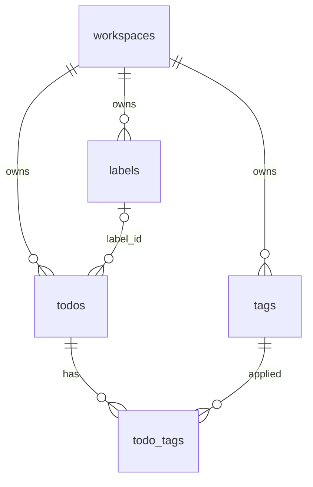

# Arsitektur Metadata Todo

Phase 4 menambahkan Tag dan Label ke bounded context Todo. Keduanya bukan microservice dan bukan module terpisah di luar `src/modules/todo`.

## 1. Tag versus Label

| | Tag | Label |
| --- | --- | --- |
| Peran | Keyword tambahan yang fleksibel | Kategori utama |
| Kardinalitas | Banyak Tag per Todo | Maksimal satu Label per Todo |
| Kepemilikan | Satu workspace | Satu workspace |
| Keunikan | `normalized_name` per workspace | `normalized_name` per workspace |
| Atribut khusus | Nama | Nama, warna `#RRGGBB`, deskripsi opsional |
| Penghapusan | Hard delete; association `todo_tags` ikut terhapus | Hard delete; `todos.label_id` menjadi `NULL` |

Normalisasi nama sama untuk keduanya: trim, lalu lowercase untuk kunci unik. Huruf pada nama tampilan dipertahankan. Tidak ada transliterasi.

## 2. Relasi



`todo_tags` memakai composite primary key `(todo_id, tag_id)`. Composite foreign key yang menyertakan `workspace_id` tidak dipasang, karena association tidak menyimpan `workspace_id` dan primary key Todo/Tag hanya `id`. Konsistensi workspace diperiksa di dalam transaksi sebelum association disimpan: Tag yang tidak ada di workspace yang sama ditolak.

## 3. Batas layer

```text
presentation/http/tag.routes.ts
presentation/http/label.routes.ts
        |
        v
application/use-cases/tag/*
application/use-cases/label/*
application/services/todo-metadata.service.ts
application/services/tag-assignment.ts
        |
        v
domain/entities/tag.ts
domain/entities/label.ts
domain/repositories/tag.repository.ts
domain/repositories/label.repository.ts
        ^
        |
infrastructure/persistence/drizzle-*.repository.ts
```

Arah dependensi tetap Presentation → Application → Domain. Infrastructure mengimplementasikan kontrak repository. Domain tidak mengimpor Elysia, Drizzle, atau PostgreSQL.

Route hanya mem-parsing HTTP dan memanggil handler. Handler memanggil use case. Use case tidak menerima context Elysia.

## 4. Otorisasi

Membership workspace tetap menjadi sumber otorisasi, lewat `WorkspaceAccessPort` yang sudah ada. Todo infrastructure tidak mengimpor repository Drizzle workspace.

| Operasi | Owner | Admin | Member |
| --- | --- | --- | --- |
| List/Get Tag dan Label | Ya | Ya | Ya |
| Create/Update/Delete Tag dan Label | Ya | Ya | Tidak |
| Assign/clear Tag dan Label pada Todo | Ya | Ya | Ya |

`TodoAction.MANAGE_METADATA` hanya lolos untuk `owner` dan `admin`. Assignment memakai `TodoAction.UPDATE`, sama seperti edit Todo. Bukan member mendapat `WORKSPACE_ACCESS_DENIED` (404). Member yang mencoba mengelola katalog mendapat `WORKSPACE_PERMISSION_DENIED` (403).

## 5. Komposisi

`createApplicationContainer` membuat `DrizzleTagRepository`, `DrizzleLabelRepository`, dan `DrizzleTodoUnitOfWork`. Use case yang mengubah association atau label Todo berjalan di dalam `TodoUnitOfWork.run`, yang membuka transaksi PostgreSQL dan mengunci baris Todo dengan `SELECT ... FOR UPDATE`. Application hanya melihat `TodoTransactionContext`, bukan objek transaksi Drizzle.
