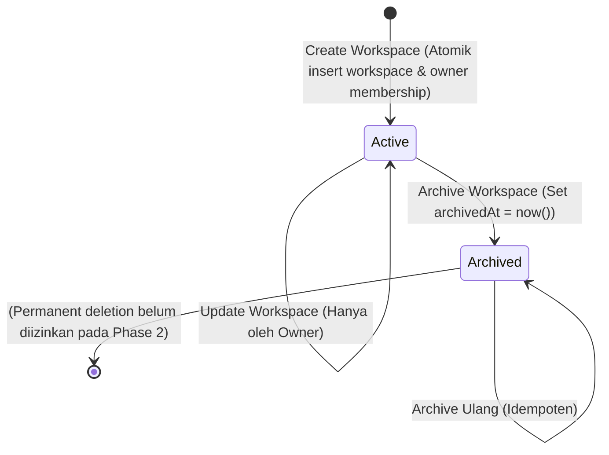

# Arsitektur Modul Workspace

Dokumen ini mendokumentasikan model domain, daur hidup (lifecycle), kepemilikan, dan arsitektur Workspace Module pada Todo Backend Application.

---

## 1. Konsep Ruang Lingkup Kerja (Workspace)

Workspace adalah entitas pengelompokan utama untuk todo item dan todo list. Pada Phase 2:
- Setiap pengguna dapat memiliki banyak workspace (misal: "Personal Tasks", "Work", "Side Projects").
- Setiap workspace memiliki tepat satu pembuat dan pemilik awal (`OWNER`).
- Workspace diisolasi secara penuh: pengguna tidak dapat melihat atau memanipulasi workspace pengguna lain.

---

## 2. Model Entitas Domain

### 2.1 Workspace Entity
```typescript
export interface Workspace {
  readonly id: string;
  readonly name: string;
  readonly description: string | null;
  readonly createdBy: string;
  readonly createdAt: Date;
  readonly updatedAt: Date;
  readonly archivedAt: Date | null;
}
```
- `id`: UUID acak (v4).
- `name`: Wajib, minimal 1 karakter, maksimal 100 karakter.
- `description`: Opsional, maksimal 500 karakter.
- `createdBy`: Menunjuk user UUID yang membuat workspace.
- `archivedAt`: `null` menandakan workspace aktif; timestamp menandakan workspace diarsipkan secara lunak.

### 2.2 Workspace Member Entity
```typescript
export interface WorkspaceMember {
  readonly id: string;
  readonly workspaceId: string;
  readonly userId: string;
  readonly role: WorkspaceRole; // 'owner' | 'admin' | 'member'
  readonly joinedAt: Date;
}
```
- Menghubungkan user dengan workspace.
- Database memberlakukan unique constraint `(workspace_id, user_id)` untuk mencegah keanggotaan ganda.

---

## 3. Daur Hidup Workspace (Workspace Lifecycle & Soft Archive)



1. **Pembuatan Atomik**:
   - Transaksi database membuat baris `workspaces` sekaligus baris `workspace_members` dengan role `OWNER`.
   - Kegagalan salah satu langkah memicu rollback penuh.
2. **Operasi Update**:
   - Membutuhkan otorisasi `OWNER`.
   - Hanya dapat memperbarui field `name` atau `description`.
   - Workspace yang telah diarsipkan tidak dapat diubah (mengembalikan 404 access denied).
3. **Pengarsipan Lunak (Soft Archive)**:
   - Dilakukan oleh `OWNER` melalui endpoint `POST /api/v1/workspaces/:workspaceId/archive`.
   - Tidak ada penghapusan fisik dari disk database (tidak ada `DELETE`).
   - Workspace yang diarsipkan otomatis dikecualikan dari query listing aktif (`archivedAt IS NULL`).
   - Tindakan ini bersifat idempoten: jika dipanggil berulang kali, tetap mengembalikan status sukses dan timestamp arsip asli.

---

## 4. Rencana Integrasi dengan Todo Engine (Phase 3)

Pada Phase 3 (Todo Core Engine):
- Setiap todo list dan todo item akan memiliki foreign key ke `workspace_id`.
- Setiap operasi query, insert, update, dan delete todo item akan otomatis mewarisi konteks kepemilikan dan permission dari workspace tersebut.
- Pengarsipan workspace di kemudian hari akan menonaktifkan visibilitas todo item di dalamnya tanpa merusak integritas relasional database.
