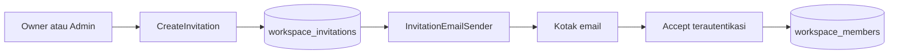

# Kolaborasi Workspace

Kolaborasi berada di dalam bounded context Workspace yang sudah ada. Tidak ada module workspace kedua dan tidak ada microservice. Undangan, anggota, dan kepemilikan memakai layer yang sama dengan workspace Phase 2.

```text
presentation/http  →  application/use-cases  →  domain
infrastructure (Drizzle, Nodemailer, crypto) mengimplementasikan port application/domain
```

## Peran

| Peran | Inti izin |
|---|---|
| owner | Mengubah workspace, mengundang admin dan member, mengubah role, menghapus admin/member, transfer kepemilikan |
| admin | Mengundang member, melihat undangan member, mengirim ulang dan mencabut undangan member yang dibuatnya, menghapus member |
| member | Melihat workspace dan anggota, mengelola Todo sesuai Phase 3, assign tag/label, reminder. Tidak mengundang dan tidak mengelola katalog tag/label |

Owner tidak dibuat lewat undangan. Owner hanya muncul saat workspace dibuat atau saat transfer kepemilikan.

## Alur undangan



Email dikirim setelah transaksi database selesai. Kegagalan SMTP mengubah `deliveryStatus` menjadi `failed` dan membiarkan status undangan `pending`.

## Anggota

Daftar anggota memakai cursor `joinedAt DESC, userId DESC`. Penghapusan anggota hanya menghapus baris `workspace_members`. Akun, workspace, dan Todo tetap ada. Akses Todo memakai membership terbaru dari database, bukan role di dalam access token.
