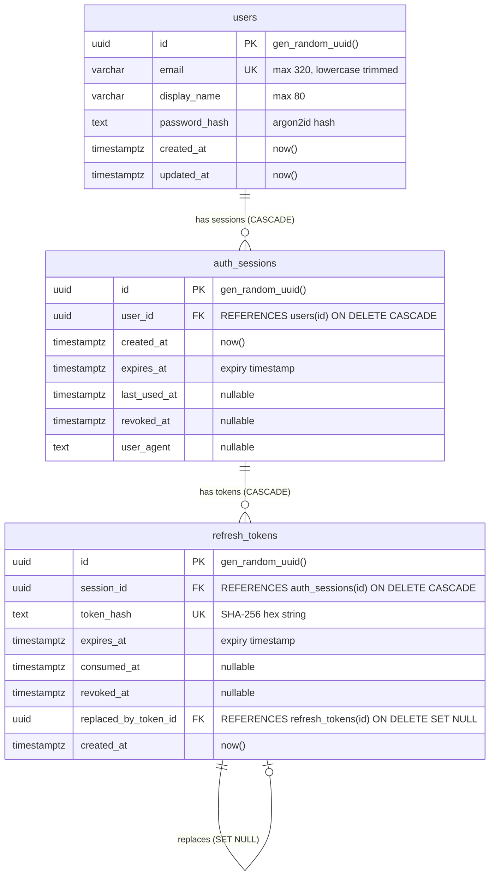

# Skema Database Autentikasi

Dokumen ini mendokumentasikan skema tabel PostgreSQL untuk modul Autentikasi dan Session Management yang dikelola melalui Drizzle ORM.

---

## 1. Diagram Relasi Entitas (ERD)



---

## 2. Rincian Tabel

### 2.1 Tabel `users`
Menyimpan data identitas kredensial pengguna.
- **`id` (UUID, Primary Key)**: Dihasilkan otomatis dengan `gen_random_uuid()`.
- **`email` (VARCHAR(320), Unique, Not Null)**: Format email kanonikal (huruf kecil dan tanpa spasi di awal/akhir). Memiliki unique constraint `users_email_unique`.
- **`display_name` (VARCHAR(80), Not Null)**: Nama tampilan pengguna.
- **`password_hash` (TEXT, Not Null)**: String hash password yang dihasilkan algoritma Argon2id.
- **`created_at` (TIMESTAMPTZ, Not Null)**: Waktu pendaftaran.
- **`updated_at` (TIMESTAMPTZ, Not Null)**: Waktu terakhir data diperbarui.

### 2.2 Tabel `auth_sessions`
Mewakili satu sesi perangkat atau browser aktif.
- **`id` (UUID, Primary Key)**: ID unik sesi.
- **`user_id` (UUID, Foreign Key)**: Mengacu ke `users(id)` dengan relasi `ON DELETE CASCADE`.
- **`created_at` (TIMESTAMPTZ, Not Null)**: Waktu sesi dibuka.
- **`expires_at` (TIMESTAMPTZ, Not Null)**: Batas akhir masa berlaku sesi (default 30 hari).
- **`last_used_at` (TIMESTAMPTZ, Nullable)**: Waktu terakhir sesi digunakan untuk request autentikasi.
- **`revoked_at` (TIMESTAMPTZ, Nullable)**: Waktu pencabutan sesi (logout atau token reuse detection).
- **`user_agent` (TEXT, Nullable)**: String User-Agent dari klien (maksimal 512 karakter). IP address sengaja tidak disimpan untuk privasi.

Indexes:
- `auth_sessions_user_id_idx` pada `user_id` untuk lookup cepat semua sesi milik pengguna.
- `auth_sessions_expires_at_idx` pada `expires_at` untuk pembersihan sesi kedaluwarsa.

### 2.3 Tabel `refresh_tokens`
Menyimpan token refresh yang sudah di-hash. Token plaintext tidak pernah disimpan.
- **`id` (UUID, Primary Key)**: ID unik token.
- **`session_id` (UUID, Foreign Key)**: Mengacu ke `auth_sessions(id)` dengan relasi `ON DELETE CASCADE`.
- **`token_hash` (TEXT, Unique, Not Null)**: Hasil SHA-256 (format hex) atas token opaque 256-bit. Memiliki unique index `refresh_tokens_token_hash_uidx`.
- **`expires_at` (TIMESTAMPTZ, Not Null)**: Waktu kedaluwarsa token.
- **`consumed_at` (TIMESTAMPTZ, Nullable)**: Dicatat saat token berhasil dirotasi. Menjadi penanda utama untuk deteksi pencurian token (token reuse).
- **`revoked_at` (TIMESTAMPTZ, Nullable)**: Dicatat saat sesi dicabut.
- **`replaced_by_token_id` (UUID, Nullable, Foreign Key)**: Mengacu ke `refresh_tokens(id)` dengan relasi `ON DELETE SET NULL`, membentuk rantai rotasi audit token.
- **`created_at` (TIMESTAMPTZ, Not Null)**: Waktu pembuatan token.

Indexes:
- `refresh_tokens_token_hash_uidx` (Unique B-Tree) pada `token_hash`.
- `refresh_tokens_session_id_idx` pada `session_id`.
- `refresh_tokens_expires_at_idx` pada `expires_at`.

---

## 3. Transaksi dan Keamanan Concurrency

Proses rotasi token refresh mengeksekusi:
```sql
SELECT * FROM refresh_tokens WHERE token_hash = ? FOR UPDATE;
```
Di dalam transaksi:
1. Row lock mencegah dua proses refresh paralel mengonsumsi token yang sama.
2. Jika token terdeteksi sudah memiliki `consumed_at IS NOT NULL`, transaksi langsung mencabut seluruh sesi milik pengguna terkait:
```sql
UPDATE auth_sessions SET revoked_at = now() WHERE user_id = ?;
```
