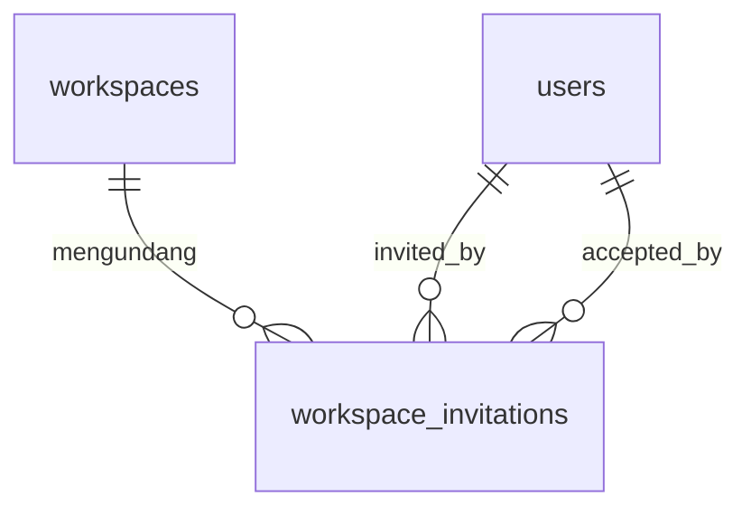

# Skema Undangan

Tabel `workspace_invitations` ditambahkan migrasi `0003_workspace_invitations`. Migrasi sebelumnya tidak diubah.

| Kolom | Arti |
|---|---|
| id | UUID primary key |
| workspace_id | FK ke `workspaces`, ON DELETE CASCADE |
| email | Email yang ditampilkan, sudah di-trim |
| normalized_email | Trim + lowercase, dipakai untuk keunikan dan pencocokan akun |
| role | `admin` atau `member` |
| token_hash | SHA-256 hex, unik |
| status | pending, accepted, declined, revoked, expired |
| invited_by | FK ke `users` |
| accepted_by | FK ke `users`, null sampai diterima |
| expires_at | Batas pakai token |
| accepted_at, declined_at, revoked_at | Stempel waktu sesuai status |
| delivery_status | pending, sent, failed |
| email_sent_at, email_last_attempt_at | Jejak pengiriman, bukan rahasia SMTP |
| created_at, updated_at | Audit |

Check `workspace_invitations_state_check` mewajibkan stempel waktu sesuai status. Pending dan expired tidak boleh punya waktu terima, tolak, atau cabut. Accepted mewajibkan `accepted_at` dan `accepted_by`.

Indeks:

- unik `token_hash`
- unik parsial `(workspace_id, normalized_email) WHERE status = 'pending'`
- `workspace_id`, `normalized_email`, `status`, `expires_at`
- `(workspace_id, created_at DESC, id DESC)` untuk daftar cursor

