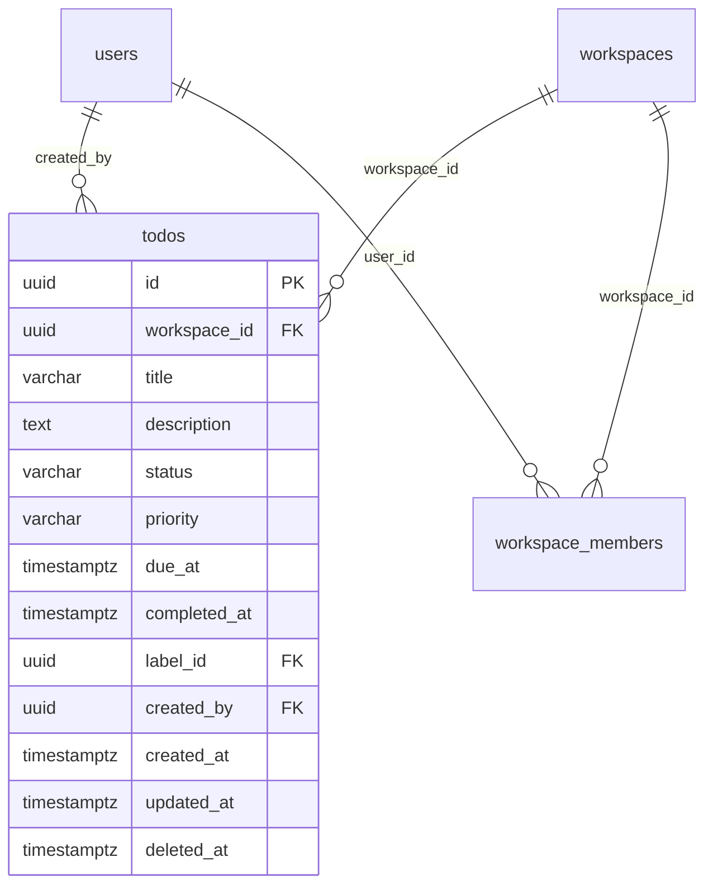

# Skema Database Todo

Phase 3 menambahkan satu tabel, `todos`, melalui migration `drizzle/0001_dashing_nightshade.sql`. Tabel ini hanya diakses oleh `DrizzleTodoRepository`; Domain dan Application tidak mengetahui bentuk kolomnya.

## 1. ERD



Relasi ke `users` dan `workspaces` hanya dideklarasikan di infrastructure karena PostgreSQL membutuhkan tabel induk untuk foreign key. Domain Todo hanya mengenal string id.

Migration `drizzle/0002_complex_logan.sql` menambahkan `label_id` (nullable, `ON DELETE SET NULL`). Detail Tag, Label, dan Reminder ada di dokumen skema Phase 4.

## 2. Kolom

| Kolom | Tipe | Null | Default | Keterangan |
| --- | --- | --- | --- | --- |
| `id` | `uuid` | tidak | `gen_random_uuid()` | Primary key. |
| `workspace_id` | `uuid` | tidak | — | FK ke `workspaces.id`, `ON DELETE CASCADE`. |
| `title` | `varchar(200)` | tidak | — | Sudah di-trim oleh domain. |
| `description` | `text` | ya | — | Maksimal 5.000 karakter (check constraint). |
| `status` | `varchar(20)` | tidak | — | `todo`, `in_progress`, `completed`, `cancelled`. |
| `priority` | `varchar(20)` | tidak | — | `low`, `medium`, `high`, `urgent`. |
| `due_at` | `timestamptz` | ya | — | Deadline, disimpan sebagai instant UTC. |
| `completed_at` | `timestamptz` | ya | — | Wajib terisi jika status `completed`; wajib null untuk status lain. |
| `created_by` | `uuid` | tidak | — | FK ke `users.id`. |
| `created_at` | `timestamptz` | tidak | — | Waktu server saat pembuatan. |
| `updated_at` | `timestamptz` | tidak | — | Waktu server saat perubahan terakhir. |
| `deleted_at` | `timestamptz` | ya | — | Soft delete; `NULL` berarti aktif. |

`due_at`, `completed_at`, `created_at`, `updated_at`, dan `deleted_at` memakai `timestamp with time zone` agar PostgreSQL menyimpan instant yang tidak bergantung pada timezone sesi.

## 3. Constraint

| Constraint | Aturan |
| --- | --- |
| `todos_status_check` | Status hanya empat nilai yang diizinkan. |
| `todos_priority_check` | Priority hanya empat nilai yang diizinkan. |
| `todos_title_length_check` | `char_length(btrim(title)) BETWEEN 1 AND 200`. |
| `todos_description_length_check` | `description IS NULL OR char_length(description) <= 5000`. |
| `todos_completed_at_check` | Status `completed` ⇔ `completed_at IS NOT NULL`. |
| `todos_timestamp_order_check` | `updated_at >= created_at` dan `deleted_at IS NULL OR deleted_at >= created_at`. |
| `todos_workspace_id_workspaces_id_fk` | Workspace harus ada; penghapusan workspace meng-cascade todo. |
| `todos_created_by_users_id_fk` | Pembuat harus user yang ada. |

Constraint database adalah lapisan pertahanan terakhir. Validasi utama tetap dilakukan oleh entity dan application layer supaya pesan error konsisten dan tidak bergantung pada pesan PostgreSQL.

## 4. Index

| Index | Kolom | Predikat | Dipakai untuk |
| --- | --- | --- | --- |
| `todos_workspace_created_at_id_idx` | `(workspace_id, created_at DESC, id DESC)` | `deleted_at IS NULL` | Listing default dan keyset pagination. |
| `todos_workspace_status_created_at_id_idx` | `(workspace_id, status, created_at DESC, id DESC)` | `deleted_at IS NULL` | Filter status + urutan listing. |
| `todos_workspace_priority_created_at_id_idx` | `(workspace_id, priority, created_at DESC, id DESC)` | `deleted_at IS NULL` | Filter priority + urutan listing. |
| `todos_workspace_due_at_idx` | `(workspace_id, due_at)` | `deleted_at IS NULL` | Today/Upcoming/Overdue dan filter `dueFrom`/`dueTo`. |
| `todos_workspace_deleted_at_idx` | `(workspace_id, deleted_at)` | — | Audit/query data terhapus per workspace. |

Semua index bisnis memakai **partial index** `deleted_at IS NULL` karena query aktif selalu menambahkan predikat tersebut. Row soft-deleted tetap tersimpan, tetapi tidak memperbesar index utama.

Urutan `created_at DESC, id DESC` mengikuti keyset pagination. `id DESC` adalah tie-breaker deterministik ketika dua todo dibuat pada instant yang sama.

## 5. Soft delete

Delete tidak menjalankan `DELETE FROM todos`. Repository mengisi `deleted_at` dan `updated_at` pada baris yang masih aktif:

```sql
UPDATE todos
SET deleted_at = $1, updated_at = $1
WHERE workspace_id = $2 AND id = $3 AND deleted_at IS NULL
RETURNING id;
```

Konsekuensi:

- Todo terhapus tidak muncul di listing, detail, Today, Upcoming, atau Overdue.
- Request detail/update terhadap todo terhapus menghasilkan 404.
- Delete idempoten: baris yang sudah terhapus tidak diubah lagi, dan endpoint tetap 204.
- Data tetap tersedia untuk audit atau pemulihan pada fase berikutnya.

## 6. Migration

```bash
# generate setelah schema berubah
bun db:generate

# terapkan ke development
bun db:migrate

# terapkan ke database test
bun db:migrate:test
```

Migration Phase 3 sudah diterapkan pada `todo_development` dan `todo_test`. File yang dihasilkan:

- `drizzle/0001_dashing_nightshade.sql`
- `drizzle/meta/0001_snapshot.json`
- entri baru pada `drizzle/meta/_journal.json`

## 7. Pemeriksaan cepat

```sql
-- Daftar index tabel todos
SELECT indexname, indexdef FROM pg_indexes WHERE tablename = 'todos' ORDER BY indexname;

-- Pastikan tidak ada completed_at yang tidak konsisten
SELECT count(*) FROM todos
WHERE (status = 'completed') <> (completed_at IS NOT NULL);

-- Pastikan title tidak kosong
SELECT count(*) FROM todos WHERE char_length(btrim(title)) = 0;
```

Integration test `tests/integration/todo-database.test.ts` memeriksa constraint, index, soft delete, dan query keyset terhadap PostgreSQL nyata, bukan mock.
