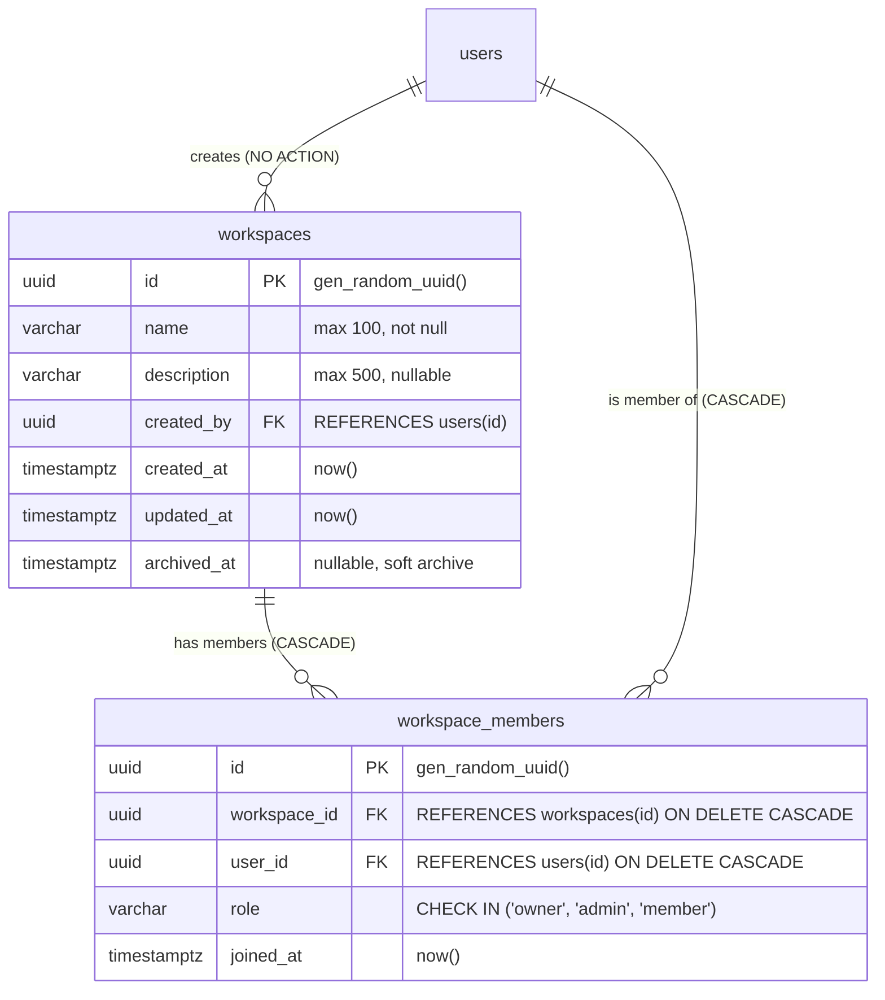

# Skema Database Workspace

Dokumen ini mendokumentasikan skema tabel PostgreSQL untuk Workspace Module yang dikelola melalui Drizzle ORM.

---

## 1. Diagram Relasi Entitas (ERD)



---

## 2. Rincian Tabel

### 2.1 Tabel `workspaces`
Menyimpan data kelompok kerja (workspace).
- **`id` (UUID, Primary Key)**: Dihasilkan otomatis dengan `gen_random_uuid()`.
- **`name` (VARCHAR(100), Not Null)**: Nama workspace (1-100 karakter).
- **`description` (VARCHAR(500), Nullable)**: Keterangan singkat mengenai workspace.
- **`created_by` (UUID, Foreign Key, Not Null)**: Mengacu ke `users(id)` sebagai pembuat awal.
- **`created_at` (TIMESTAMPTZ, Not Null)**: Waktu pembuatan.
- **`updated_at` (TIMESTAMPTZ, Not Null)**: Waktu pembaruan terakhir.
- **`archived_at` (TIMESTAMPTZ, Nullable)**: Waktu pengarsipan lunak (soft archive). Bernilai `NULL` saat workspace aktif.

Indexes:
- `workspaces_created_by_idx` pada `created_by`.
- `workspaces_archived_at_idx` pada `archived_at` untuk mempercepat filter workspace aktif.

### 2.2 Tabel `workspace_members`
Menyimpan keanggotaan pengguna di dalam workspace beserta perannya.
- **`id` (UUID, Primary Key)**: ID unik keanggotaan.
- **`workspace_id` (UUID, Foreign Key, Not Null)**: Mengacu ke `workspaces(id)` dengan `ON DELETE CASCADE`.
- **`user_id` (UUID, Foreign Key, Not Null)**: Mengacu ke `users(id)` dengan `ON DELETE CASCADE`.
- **`role` (VARCHAR(20), Not Null)**: Role keanggotaan. Dibatasi oleh check constraint:
  ```sql
  CONSTRAINT workspace_members_role_check CHECK (role IN ('owner', 'admin', 'member'))
  ```
- **`joined_at` (TIMESTAMPTZ, Not Null)**: Waktu pengguna bergabung ke workspace.

Constraints & Indexes:
- `workspace_members_workspace_id_user_id_uidx` (Unique B-Tree) pada `(workspace_id, user_id)` untuk memastikan tidak ada duplikasi keanggotaan.
- `workspace_members_user_id_idx` pada `user_id` untuk lookup daftar workspace milik pengguna.
- `workspace_members_workspace_id_idx` pada `workspace_id`.

---

## 3. Transaksi Atomik Pembuatan Workspace

Pembuatan workspace dan membership pembuat sebagai `OWNER` dieksekusi secara atomik dalam satu transaksi:

```typescript
await db.transaction(async (tx) => {
  const [workspace] = await tx.insert(workspaces).values(...).returning();
  const [membership] = await tx.insert(workspaceMembers).values({
    workspaceId: workspace.id,
    userId: creatorId,
    role: 'owner'
  }).returning();
});
```

Apabila terjadi kegagalan pada penyisipan keanggotaan, pembuatan workspace otomatis dibatalkan (rollback).
