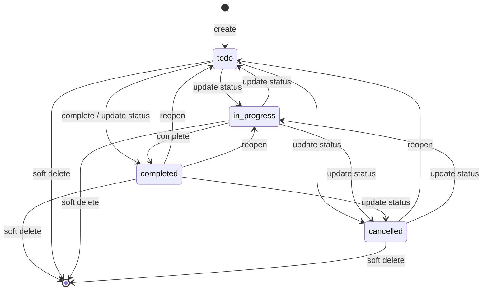

# Lifecycle Todo

Dokumen ini menjelaskan siklus hidup todo dari pembuatan sampai soft delete, termasuk status, timestamp, dan sifat idempoten.

## 1. Ringkasan siklus

Soft delete dapat dilakukan dari status apa pun. Entity yang sudah terhapus tidak dapat diubah atau dihapus lagi.

## 2. Create

Saat create, server menetapkan:

| Field | Nilai |
| --- | --- |
| `id` | UUID baru dari server. |
| `workspaceId` | Dari path, setelah otorisasi. |
| `status` | Selalu `todo`. |
| `priority` | Dari body, default `low`. |
| `completedAt` | `null`. |
| `createdBy` | `user.id` dari access token. |
| `createdAt` | `Clock.now()` server. |
| `updatedAt` | Sama dengan `createdAt`. |
| `deletedAt` | `null`. |

Client tidak boleh mengirim metadata tersebut. Schema body memakai `additionalProperties: false`, sehingga field asing ditolak dengan **422**.

## 3. Update

`PATCH` menerima perubahan sebagian. Field yang tidak dikirim tidak berubah.

Aturan status dan `completedAt`:

| Perubahan | `completedAt` |
| --- | --- |
| Status tetap `completed` | Dipertahankan. |
| Masuk ke `completed` dari status lain | Diisi `Clock.now()`. |
| Keluar dari `completed` | Dikosongkan menjadi `null`. |
| Status lain selain `completed` | Tetap `null`. |

`updatedAt` selalu diisi waktu server ketika ada perubahan. Body tanpa field yang dapat diubah menghasilkan **422 `VALIDATION_ERROR`**.

## 4. Complete

`PATCH /{todoId}/complete` adalah shortcut dari perubahan status ke `completed`.

- Todo `todo`, `in_progress`, atau `cancelled` akan berubah menjadi `completed`.
- Todo yang sudah `completed` dikembalikan tanpa perubahan; `completedAt` dan `updatedAt` tidak bergeser.
- Todo terhapus atau tidak ada menghasilkan **404 `TODO_NOT_FOUND`**.
- Otorisasi tetap sama dengan update: member workspace yang belum diarsipkan.

Idempotensi ini penting untuk retry client setelah timeout jaringan.

## 5. Delete

Delete adalah **soft delete**:

1. Application memeriksa membership workspace.
2. Repository menjalankan `UPDATE ... SET deleted_at = now, updated_at = now WHERE deleted_at IS NULL`.
3. Tidak ada baris fisik yang dihapus.

Sifat yang dijamin:

- Delete todo yang sudah terhapus atau tidak ada di workspace tersebut tetap **204**.
- Delete tidak pernah mengubah todo di workspace lain.
- Todo terhapus tidak muncul di listing dan semua view.
- `GET`/`PATCH` terhadap todo terhapus menghasilkan **404**.
- `createdAt` tidak berubah; `updatedAt` dan `deletedAt` diisi waktu server.

## 6. Anti-enumerasi

Pesan dan status untuk kondisi berikut sengaja disamakan:

- Todo tidak ada.
- Todo sudah soft-deleted.
- Todo berada di workspace lain.
- User bukan member workspace.
- Workspace sudah diarsipkan.

Detail/update/complete menghasilkan **404 `TODO_NOT_FOUND`** atau **404 `WORKSPACE_ACCESS_DENIED`** dengan pesan generik. Delete tetap 204 karena bersifat idempoten, tetapi tidak membocorkan apakah id tersebut pernah ada.

## 7. Timestamp

| Timestamp | Pemilik | Berubah saat |
| --- | --- | --- |
| `createdAt` | Server | Hanya saat create. |
| `updatedAt` | Server | Update, complete yang mengubah status, dan soft delete. |
| `dueAt` | Client | Create/update, atau dihapus dengan `null`. |
| `completedAt` | Server | Transisi masuk/keluar status `completed`. |
| `deletedAt` | Server | Soft delete pertama. |

Semua timestamp disimpan sebagai `timestamp with time zone` dan diserialisasi sebagai ISO 8601 UTC.
